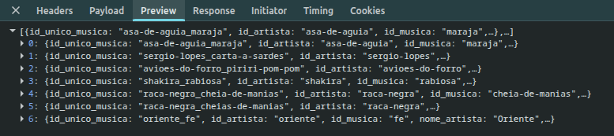
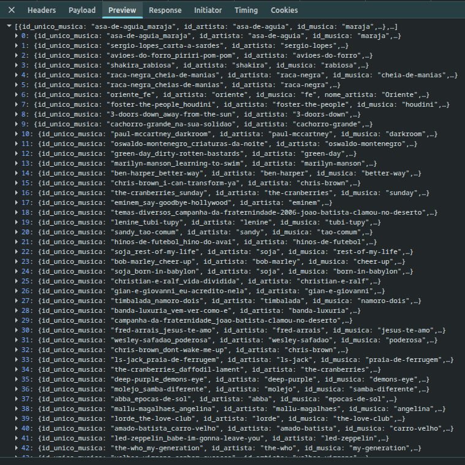

# Pesquisa — Sequências de Acordes Customizadas

> Preencha esta fase antes de propor qualquer solução. O objetivo é investigar as
> perguntas abaixo com evidência real (código, dados, testes rápidos que você mesmo
> rodou), não chutar. Apague este bloco de instruções antes de entregar.

## Perguntas que você precisa responder

1. **Algoritmo de matching**: hoje, as 6 sequências hardcoded em `main.py` (linhas
   40-45) são comparadas contra músicas via uma tag pré-computada
   (`SEQ_FAMOSA`/`seqs_famosas`, vinda do CSV). Sequências cadastradas pelo usuário
   não têm essa tag — o matching precisa ser calculado em tempo real a partir da
   lista de acordes de cada música (`musica.acordes`/`musica.cifra`). O que vai
   definir "a sequência X aparece na música Y"? A ordem dos acordes importa?
   Repetições de acorde dentro da música importam? É preciso normalizar (ex.:
   maiúsculas/minúsculas, variações de escrita do mesmo acorde)?

   > RESPOSTA: O que define se a sequência X aparece na música Y depende se a sequência é conhecida no sistema. Ele verifica se a sequência de acordes fornecidos está nas sequências fixadas no backend, **a ordem importa**, pois é a verificação feita é `if acordes in sequencias`, que com strings verifica se uma letra ou a substring está contida no alvo de comparação. Caso esteja, ele busca por música similares que a sequência possui. Caso contrário, realiza `get_similares(...)` que realiza ordenação por menor diferença e maior intersecção. Na avaliação inicial (linhas 171-201 de main.py), repetições de acordes importam , pois ele observa a sequência no modo em que ela vier. Já na segunda (linhas 203-223 de main.py), é utilizada a função `set()` no momento de calcular interseção, o que remove repetições. Não é preciso normalizar, pois a variação de maiúsculas ou minúsculas importam, por exemplo B != Bm.

2. **Validação da hipótese**: rode o algoritmo que você está considerando contra os
   dados reais em `data/top/dataset_final.csv`, para as 6 sequências hoje
   hardcoded, e confirme (ou refute) que ele reproduz os mesmos matches que o
   código atual produz via `seqs_famosas`. Esse é o bar mínimo de correção que
   você vai usar na fase de testes.

   > RESPOSTA: Ele não produz os mesmos matches, por exemplo, para a sequência famosa `Gm,F` ele retornou 6 músicas em `/similares?sequencia=Gm,F`, já para `/similares?acordes=Gm,F` ele retornou mais de 40 músicas.

3. **Banco de dados**: quais bancos embarcados (sem serviço externo adicional) são
   viáveis dentro do container Docker único e local-only já documentado em
   `docs/adr/0001-local-only-docker-deploy.md`? O que cada opção implica para o
   `Dockerfile` atual e para a persistência dos dados entre reinícios do
   container?

   > RESPOSTA:
   >
   > - **SQLite**: `sqlite3` (stdlib); sem mudança no `pip install`; arquivo único, persiste com volume; ACID, índices, consultas e backup fácil; um escritor por vez (ok com 1 worker; com vários, WAL + timeout). **Melhor encaixe.**
   > - **JSON/CSV em arquivo**: stdlib; sem mudança; arquivo, persiste com volume; simples e legível; sem transação/consulta; reescrita do arquivo inteiro; risco de perda em escrita concorrente.
   > - **shelve/dbm/pickle**: stdlib; sem mudança; arquivo(s), persiste com volume; chave-valor simples; baixa portabilidade entre versões; pickle inseguro com dados não confiáveis; concorrência ruim.
   > - **TinyDB**: `tinydb` no `requirements.txt` (rebuild); JSON, persiste com volume; API simples e consultas básicas; mesmas limitações de concorrência/durabilidade do JSON; dependência extra.
   > - **LMDB**: `lmdb` no `requirements.txt` (rebuild; wheel nativo); diretório, persiste com volume; rápido e transacional; mais complexo, tuning de tamanho, menos familiar.
   > - **Só memória**: nenhuma dependência; sem mudança; não possui persistência (perde em restart/recriação/rebuild); zero infraestrutura; só serve se as sequências forem efêmeras, read-only ou re-semeadas de um arquivo da imagem; não compartilha entre workers.

4. **Frontend existente**: o que a página `#/porsequencia`
   (`static/templates/sequencia.html` +
   `static/assets/js/controllers/sequencia.js`) já faz? Repare que ela tem hoje uma
   lista _hardcoded no JavaScript_ de 4 sequências (`sequencia1`..`sequencia4`),
   diferente das 6 que existem no backend — um detalhe real e pré-existente do
   código, não um erro seu, que vale entender antes de decidir o que precisa
   mudar.

   > RESPOSTA:
   > A página html renderiza a lista fixa de sequências, quando selecionada exibe a sequência selecionada e as músicas resultantes para ela, se clicado outra vez sobre a sequência selecionada previamente, ela é limpada da tela.
   > O arquivo javascript `sequencia.js` requisita ao endpoint /similares?sequencia=... com os acordes separados por vírgula.

## Registro das descobertas

- Pergunta 1: linhas 171-201 de `main.py` e linhas 203-223 de `main.py`
- Pegunta 2:

  `/similares?sequencia=Gm,F`:

    
  `/similares?acordes=Gm,F`:

  

- Pergunta 3:
  - `sequencia.html:19` mostra a sequência selecionada;
  - `sequencia.html:34` renderiza os acordes da sequência selecionada com clique para limpar;
  - `sequencia.html:40-59` renderiza os resultados.
  - `sequencia.js:2-31` define quatro sequências: Bm G D A, C G Am F, Gm F e C C7 F Fm;
  - `sequencia.js:33-37` popula vm.sequenciasFamosas. O backend tem seis sequências (`main.py`:40-45), incluindo Em G e C A7 Dm G7, que não estão nessa lista fixa do frontend.
  - `sequencia.js:55-61` junta os nomes dos acordes selecionados com vírgulas;
  - `sequencia.js:63-90` chama similares?sequencia=...;
  - `sequencia.js:92-95` limpa a seleção.

## Trade-offs identificados

[Opções reais que você considerou para cada decisão (algoritmo, banco, frontend) e
os prós/contras de cada uma. Isso alimenta a fase de proposta — não decida ainda
aqui.]

- Correção para a pesquisa por acordes:
  - Ele não realiza a requisição corretamente para derterminado acordes enviados juntos;
  - Não identifica sustenidos, acordes com sétima na pesquisa deste endpoint. Ex: C# ele busca com "C".
- Consideração para o banco:
  - **SQLite**: `sqlite3` (stdlib); sem mudança no `pip install`; arquivo único, persiste com volume; ACID, índices, consultas e backup fácil; um escritor por vez (ok com 1 worker; com vários, WAL + timeout). **Melhor encaixe.**
