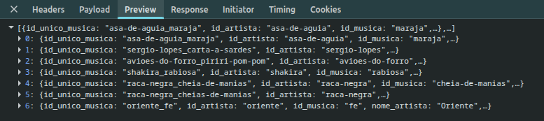
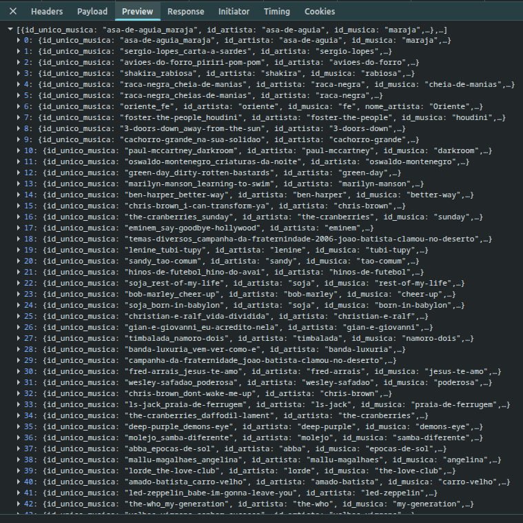

# Plano para sequências de acordes customizadas

**Session ID:** ses_e48f4fac8ffe6MbBoZbcWfxGtF
**Created:** 11/7/2026, 2:25:15 PM
**Updated:** 11/7/2026, 3:18:57 PM

---

## User

1. Clarify the code change scope, constraints, and timelines before writing anything down.
2. Open `@templates/design_doc_template.md`, mirror its structure, and draft the plan as a `.md` file in `desired_location`.
3. Populate current context, requirements, design decisions, and implementation plan with concise, actionable bullets.
4. Note testing, observability, rollout, and security sections only if they influence this change; leave sections blank when they do not apply.
5. Do not actually implement any change. Only create a plan .md reflecting what needs to be implemented.
6. Only make changes that are directly requested. Keep solutions simple and focused.

@docs/features/sequencias-customizadas/03-plan.md

---

## Assistant (Plan · Big Pickle · 42.5s)

_Thinking:_

Let me start by understanding the task. The user wants me to draft a plan as a `.md` file in a "desired_location" mirroring the structure of `templates/design_doc_template.md`. But wait — I'm in plan mode, read-only. The user's instructions say to create a plan .md file. But system reminder says I must NOT make edits. There's a conflict. The system reminder explicitly says the user indicated they don't want me to execute yet, and this supersedes any other instructions. So I should produce the plan content, ask clarifying questions, but not write the file yet.

The user references `@templates/design_doc_template.md` and `@docs/features/sequencias-customizadas/03-plan.md`. The 03-plan.md exists with a template structure. The user says "Open `@templates/design_doc_template.md`, mirror its structure, and draft the plan as a `.md` file in `desired_location`."

So I need to read the design doc template, explore the codebase, and understand the feature. Let me look at the existing feature docs (sequencias-customizadas) to understand context.

Let me explore. I need to read:
- templates/design_doc_template.md
- docs/features/sequencias-customizadas/ (all files)
- main.py, musica.py, static files relevant

Let me do parallel reads/searches.

I'll start by reading the template and the existing feature docs to understand structure and context.

**Tool: read**

**Input:**
```json
{
  "filePath": "/home/anarita/ufcg/devia/ana/ciframe/templates/design_doc_template.md"
}
```

**Error:**
```
File not found: /home/anarita/ufcg/devia/ana/ciframe/templates/design_doc_template.md
```

**Tool: bash**

**Input:**
```json
{
  "command": "ls -la /home/anarita/ufcg/devia/ana/ciframe/docs/features/sequencias-customizadas/ && echo \"---TEMPLATES---\" && ls -la /home/anarita/ufcg/devia/ana/ciframe/templates/ && echo \"---DOCS---\" && ls -la /home/anarita/ufcg/devia/ana/ciframe/docs/"
}
```

**Output:**
```
total 40
drwxrwxr-x 2 anarita anarita 4096 nov  7 12:33 .
drwxrwxr-x 3 anarita anarita 4096 nov  7 12:32 ..
-rw-rw-r-- 1 anarita anarita 6225 nov  7 12:32 00-enunciado.md
-rw-rw-r-- 1 anarita anarita 6673 nov  7 12:33 01-research.md
-rw-rw-r-- 1 anarita anarita 7253 nov  7 14:18 02-proposal.md
-rw-rw-r-- 1 anarita anarita  985 nov  7 12:32 03-plan.md
-rw-rw-r-- 1 anarita anarita  637 nov  7 12:32 04-test-report.md
---TEMPLATES---
ls: não foi possível acessar '/home/anarita/ufcg/devia/ana/ciframe/templates/': Arquivo ou diretório inexistente

```

---

## Assistant (Plan · Big Pickle · 18.1s)

_Thinking:_

The template file doesn't exist at that path. Let me search for it.

**Tool: bash**

**Input:**
```json
{
  "command": "find /home/anarita/ufcg/devia/ana/ciframe -iname \"*design_doc*\" -o -iname \"*template*.md\" 2>/dev/null; echo \"---\"; find /home/anarita/ufcg/devia/ana/ciframe -type d -iname \"templates\" 2>/dev/null"
}
```

**Output:**
```
---
/home/anarita/ufcg/devia/ana/ciframe/static/templates

```

**Tool: read**

**Input:**
```json
{
  "filePath": "/home/anarita/ufcg/devia/ana/ciframe/docs/features/sequencias-customizadas/00-enunciado.md"
}
```

**Output:**
```
<path>/home/anarita/ufcg/devia/ana/ciframe/docs/features/sequencias-customizadas/00-enunciado.md</path>
<type>file</type>
<content>
1: # Tarefa: Sequências de Acordes Customizadas
2: 
3: ## Contexto
4: 
5: Vimos em sala de aula que os princípios de engenharia é que são fundamentais, independente da tecnologia. Então vamos focar em exercitar nossas habilidades de engenheiros através dos workflows que apresentei em sala de aula.
6: 
7: Como disse, temos 3 bons candidatos: o RePPIT, o do Matt Pocock (o que mais uso até agora) e o /pstack da @poteto.
8: 
9: Vamos começar com o RePPIT por dois motivos: é um framework que está alinhado com o que a gente vem discutindo e, principalmente, há uma implementação dele que ainda é incipiente. 
10: 
11: A ideia é usarmos como está agora e tentarmos sugerir mudanças nos comandos que ele definiu aqui: (https://github.com/levelup-labs-ai/reppit-framework/tree/main/commands)
12: 
13: ## Como instalar os comandos do reppit no opencode
14: 
15: `git clone https://github.com/levelup-labs-ai/reppit-framework.git ~/reppit-framework`
16: 
17: `mkdir -p ~/.config/opencode/commands`
18: 
19: `cp ~/reppit-framework/commands/*.md ~/.config/opencode/commands/`
20: 
21: # A tarefa
22: 
23: Há muito tempo atrás, eu fiz o deciframe, um app em que você lista os acordes que você sabe tocar e ele minera músicas do cifraclub para mostrar quais você pode já sabe tocar com os acordes que você apontou. Também lista algumas músicas que, se você aprender alguns acordes a mais, você saberá tocar. Veja [README.md](../../../README.md) e [AGENTS.md](../../../AGENTS.md) na raiz do projeto para a stack e as
24: convenções do backend antes de começar.
25: 
26: Hoje, a busca por "sequência famosa" (`GET /similares?sequencia=...`) só
27: reconhece 6 sequências *hardcoded* no backend (`main.py`), e o
28: frontend (`#/porsequencia`) mostra apenas 4 delas, também hardcoded em
29: JavaScript. Essas sequências vêm de uma tag pré-computada no CSV
30: (`SEQ_FAMOSA`). Não existe nenhuma lógica que calcule, em tempo real, se uma
31: sequência de acordes aparece em uma música.
32: 
33: ## O que você vai construir
34: 
35: Uma feature que permite a **qualquer visitante cadastrar uma nova sequência de
36: acordes famosa** e **buscar músicas por ela**, exatamente do mesmo jeito que já
37: funciona hoje para as 6 sequências pré-existentes. O catálogo de sequências
38: passa a ser persistido em um **banco de dados** (não mais no CSV), para
39: sobreviver a reinícios do servidor e poder crescer sem precisar de um novo
40: deploy.
41: 
42: Esta é uma tarefa **full-stack**: ela toca o backend (Flask), a persistência
43: (novo: um banco de dados) e o frontend (AngularJS).
44: 
45: ## O que é obrigatório (requisitos funcionais)
46: 
47: - Qualquer pessoa pode cadastrar uma nova sequência de acordes (lista ordenada
48:   de acordes). Sem login. Catálogo aberto e anônimo.
49: - Qualquer sequência cadastrada (as 6 originais + as novas) pode ser usada para
50:   buscar músicas, com os mesmos resultados esperados de hoje para as 6
51:   originais.
52: - O catálogo de sequências é persistido em um banco de dados. Não volta a ser
53:   perdido ao reiniciar o container.
54: - A página `#/porsequencia` do frontend reflete o catálogo real (vindo do
55:   backend, não mais hardcoded em JS) e permite cadastrar uma sequência nova.
56: 
57: ## O que está fixo (não é decisão sua)
58: 
59: - É obrigado o uso do `opencode` e do modelo `BigPickle`.
60: - O catálogo de **músicas e gêneros continua vindo do CSV**, carregado em
61:   memória como hoje. Não migre `musicas`/`generos` para o banco. Só o
62:   catálogo de sequências precisa de persistência.
63: - A aplicação continua rodando via o `Dockerfile` único e local-only já
64:   documentado em `docs/adr/0001-local-only-docker-deploy.md` (container único,
65:   sem serviços externos adicionais).
66: - As 6 sequências hoje hardcoded precisam continuar produzindo os mesmos
67:   resultados de busca depois da sua mudança. É o seu critério para teste de regressão.
68: - Endpoints continuam retornando `json.dumps(...)` como string, não `jsonify`.
69: 
70: ## O que é decisão sua (faz parte do trabalho)
71: 
72: - O **algoritmo de matching**: o que define que uma sequência "aparece" em uma
73:   música.
74: - A **tecnologia de banco de dados** (desde que caiba no container Docker
75:   único e local).
76: - O formato exato da API nova, o esquema do banco, e os detalhes de validação
77:   (ex.: o que fazer com sequências duplicadas).
78: 
79: ## Fluxo de trabalho obrigatório
80: 
81: Este exercício avalia principalmente o **processo**, não só o resultado final.
82: Siga as 5 fases usando [este ferramental](https://github.com/levelup-labs-ai/reppit-framework/tree/main/commands), nesta ordem, e documente cada uma antes de passar para a próxima.
83: 
84: # Como instalar os comandos do reppit no opencode
85: `git clone https://github.com/levelup-labs-ai/reppit-framework.git ~/reppit-framework` 
86: 
87: `mkdir -p ~/.config/opencode/commands`
88: 
89: `cp ~/reppit-framework/commands/*.md ~/.config/opencode/commands/`
90: 
91: 
92: 1. **Pesquisa** — investigue as perguntas em
93:    [`01-research.md`](01-research.md) com evidência real, não suposição.
94: 2. **Proposta** — decida e justifique a abordagem em
95:    [`02-proposal.md`](02-proposal.md). Inclua uma ADR em
96:    [`docs/adr/0002-persist-custom-sequences.md`](../../adr/0002-persist-custom-sequences.md)
97:    documentando a decisão de introduzir persistência, no mesmo estilo de
98:    `0001-local-only-docker-deploy.md`.
99: 3. **Plano** — decomponha a proposta em passos executáveis em
100:    [`03-plan.md`](03-plan.md).
101: 4. **Implementação** — siga o plano. Se mudar de ideia no meio do caminho,
102:    volte e atualize o plano antes de continuar (não deixe o plano
103:    desatualizado).
104: 5. **Testes** — documente cobertura e o resultado do teste de regressão
105:    obrigatório em [`04-test-report.md`](04-test-report.md).
106: 
107: 
108: ### O que você vai entregar
109: 
110: - Os templates de cada fase já existem no diretório docs/features/sequencias-customizadas. Preencha-os (e apague as
111: instruções em bloco de citação de cada um antes de entregar).
112: 
113: - Um vídeo/gif demonstrando a feature funcionando no browser.
114: 
115: - O arquivo da sessão.
116: 
117: Suba tudo para o seu fork e compartilhe o link no form. 
118: 
119: ## Como vai ser corrigido?
120: 
121: | Fase | Peso |
122: |---|---|
123: | Pesquisa | 15% |
124: | Proposta (+ ADR) | 20% |
125: | Plano | 20% |
126: | Implementação | 25% |
127: | Testes | 20% |
128: 
129: A nota de cada fase reflete a honestidade do raciocínio documentado,
130: não só se a feature "funciona" no final.

(End of file - total 130 lines)
</content>
```

**Tool: read**

**Input:**
```json
{
  "filePath": "/home/anarita/ufcg/devia/ana/ciframe/docs/features/sequencias-customizadas/01-research.md"
}
```

**Output:**
```
<path>/home/anarita/ufcg/devia/ana/ciframe/docs/features/sequencias-customizadas/01-research.md</path>
<type>file</type>
<content>
1: # Pesquisa — Sequências de Acordes Customizadas
2: 
3: > Preencha esta fase antes de propor qualquer solução. O objetivo é investigar as
4: > perguntas abaixo com evidência real (código, dados, testes rápidos que você mesmo
5: > rodou), não chutar. Apague este bloco de instruções antes de entregar.
6: 
7: ## Perguntas que você precisa responder
8: 
9: 1. **Algoritmo de matching**: hoje, as 6 sequências hardcoded em `main.py` (linhas
10:    40-45) são comparadas contra músicas via uma tag pré-computada
11:    (`SEQ_FAMOSA`/`seqs_famosas`, vinda do CSV). Sequências cadastradas pelo usuário
12:    não têm essa tag — o matching precisa ser calculado em tempo real a partir da
13:    lista de acordes de cada música (`musica.acordes`/`musica.cifra`). O que vai
14:    definir "a sequência X aparece na música Y"? A ordem dos acordes importa?
15:    Repetições de acorde dentro da música importam? É preciso normalizar (ex.:
16:    maiúsculas/minúsculas, variações de escrita do mesmo acorde)?
17: 
18:    > RESPOSTA: O que define se a sequência X aparece na música Y depende se a sequência é conhecida no sistema. Ele verifica se a sequência de acordes fornecidos está nas sequências fixadas no backend, **a ordem importa**, pois é a verificação feita é `if acordes in sequencias`, que com strings verifica se uma letra ou a substring está contida no alvo de comparação. Caso esteja, ele busca por música similares que a sequência possui. Caso contrário, realiza `get_similares(...)` que realiza ordenação por menor diferença e maior intersecção. Na avaliação inicial (linhas 171-201 de main.py), repetições de acordes importam , pois ele observa a sequência no modo em que ela vier. Já na segunda (linhas 203-223 de main.py), é utilizada a função `set()` no momento de calcular interseção, o que remove repetições. Não é preciso normalizar, pois a variação de maiúsculas ou minúsculas importam, por exemplo B != Bm.
19: 
20: 2. **Validação da hipótese**: rode o algoritmo que você está considerando contra os
21:    dados reais em `data/top/dataset_final.csv`, para as 6 sequências hoje
22:    hardcoded, e confirme (ou refute) que ele reproduz os mesmos matches que o
23:    código atual produz via `seqs_famosas`. Esse é o bar mínimo de correção que
24:    você vai usar na fase de testes.
25: 
26:    > RESPOSTA: Ele não produz os mesmos matches, por exemplo, para a sequência famosa `Gm,F` ele retornou 6 músicas em `/similares?sequencia=Gm,F`, já para `/similares?acordes=Gm,F` ele retornou mais de 40 músicas.
27: 
28: 3. **Banco de dados**: quais bancos embarcados (sem serviço externo adicional) são
29:    viáveis dentro do container Docker único e local-only já documentado em
30:    `docs/adr/0001-local-only-docker-deploy.md`? O que cada opção implica para o
31:    `Dockerfile` atual e para a persistência dos dados entre reinícios do
32:    container?
33: 
34:    > RESPOSTA:
35:    >
36:    > - **SQLite**: `sqlite3` (stdlib); sem mudança no `pip install`; arquivo único, persiste com volume; ACID, índices, consultas e backup fácil; um escritor por vez (ok com 1 worker; com vários, WAL + timeout). **Melhor encaixe.**
37:    > - **JSON/CSV em arquivo**: stdlib; sem mudança; arquivo, persiste com volume; simples e legível; sem transação/consulta; reescrita do arquivo inteiro; risco de perda em escrita concorrente.
38:    > - **shelve/dbm/pickle**: stdlib; sem mudança; arquivo(s), persiste com volume; chave-valor simples; baixa portabilidade entre versões; pickle inseguro com dados não confiáveis; concorrência ruim.
39:    > - **TinyDB**: `tinydb` no `requirements.txt` (rebuild); JSON, persiste com volume; API simples e consultas básicas; mesmas limitações de concorrência/durabilidade do JSON; dependência extra.
40:    > - **LMDB**: `lmdb` no `requirements.txt` (rebuild; wheel nativo); diretório, persiste com volume; rápido e transacional; mais complexo, tuning de tamanho, menos familiar.
41:    > - **Só memória**: nenhuma dependência; sem mudança; não possui persistência (perde em restart/recriação/rebuild); zero infraestrutura; só serve se as sequências forem efêmeras, read-only ou re-semeadas de um arquivo da imagem; não compartilha entre workers.
42: 
43: 4. **Frontend existente**: o que a página `#/porsequencia`
44:    (`static/templates/sequencia.html` +
45:    `static/assets/js/controllers/sequencia.js`) já faz? Repare que ela tem hoje uma
46:    lista _hardcoded no JavaScript_ de 4 sequências (`sequencia1`..`sequencia4`),
47:    diferente das 6 que existem no backend — um detalhe real e pré-existente do
48:    código, não um erro seu, que vale entender antes de decidir o que precisa
49:    mudar.
50: 
51:    > RESPOSTA:
52:    > A página html renderiza a lista fixa de sequências, quando selecionada exibe a sequência selecionada e as músicas resultantes para ela, se clicado outra vez sobre a sequência selecionada previamente, ela é limpada da tela.
53:    > O arquivo javascript `sequencia.js` requisita ao endpoint /similares?sequencia=... com os acordes separados por vírgula.
54: 
55: ## Registro das descobertas
56: 
57: - Pergunta 1: linhas 171-201 de `main.py` e linhas 203-223 de `main.py`
58: - Pegunta 2:
59: 
60:   `/similares?sequencia=Gm,F`:
61: 
62:     
63:   `/similares?acordes=Gm,F`:
64: 
65:   
66: 
67: - Pergunta 3:
68:   - `sequencia.html:19` mostra a sequência selecionada;
69:   - `sequencia.html:34` renderiza os acordes da sequência selecionada com clique para limpar;
70:   - `sequencia.html:40-59` renderiza os resultados.
71:   - `sequencia.js:2-31` define quatro sequências: Bm G D A, C G Am F, Gm F e C C7 F Fm;
72:   - `sequencia.js:33-37` popula vm.sequenciasFamosas. O backend tem seis sequências (`main.py`:40-45), incluindo Em G e C A7 Dm G7, que não estão nessa lista fixa do frontend.
73:   - `sequencia.js:55-61` junta os nomes dos acordes selecionados com vírgulas;
74:   - `sequencia.js:63-90` chama similares?sequencia=...;
75:   - `sequencia.js:92-95` limpa a seleção.
76: 
77: ## Trade-offs identificados
78: 
79: [Opções reais que você considerou para cada decisão (algoritmo, banco, frontend) e
80: os prós/contras de cada uma. Isso alimenta a fase de proposta — não decida ainda
81: aqui.]
82: 
83: - Correção para a pesquisa por acordes:
84:   - Ele não realiza a requisição corretamente para derterminado acordes enviados juntos;
85:   - Não identifica sustenidos, acordes com sétima na pesquisa deste endpoint. Ex: C# ele busca com "C".
86: - Consideração para o banco:
87:   - **SQLite**: `sqlite3` (stdlib); sem mudança no `pip install`; arquivo único, persiste com volume; ACID, índices, consultas e backup fácil; um escritor por vez (ok com 1 worker; com vários, WAL + timeout). **Melhor encaixe.**

(End of file - total 87 lines)
</content>
```

**Tool: read**

**Input:**
```json
{
  "filePath": "/home/anarita/ufcg/devia/ana/ciframe/docs/features/sequencias-customizadas/02-proposal.md"
}
```

**Output:**
```
<path>/home/anarita/ufcg/devia/ana/ciframe/docs/features/sequencias-customizadas/02-proposal.md</path>
<type>file</type>
<content>
1: # Proposta — Sequências de Acordes Customizadas
2: 
3: ## Abordagem escolhida
4: 
5: ### Algoritmo de matching
6: 
7: Uma sequência é uma lista ordenada de acordes. Uma música casa com a sequência
8: `S` quando `S` aparece como um bloco **contíguo e na mesma ordem** em
9: `musica.cifra` (a progressão ordenada lida do CSV por `limpa_cifra`,
10: `main.py:11-23` e `main.py:58-61`). Formalmente: existe um índice `i` tal que
11: `musica.cifra[i:i+len(S)] == S`. A comparação é token a token, case-sensitive,
12: sem normalização; repetições contam; acordes extras antes ou depois do bloco são
13: permitidos; acordes no meio do bloco, reordenação ou repetição diferente não
14: casam. Por exemplo, `C,Gm,F,Bb` casa com `Gm,F`, mas `Gm,C,F` e `F,Gm` não casam.
15: Não usamos `musica.acordes` (`musica.py:17`) porque ele é um `set` e perde ordem e
16: repetição.
17: 
18: As 6 sequências originais permanecem no modo legado: são semeadas no banco com
19: `match_mode='legacy'` e `legacy_id` 0-5 e continuam usando `musica.seqs_famosas`
20: via `get_similares_por_sequencia` (`main.py:203-223`). Isso é obrigatório porque
21: o matching em tempo real não reproduz os resultados atuais — a pesquisa mostrou
22: `Gm,F` retornando 6 músicas via tag e 40+ via acordes. Sequências novas usam o
23: matcher exato. O endpoint devolve o mesmo formato de objeto do caminho legado
24: (`main.py:210-220`) e pagina com `get_pagina`; não devolvemos `diferenca` não
25: vazia, porque `static/templates/sequencia.html:43` esconde resultados com
26: `diferenca`.
27: 
28: ### Banco de dados
29: 
30: SQLite via `sqlite3` da stdlib, em arquivo único. O arquivo fica fora de `data/`
31: (por exemplo `/app/instance/sequences.db`, configurável por `SEQUENCES_DB`) para
32: que um volume não esconda `data/top/dataset_final.csv`, que é embutido na imagem.
33: O container continua único; a persistência entre reinícios e recriações exige
34: montar um volume nesse diretório
35: (`docker run -v ciframe-instance:/app/instance ...`). Usamos WAL e
36: `busy_timeout` para tolerar escrita concorrente; o caso normal é 1 worker do
37: gunicorn.
38: 
39: Alternativas descartadas: JSON/shelve/TinyDB (sem transação ou consulta robusta
40: e concorrência ruim), LMDB (dependência nativa e complexidade) e memória (não
41: persiste). SQLite foi o melhor encaixe na pesquisa.
42: 
43: ### Esquema de dados (alto nível)
44: 
45: - `sequences`: `id` (PK), `slug` (único), `name`, `chords` (JSON com a lista
46:   ordenada de acordes), `match_mode` (`legacy` ou `exact`), `legacy_id` (0-5,
47:   único, nulo para sequências customizadas) e `created_at`.
48: - Seed idempotente das 6 originais por `legacy_id` (`INSERT OR IGNORE`).
49: - Índice único em `slug`; a lista ordenada de acordes (JSON normalizado) é usada
50:   para detectar duplicatas.
51: 
52: ### API
53: 
54: - `GET /sequencias`: retorna o catálogo completo (as 6 + custom) como string de
55:   `json.dumps`, no formato
56:   `{id, slug, name, chords: [...], match_mode, legacy_id, created_at}`.
57: - `POST /sequencias`: corpo `{ "name": "...", "chords": ["Gm", "F"] }`. Valida
58:   nome e lista (não vazia, máximo de acordes, tokens com caracteres permitidos),
59:   gera `slug` e insere. Duplicata é definida como a mesma lista ordenada de
60:   acordes: nesse caso retorna a sequência existente de forma idempotente, em vez
61:   de criar outra. As respostas continuam sendo `json.dumps(...)`, não `jsonify`,
62:   inclusive os erros de validação.
63: - `GET /similares?sequencia=...`: aceita o `slug` de uma sequência do catálogo
64:   ou, por compatibilidade, a lista de acordes separada por vírgulas (ex.:
65:   `Gm,F` e `Bm,G,D,A`). Resolve primeiro por `slug`, depois pela lista ordenada
66:   já cadastrada. Se for `legacy`, usa `get_similares_por_sequencia`; se for
67:   `exact`, usa o matcher novo. Pagina com `pagina` como hoje; entrada
68:   desconhecida continua retornando `[]`.
69: - Não há login, autoria nem moderação. O catálogo é aberto e anônimo, conforme o
70:   enunciado.
71: 
72: ### Frontend
73: 
74: Em `static/assets/js/controllers/sequencia.js`, remover os quatro objetos
75: hardcoded (`sequencia.js:2-37`) e carregar o catálogo com `GET /sequencias` na
76: inicialização. A lista `vm.sequenciasFamosas` passa a vir da API e é renderizada
77: do mesmo jeito em `static/templates/sequencia.html:5-8`. Adicionar um formulário
78: simples (nome + acordes separados por vírgula) que faz `POST /sequencias` e
79: recarrega a lista. `pesquisarPorSequencia` continua chamando
80: `similares?sequencia=...` (`sequencia.js:63-90`), agora com o `slug` da sequência
81: selecionada (ou a lista de acordes, mantendo compatibilidade). A rota
82: `#/porsequencia` (`routes.js:17-20`) não muda. Itens com acordes extras fora do
83: bloco continuam visíveis; não usamos `diferenca` para escondê-los.
84: 
85: ## Alternativas consideradas e descartadas
86: 
87: - **Reutilizar `get_similares` por interseção de conjuntos.** Descartada porque
88:   ignora ordem e repetição e casa com qualquer música que tenha pelo menos um
89:   acorde em comum (para `Gm,F`, 40+ resultados, incluindo músicas com só `Gm` ou
90:   só `F`). Não modela "a sequência aparece na música" e exigiria um filtro
91:   explícito de contenção para não sugerir músicas que não têm os dois acordes.
92: - **Matching em tempo real também para as 6 originais.** Descartada porque quebra
93:   o critério de regressão: a pesquisa mostrou resultados diferentes dos atuais
94:   (6 músicas via `SEQ_FAMOSA` vs 40+ via acordes para `Gm,F`). As 6 continuam no
95:   caminho legado.
96: - **JSON/shelve/TinyDB/LMDB em vez de SQLite.** Descartadas pelos motivos da
97:   pesquisa: falta de transação ou consulta, concorrência fraca, dependência extra
98:   ou complexidade.
99: - **Manter a lista hardcoded no frontend e só adicionar um cadastro.** Descartada
100:   porque o enunciado exige que `#/porsequencia` reflita o catálogo real do
101:   backend.
102: 
103: ## Escopo explícito
104: 
105: **Dentro do escopo:**
106: 
107: - Criar o banco SQLite, inicializar e semear as 6 sequências legadas.
108: - `GET /sequencias` e `POST /sequencias` (cadastro anônimo, validação e
109:   deduplicação).
110: - Matcher exato contíguo e ordenado sobre `musica.cifra` para sequências
111:   customizadas; caminho legado preservado para as 6.
112: - Resolução de `/similares?sequencia=` por slug ou lista de acordes, com
113:   paginação e o mesmo formato de resposta atual.
114: - Frontend `#/porsequencia` lendo o catálogo da API e formulário de cadastro.
115: - Persistência via volume Docker, documentada no ADR 0002.
116: - Teste de regressão das 6 sequências e testes do matcher e da API.
117: 
118: **Fora do escopo (e por quê):**
119: 
120: - Login, autoria, edição, exclusão ou moderação de sequências: o catálogo é
121:   aberto e anônimo; um CRUD completo aumenta o escopo sem requisito.
122: - Migrar músicas/gêneros para o banco: o enunciado fixa o CSV em memória.
123: - Normalização enarmônica, transposição ou equivalência de acordes: a pesquisa
124:   mostrou que `B != Bm` e que o comportamento atual é case-sensitive; mudar isso
125:   alteraria resultados.
126: - Matching fuzzy ou por conjunto de acordes: ver alternativa descartada.
127: - Alterar o pipeline offline, o CSV ou os scripts de scraping.
128: - Trocar `json.dumps(...)` por `jsonify` ou mudar o content type das respostas.
129: - Múltiplos containers, banco externo ou deploy em nuvem (ADR 0001).
130: - Framework de migração: o seed é idempotente no startup.
131: - Rate limiting/antispam: fica como risco em aberto para uma iteração futura.

(End of file - total 131 lines)
</content>
```

**Tool: read**

**Input:**
```json
{
  "filePath": "/home/anarita/ufcg/devia/ana/ciframe/docs/features/sequencias-customizadas/04-test-report.md"
}
```

**Output:**
```
<path>/home/anarita/ufcg/devia/ana/ciframe/docs/features/sequencias-customizadas/04-test-report.md</path>
<type>file</type>
<content>
1: # Relatório de testes — Sequências de Acordes Customizadas
2: 
3: > Apague este bloco de instruções antes de entregar.
4: 
5: ## Cobertura
6: 
7: [O que tem teste automatizado, e o que cada teste verifica.]
8: 
9: ## Teste de regressão obrigatório
10: 
11: As 6 sequências originais (`main.py`, linhas 40-45) precisam continuar
12: retornando os mesmos resultados de antes da migração para o banco de dados.
13: 
14: [Descreva como você verificou isso, e o resultado.]
15: 
16: ## Como rodar
17: 
18: ```
19: [comando exato para rodar a suíte de testes]
20: ```
21: 
22: ## O que ficou de fora
23: 
24: [O que você decidiu não testar e por quê. Ser honesto aqui conta mais do que
25: fingir cobertura total.]

(End of file - total 25 lines)
</content>
```

---

## Assistant (Plan · Big Pickle · 48.6s)

_Thinking:_

The template `templates/design_doc_template.md` doesn't exist. The user referenced it. The 03-plan.md already exists (with its own template structure). The user wants me to draft the plan as a .md file in `desired_location` — but "desired_location" is a placeholder/variable, not specified. Also `desired_location` is ambiguous.

Wait, the user's message says: "Open `@templates/design_doc_template.md`, mirror its structure, and draft the plan as a `.md` file in `desired_location`." This seems like a generic prompt template where variables weren't filled. The actual referenced file is `@docs/features/sequencias-customizadas/03-plan.md` at the end. So likely the desired location is `docs/features/sequencias-customizadas/03-plan.md`.

But the design doc template doesn't exist. Let me search more broadly (maybe in the reppit framework installed at ~/reppit-framework). The task says the commands are from reppit-framework. The template might be there. Let me look.

The referenced template doesn't exist in the repo. Let me check the installed reppit commands and the actual code to ground the plan.

**Tool: bash**

**Input:**
```json
{
  "command": "find /home/anarita/reppit-framework /home/anarita/.config/opencode -iname \"*plan*\" -o -iname \"*design_doc*\" 2>/dev/null | head -50; echo \"---REPPIT TREE---\"; ls -R /home/anarita/reppit-framework 2>/dev/null | head -60"
}
```

**Output:**
```
/home/anarita/reppit-framework/commands/make-plan.md
/home/anarita/reppit-framework/templates/design_doc_template.md
/home/anarita/.config/opencode/commands/plannotator-review.md
/home/anarita/.config/opencode/commands/make-plan.md
/home/anarita/.config/opencode/commands/plannotator-annotate.md
/home/anarita/.config/opencode/commands/plannotator-inbox.md
/home/anarita/.config/opencode/commands/plannotator-last.md
/home/anarita/.config/opencode/node_modules/effect/src/ExecutionPlan.ts
/home/anarita/.config/opencode/node_modules/effect/src/internal/executionPlan.ts
/home/anarita/.config/opencode/node_modules/effect/dist/ExecutionPlan.d.ts.map
/home/anarita/.config/opencode/node_modules/effect/dist/ExecutionPlan.d.ts
/home/anarita/.config/opencode/node_modules/effect/dist/ExecutionPlan.js
/home/anarita/.config/opencode/node_modules/effect/dist/ExecutionPlan.js.map
/home/anarita/.config/opencode/node_modules/effect/dist/internal/executionPlan.js.map
/home/anarita/.config/opencode/node_modules/effect/dist/internal/executionPlan.d.ts
/home/anarita/.config/opencode/node_modules/effect/dist/internal/executionPlan.d.ts.map
/home/anarita/.config/opencode/node_modules/effect/dist/internal/executionPlan.js
---REPPIT TREE---
/home/anarita/reppit-framework:
commands
README.md
templates

/home/anarita/reppit-framework/commands:
implement.md
make-plan.md
make-proposals.md
research-codebase.md
review-code.md

/home/anarita/reppit-framework/templates:
design_doc_template.md

```

**Tool: bash**

**Input:**
```json
{
  "command": "cd /home/anarita/ufcg/devia/ana/ciframe && wc -l main.py musica.py Dockerfile requirements.txt static/assets/js/controllers/sequencia.js static/templates/sequencia.html 2>/dev/null; echo \"---ADR---\"; ls docs/adr/ 2>/dev/null; echo \"---GIT---\"; git status --short; git branch --show-current"
}
```

**Output:**
```
  280 main.py
   25 musica.py
   12 Dockerfile
    5 requirements.txt
  105 static/assets/js/controllers/sequencia.js
   63 static/templates/sequencia.html
  490 total
---ADR---
0001-local-only-docker-deploy.md
0002-persist-custom-sequences.md
0003-lift-frontend-freeze.md
---GIT---
master

```

---

## Assistant (Plan · Big Pickle · 280.1s)

_Thinking:_

Found the template at `/home/anarita/reppit-framework/templates/design_doc_template.md`. Let me read it and the make-plan command. Also read main.py, musica.py, Dockerfile, requirements, sequencia.js, sequencia.html, and ADR 0002 to ground the plan.

**Tool: read**

**Input:**
```json
{
  "filePath": "/home/anarita/reppit-framework/templates/design_doc_template.md"
}
```

**Output:**
```
<path>/home/anarita/reppit-framework/templates/design_doc_template.md</path>
<type>file</type>
<content>
1: # [FEATURE] Design Document
2: 
3: ## Current Context
4: - Brief overview of the existing system
5: - Key components and their relationships
6: - Pain points or gaps being addressed
7: 
8: ## Requirements
9: 
10: ### Functional Requirements
11: - List of must-have functionality
12: - Expected behaviors
13: - Integration points
14: 
15: ### Non-Functional Requirements
16: - Performance expectations
17: - Scalability needs
18: - Observability requirements
19: - Security considerations
20: 
21: ## Design Decisions
22: 
23: ### 1. [Major Decision Area]
24: Will implement/choose [approach] because:
25: - Rationale 1
26: - Rationale 2
27: - Trade-offs considered
28: 
29: ### 2. [Another Decision Area]
30: Will implement/choose [approach] because:
31: - Rationale 1
32: - Rationale 2
33: - Alternatives considered
34: 
35: ## Technical Design
36: If relevant, specify the following:
37: ### 1. Core Components
38: ```python
39: # Key interfaces/classes with type hints
40: class MainComponent:
41:     """Core documentation"""
42:     pass
43: ```
44: 
45: ### 2. Data Models
46: ```python
47: # Key data models with type hints
48: class DataModel:
49:     """Model documentation"""
50:     pass
51: ```
52: 
53: ### 3. Integration Points
54: - How this interfaces with other systems
55: - API contracts
56: - Data flow diagrams if needed
57: 
58: ### 4. Files Changes
59: - Explicitly mention which files will be impacted/created in this change.
60: - These should be the ONLY files impacted in the change.
61: 
62: ## Implementation Plan
63: 
64: 1. Phase 1: [Initial Implementation]
65:    - Task 1
66:    - Task 2
67:    - Expected timeline
68: 
69: 2. Phase 2: [Enhancement Phase]
70:    - Task 1
71:    - Task 2
72:    - Expected timeline
73: 
74: 3. Phase 3: [Production Readiness]
75:    - Task 1
76:    - Task 2
77:    - Expected timeline
78: 
79: ## Testing Strategy
80: 
81: ### Unit Tests
82: - Key test cases
83: - Mock strategies
84: - Coverage expectations
85: 
86: ### Integration Tests
87: - Test scenarios
88: - Environment needs
89: - Data requirements
90: 
91: ## Observability
92: 
93: ### Logging
94: - Key logging points
95: - Log levels
96: - Structured logging format
97: 
98: ### Metrics
99: - Key metrics to track
100: - Collection method
101: - Alert thresholds
102: 
103: ## Future Considerations
104: 
105: ### Potential Enhancements
106: - Future feature ideas
107: - Scalability improvements
108: - Performance optimizations
109: 
110: ### Known Limitations
111: - Current constraints
112: - Technical debt
113: - Areas needing future attention
114: 
115: ## Dependencies
116: 
117: ### Development Dependencies
118: - Build tools
119: - Test frameworks
120: - Development utilities
121: 
122: ## Security Considerations
123: - Authentication/Authorization
124: - Data protection
125: - Compliance requirements
126: 
127: ## Rollout Strategy
128: 1. Development phase
129: 2. Testing phase
130: 3. Staging deployment
131: 4. Production deployment
132: 5. Monitoring period
133: 
134: ## References
135: - Related design documents
136: - External documentation
137: - Relevant standards

(End of file - total 137 lines)
</content>
```

**Tool: read**

**Input:**
```json
{
  "filePath": "/home/anarita/reppit-framework/commands/make-plan.md"
}
```

**Output:**
```
<path>/home/anarita/reppit-framework/commands/make-plan.md</path>
<type>file</type>
<content>
1: 1. Clarify the code change scope, constraints, and timelines before writing anything down.
2: 2. Open `@templates/design_doc_template.md`, mirror its structure, and draft the plan as a `.md` file in `desired_location`.
3: 3. Populate current context, requirements, design decisions, and implementation plan with concise, actionable bullets.
4: 4. Note testing, observability, rollout, and security sections only if they influence this change; leave sections blank when they do not apply.
5: 5. Do not actually implement any change. Only create a plan .md reflecting what needs to be implemented.
6: 6. Only make changes that are directly requested. Keep solutions simple and focused.

(End of file - total 6 lines)
</content>
```

**Tool: read**

**Input:**
```json
{
  "filePath": "/home/anarita/ufcg/devia/ana/ciframe/main.py"
}
```

**Output:**
```
<path>/home/anarita/ufcg/devia/ana/ciframe/main.py</path>
<type>file</type>
<content>
1: # coding: utf-8
2: import json
3: from flask import Flask, request
4: import sys
5: from musica import *
6: from collections import OrderedDict
7: import unicodedata
8: 
9: app = Flask(__name__)
10: 
11: def limpa_cifra(raw_cifra):
12:     cifra = []
13:     for m in raw_cifra:
14:         if m.strip() != '':
15:             # filtra tablaturas
16:             if '|' in m:
17:                 acorde = m.split('|')[0].split()[0]
18:                 cifra.append(acorde)
19:             # lida com acordes separados por espaço
20:             else:
21:                 tokens = [token for token in m.split()]
22:                 cifra += tokens
23:     return cifra
24: 
25: # colunas do csv
26: ARTISTA_ID = 0
27: MUSICA_ID = 1
28: ARTISTA = 2
29: MUSICA = 3
30: GENERO = 4
31: POPULARIDADE = 5
32: TOM = 6
33: SEQ_FAMOSA = 7
34: CIFRA = 8
35: TAM_PAGINA = 100
36: 
37: genero_musicas = {}
38: generos = set()
39: acordes = set()
40: sequencias = {'BmGDA' : 0,
41:         'CGAmF' : 1,
42:         'EmG' : 2,
43:         'CA7DmG7' : 3,
44:         'GmF' : 4,
45:         'CC7FFm' : 5}
46: 
47: musicas_dict = {}
48: 
49: f = open('data/top/dataset_final.csv')
50: f.readline()
51: 
52: for line in f:
53:     line = line.replace('"', '').replace('NA', '')[:-1]
54: 
55:     musica = line.split(',')
56:     musica[POPULARIDADE] = int(musica[POPULARIDADE].replace('.', ''))
57: 
58:     if musica[CIFRA] != '':
59:         musica[CIFRA] = limpa_cifra(musica[CIFRA].split(';'))
60:     else:
61:         musica[CIFRA] = []
62: 
63:     musica[SEQ_FAMOSA] = musica[SEQ_FAMOSA].split(";")
64: 
65:     # conjunto único de gêneros
66:     generos.add(musica[GENERO])
67: 
68:     # inclui música no dict de músicas
69:     musica_obj = Musica(musica[ARTISTA_ID], musica[ARTISTA],
70:             musica[MUSICA_ID], musica[MUSICA], musica[GENERO],
71:             int(musica[POPULARIDADE]), musica[SEQ_FAMOSA],
72:             musica[TOM], musica[CIFRA])
73: 
74:     musicas_dict[musica_obj.id_unico_musica] = musica_obj
75: 
76:     # conjunto único de acordes
77:     for acorde in musica_obj.acordes:
78:         acordes.add(acorde)
79: 
80:     # constrói dict mapeando gênero para músicas
81:     # deve ser usado para melhorar o desempenho das buscas
82:     if musica_obj.genero in genero_musicas:
83:         genero_musicas[musica_obj.genero].append(musica_obj)
84:     else:
85:         genero_musicas[musica_obj.genero] = [musica_obj]
86: 
87: # dicionário de músicas cujos valores são ordenados por popularidade
88: musicas = OrderedDict(sorted(musicas_dict.items(),
89:     key=lambda x: x[1].popularidade, reverse = True))
90: 
91: # para trabalhar melhor com json
92: generos = list(generos)
93: 
94: # ordena genero_musicas por popularidade
95: for k,v in genero_musicas.items():
96:     genero_musicas[k].sort(key = lambda x : x.popularidade, reverse = True)
97: 
98: f.close()
99: 
100: 
101: @app.route('/')
102: def index():
103:     return app.send_static_file('index.html')
104: ''' Busca por músicas que possuem no título ou no nome do artista o argumento passado por key.
105: params: key e generos (opcional). Caso generos não sejam definidos, a busca não irá filtrar por gênero.
106: exemplo 1: /search?key=no dia em que eu saí de casa
107: exemplo 2: /search?key=no dia em que eu saí de casa&generos=Rock,Samba '''
108: 
109: @app.route('/<path:path>')
110: def static_proxy(path):
111:   # send_static_file will guess the correct MIME type
112:   return app.send_static_file(path)
113: 
114: @app.route('/search')
115: def busca():
116:     generos_tag = request.args.get('generos', [])
117:     pagina_tag = request.args.get('pagina','1')
118:     keys = request.args.get('key').lower()
119:     keys = remover_combinantes(keys).split(' ')
120: 
121:     generos_key = generos
122:     if generos_tag:
123:         generos_key = generos_tag.split(',')
124: 
125:     collection = apply_filtro(musicas.values(), generos_key)
126:     out = []
127: 
128:     for musica in collection:
129:         text = '%s %s' % (musica.nome_artista.lower(), musica.nome_musica.lower())
130:         text_list = remover_combinantes(text).split(' ')
131:         if all(key in text_list for key in keys):
132:             matches = {
133:                 'id_unico_musica' : musica.id_unico_musica,
134:                 'id_artista' : musica.id_artista,
135:                 'id_musica' : musica.id_musica,
136:                 'nome_artista' : musica.nome_artista,
137:                 'nome_musica' : musica.nome_musica,
138:                 'genero' : musica.genero,
139:                 'url' : musica.url,
140:             }
141:             out.append(matches)
142:     return json.dumps(get_pagina(out, pagina_tag))
143: 
144: # cópia
145: def remover_combinantes(string):
146:     string = unicodedata.normalize('NFD', string)
147:     return u''.join(ch for ch in string if unicodedata.category(ch) != 'Mn')
148: 
149: ''' Retorna as músicas armazenadas no sistema (ordenados por popularidade).
150:     O serviço é paginado. Cada página tem tamanho 100, por default.
151:     params: pagina. Caso não seja definida a página, o valor default é 1.
152:     exemplo 1: /musica?pagina=2
153:     exemplo 2: /musica'''
154: @app.route('/musicas')
155: def get_musicas():
156:     return json.dumps([v.__dict__ for v in musicas.values()])
157: 
158: @app.route('/generos')
159: def get_generos():
160:     return json.dumps(generos)
161: 
162: @app.route('/acordes')
163: def get_acordes():
164:     return json.dumps(list(acordes))
165: 
166: @app.route('/musica/<m_id>/')
167: def get_musica(m_id):
168:     return json.dumps(musicas[m_id].__dict__)
169: 
170: @app.route('/similares')
171: def get_similares():
172:     # tratando request
173:     acordes_tag = request.args.get('acordes')
174:     id_musica_tag = request.args.get('id_unico_musica')
175:     sequencia_tag = request.args.get('sequencia')
176:     pagina_tag = request.args.get('pagina','1')
177: 
178:     # se não existir, filtra por todos.
179:     generos_tag = request.args.get('generos')
180:     generos_key = generos
181:     if generos_tag:
182:         generos_key = generos_tag.split(',')
183: 
184:     acordes = []
185:     if acordes_tag:
186:         acordes = acordes_tag.split(',')
187:     elif id_musica_tag:
188:         musica = musicas[id_musica_tag]
189:         acordes = musica.acordes
190:     elif sequencia_tag:
191:         acordes = sequencia_tag.replace(',','')
192:         similares = []
193: 
194:         if acordes in sequencias:
195:             id_seq = sequencias[acordes]
196:             similares = get_pagina(get_similares_por_sequencia(id_seq, generos_key), pagina_tag)
197:         return json.dumps(similares)
198: 
199:     similares = get_similares(acordes, generos_key, id_musica_tag)
200: 
201:     return json.dumps(get_pagina(similares, pagina_tag))
202: 
203: def get_similares_por_sequencia(id_seq, generos_key):
204:     # filtra para melhor desempenho
205:     collection = apply_filtro(musicas.values(), generos_key)
206: 
207:     similares = []
208:     for musica in collection:
209:         if str(id_seq) in musica.seqs_famosas:
210:             similar = {
211:                 'id_unico_musica' : musica.id_unico_musica,
212:                 'id_artista' : musica.id_artista,
213:                 'id_musica' : musica.id_musica,
214:                 'nome_artista' : musica.nome_artista,
215:                 'nome_musica' : musica.nome_musica,
216:                 'popularidade' : musica.popularidade,
217:                 'acordes' : musica.acordes,
218:                 'genero' : musica.genero,
219:                 'url' : musica.url,
220:             }
221:             similares.append(similar)
222: 
223:     return similares
224: 
225: 
226: def get_pagina(colecao, pagina_tag):
227:     sl = (int(pagina_tag) - 1)*TAM_PAGINA
228:     return colecao[sl:sl+TAM_PAGINA]
229: 
230: def get_similares(acordes, generos_key, id_musica = None):
231: 
232:     # filtra para melhor desempenho
233:     collection = apply_filtro(musicas.values(), generos_key)
234: 
235:     similares = []
236:     for musica in collection:
237: 
238:         if musica.id_unico_musica != id_musica:
239: 
240:             inter = set(acordes).intersection(set(musica.acordes))
241:             diff = set(musica.acordes) - set(acordes)
242: 
243:             # somente as que tiverem interseção e as que forem
244:             # dos generos solicitados.
245:             if len(inter) > 0:
246:                 similar = {
247:                         'id_unico_musica' : musica.id_unico_musica,
248:                         'id_artista' : musica.id_artista,
249:                         'id_musica' : musica.id_musica,
250:                         'nome_artista' : musica.nome_artista,
251:                         'nome_musica' : musica.nome_musica,
252:                         'popularidade' : musica.popularidade,
253:                         'acordes' : musica.acordes,
254:                         'genero' : musica.genero,
255:                         'url' : musica.url,
256:                         'diferenca' : list(diff),
257:                         'intersecao' : list(inter)
258:                 }
259: 
260:                 similares.append(similar)
261: 
262:     # ordenados por menor diferença, maior interseção e maior popularidade.
263:     return sorted(similares, key=lambda x: (len(x['diferenca']), -len(x['intersecao'])))
264: 
265: ## Filtra a coleção de músicas por gênero.
266: def apply_filtro(musicas, generos_key):
267:     # filtra para melhor desempenho
268:     collection = []
269:     for genero in generos_key:
270:         if genero in generos:
271:             collection += genero_musicas[genero]
272:     return collection
273: 
274: @app.after_request
275: def add_header(response):
276:     response.headers['Access-Control-Allow-Origin'] = '*'
277:     return response
278: 
279: if __name__ == '__main__':
280:     app.run(debug=True)

(End of file - total 280 lines)
</content>
```

**Tool: read**

**Input:**
```json
{
  "filePath": "/home/anarita/ufcg/devia/ana/ciframe/musica.py"
}
```

**Output:**
```
<path>/home/anarita/ufcg/devia/ana/ciframe/musica.py</path>
<type>file</type>
<content>
1: class Musica:
2: 
3:     def __init__(self, id_artista, nome_artista, id_musica, nome_musica,
4:     
5:             genero, popularidade, seqs_famosas, tom, cifra):
6: 
7:             self.id_artista = id_artista
8:             self.nome_artista = nome_artista
9:             
10:             self.id_musica = id_musica
11:             self.nome_musica = nome_musica
12: 
13:             self.genero = genero
14:             self.popularidade = popularidade
15:             self.tom = tom
16:             self.cifra = cifra
17:             self.acordes = list(set(cifra))
18:             self.seqs_famosas = seqs_famosas
19: 
20:             self.id_unico_musica = '%s_%s' % (id_artista, id_musica)
21: 
22:             self.url = 'http://www.cifraclub.com.br/%s/%s' % (id_artista, id_musica)
23: 
24:     def __str__(self):
25:         return '%s,%s,%s' % (self.id_unico_musica, self.genero, self.popularidade)

(End of file - total 25 lines)
</content>
```

**Tool: read**

**Input:**
```json
{
  "filePath": "/home/anarita/ufcg/devia/ana/ciframe/Dockerfile"
}
```

**Output:**
```
<path>/home/anarita/ufcg/devia/ana/ciframe/Dockerfile</path>
<type>file</type>
<content>
1: FROM python:3.9-slim
2: 
3: WORKDIR /app
4: 
5: COPY requirements.txt .
6: RUN pip install --no-cache-dir -r requirements.txt
7: 
8: COPY . .
9: 
10: EXPOSE 8080
11: 
12: CMD ["gunicorn", "--bind", "0.0.0.0:8080", "main:app"]

(End of file - total 12 lines)
</content>
```

**Tool: read**

**Input:**
```json
{
  "filePath": "/home/anarita/ufcg/devia/ana/ciframe/requirements.txt"
}
```

**Output:**
```
<path>/home/anarita/ufcg/devia/ana/ciframe/requirements.txt</path>
<type>file</type>
<content>
1: # This requirements file lists all third-party dependencies for this project.
2: #
3: # Run 'pip install -r requirements.txt' to install them into your virtualenv.
4: Flask==3.1.3
5: gunicorn==23.0.0

(End of file - total 5 lines)
</content>
```

**Tool: read**

**Input:**
```json
{
  "filePath": "/home/anarita/ufcg/devia/ana/ciframe/static/assets/js/controllers/sequencia.js"
}
```

**Output:**
```
<path>/home/anarita/ufcg/devia/ana/ciframe/static/assets/js/controllers/sequencia.js</path>
<type>file</type>
<content>
1: angular.module('deciframeApp').controller('SequenciaController', function($http, $window, ngProgressFactory, $anchorScroll, $location, GENEROS) {
2:   var sequencia1 = {
3:     'index': 1,
4:     'acordes': [
5:       { 'acorde': 'Bm', 'cor': '#2E1C74' },
6:       { 'acorde': 'G',  'cor': '#2E1C74' },
7:       { 'acorde': 'D',  'cor': '#2E1C74' },
8:       { 'acorde': 'A',  'cor': '#2E1C74' }
9:   ]};
10:   var sequencia2 = {
11:     'index': 1,
12:     'acordes': [
13:       { 'acorde': 'C',  'cor': '#2E1C74' },
14:       { 'acorde': 'G',  'cor': '#2E1C74' },
15:       { 'acorde': 'Am', 'cor': '#2E1C74' },
16:       { 'acorde': 'F',  'cor': '#2E1C74' }
17:   ]};
18:   var sequencia3 = {
19:     'index': 1,
20:     'acordes': [
21:       { 'acorde': 'Gm', 'cor': '#2E1C74' },
22:       { 'acorde': 'F',  'cor': '#2E1C74' }
23:   ]};
24:   var sequencia4 = {
25:     'index': 1,
26:     'acordes': [
27:       { 'acorde': 'C',  'cor': '#2E1C74' },
28:       { 'acorde': 'C7', 'cor': '#2E1C74' },
29:       { 'acorde': 'F',  'cor': '#2E1C74' },
30:       { 'acorde': 'Fm', 'cor': '#2E1C74' }
31:   ]};
32:   var vm = this;
33:   vm.sequenciasFamosas = [];
34:   vm.sequenciasFamosas.push(sequencia1);
35:   vm.sequenciasFamosas.push(sequencia2);
36:   vm.sequenciasFamosas.push(sequencia3);
37:   vm.sequenciasFamosas.push(sequencia4);
38:   vm.minhaSequencia = {};
39:   vm.isSearching = false;
40:   vm.showSearchResultsCount = false;
41:   vm.esfigeSpeech =  "";
42:   vm.musics = [];
43:   vm.generos = GENEROS;
44:   vm.meuGenero = "";
45:   vm.progressbar = ngProgressFactory.createInstance();
46: 
47:   vm.temAcorde = function(acorde) {
48:     if (vm.minhaSequencia.acordes) {
49:       return (vm.minhaSequencia.acordes.indexOf(acorde) > -1);
50:     } else {
51:       return false;
52:     }
53:   }
54: 
55:   var createChordsString = function(chords) {
56:     var str = "";
57:     for (var i = 0; i < chords.length; i++) {
58:       str = str.concat(chords[i].acorde, ',');
59:     }
60:     return str.substring(0, str.length-1);
61:   }
62: 
63:   vm.pesquisarPorSequencia = function(sequencia) {
64:     if (sequencia) {
65:       vm.minhaSequencia = sequencia;
66:     }
67:     vm.progressbar.start();
68:     vm.esfigeSpeech = "Procurando músicas com base na sequencia...";
69:     vm.isSearching = true;
70:     vm.musics = [];
71: 
72:     var apiUrl = "";
73:     var searchString = "similares?sequencia=".concat(createChordsString(vm.minhaSequencia.acordes));
74:     if (vm.meuGenero !== "" && vm.meuGenero !== null) {
75:       searchString += "&generos="+vm.meuGenero;
76:     }
77:     $http.get(apiUrl.concat(searchString))
78:       .success(function(data) {
79:         vm.progressbar.complete();
80:         vm.esfigeSpeech = "Encontrei essas músicas";
81:         vm.isSearching = false;
82:         vm.showSearchResultsCount = true;
83:         vm.musics = data;
84:       })
85:       .error(function(data) {
86:         vm.esfigeSpeech = "Ops! Algo errado.";
87:         vm.isSearching = false;
88:         vm.showSearchResultsCount = false;
89:       });
90:   }
91: 
92:   vm.limparPesquisa = function() {
93:     vm.minhaSequencia = {};
94:     vm.musics = [];
95:   }
96: 
97:   vm.goToLirics = function(music) {
98:     $window.open(music.url);
99:   };
100: 
101:   vm.goToResults = function() {
102:     vm.showSearchResultsCount = false;
103:     $("body").animate({scrollTop: $("#results").offset().top}, "slow");
104:   };
105: });

(End of file - total 105 lines)
</content>
```

**Tool: read**

**Input:**
```json
{
  "filePath": "/home/anarita/ufcg/devia/ana/ciframe/static/templates/sequencia.html"
}
```

**Output:**
```
<path>/home/anarita/ufcg/devia/ana/ciframe/static/templates/sequencia.html</path>
<type>file</type>
<content>
1: <div class="container-fluid">
2:   <div class="row">
3:     <div class="col-sm-6 col-md-4 viewWindow-panel viewWindow-panel-C">
4:       <div class="viewWindow-panel-container">
5:         <h4 class="text-center">Aponte uma sequencia de acordes</h4>
6:         <div class="acordes-container" ng-repeat='sequencia in Sequencia.sequenciasFamosas' ng-click="Sequencia.pesquisarPorSequencia(sequencia)">
7:           <df-hex acorde="{{acordeon.acorde}}" acorde-color="{{acordeon.cor}}" acorde-checked="Sequencia.temAcorde(acordeon)" ng-repeat="acordeon in sequencia.acordes"></df-hex>
8:         </div>
9:         <br style="clear: both;">
10:         <button class="search-results-count" ng-if="Sequencia.showSearchResultsCount" ng-click="Sequencia.goToResults()">
11:           <span class="glyphicon glyphicon-triangle-bottom bounce animated infinite"></span>
12:           <br>
13:           Encontrei essas músicas
14:         </button>
15:       </div>
16:     </div>
17:     <div id="results" class="col-sm-6 col-md-8 viewWindow-panel viewWindow-panel-D">
18:       <div class="viewWindow-panel-container">
19:         <div ng-show="Sequencia.minhaSequencia.acordes.length">
20:           <h4>{{Sequencia.esfigeSpeech}}</h4>
21:           <div class="row">
22:             <div class="col-md-3">
23:               <div class="form-group">
24:                 <select
25:                   class="form-control form-control-inverse input-lg"
26:                   ng-options="genero for genero in Sequencia.generos | orderBy:'genero'"
27:                   ng-model="Sequencia.meuGenero"
28:                   ng-change="Sequencia.pesquisarPorSequencia()">
29:                   <option value="">-- Gênero --</option>
30:                 </select>
31:               </div>
32:             </div>
33:             <div class="col-md-9">
34:               <df-hex acorde="{{acordeon.acorde}}" acorde-color="{{acordeon.cor}}" ng-repeat="acordeon in Sequencia.minhaSequencia.acordes" ng-click="Sequencia.limparPesquisa()"></df-hex>
35:               <br style="clear: both;"><br>
36:             </div>
37:           </div>
38:         </div>
39: 
40:         <div class="row row-in">
41:           <div class="col-sm-6 col-lg-4"
42:             ng-repeat="music in Sequencia.musics | orderBy:'-popularidade'"
43:             ng-hide="music.diferenca.length">
44: 
45:               <div class="music-card" ng-click="Sequencia.goToLirics(music)">
46:                 <div class="row row-in">
47:                   <div class="col-xs-2 text-center">
48:                     <div class="music-lock"><span class="icon-lg icon-lock-open"></span></div>
49:                   </div>
50:                   <div class="col-xs-10">
51:                     <p class="music-title">{{music.nome_musica}}</p>
52:                     <p class="music-artist">{{music.nome_artista}}</p>
53:                     <p class="music-gender"><span class="label label-default">{{music.genero}}</span></p>
54:                   </div>
55:                 </div>
56:               </div>
57: 
58:           </div>
59:         </div>
60: 
61:     </div>
62:   </div>
63: </div>

(End of file - total 63 lines)
</content>
```

**Tool: read**

**Input:**
```json
{
  "filePath": "/home/anarita/ufcg/devia/ana/ciframe/docs/adr/0002-persist-custom-sequences.md"
}
```

**Output:**
```
<path>/home/anarita/ufcg/devia/ana/ciframe/docs/adr/0002-persist-custom-sequences.md</path>
<type>file</type>
<content>
1: # Persistir sequências de acordes customizadas em SQLite
2: 
3: A busca por sequência sempre foi fechada: seis sequências fixas em `main.py` e
4: quatro no frontend, e os matches vinham de uma tag pré-computada no CSV
5: (`SEQ_FAMOSA`). Não havia como um visitante cadastrar uma sequência nova nem
6: como ela sobreviver a um reinício, porque não existia persistência. A tarefa
7: pede um catálogo aberto e anônimo, que cresça sem novo deploy, mantendo músicas e
8: gêneros no CSV em memória e a aplicação no Dockerfile único e local-only do ADR
9: 0001.
10: 
11: Decidimos introduzir um banco SQLite de arquivo único para persistir apenas o
12: catálogo de sequências. O `sqlite3` é da stdlib, não adiciona dependência de pip
13: nem serviço externo, dá ACID, índices e consultas simples, e cabe no container
14: único já existente. O arquivo fica fora de `data/` (por exemplo
15: `/app/instance/sequences.db`, configurável por `SEQUENCES_DB`) para que um volume
16: Docker não esconda o `data/top/dataset_final.csv` embutido na imagem; a
17: persistência entre reinícios e recriações do container passa a exigir a montagem
18: de um volume nesse diretório. As seis sequências originais são semeadas de forma
19: idempotente com um `legacy_id` e um modo de matching, e continuam usando
20: `musica.seqs_famosas` exatamente como hoje. Sequências customizadas usam um
21: matcher novo sobre `musica.cifra`: a sequência precisa aparecer como um bloco
22: contíguo e ordenado de acordes.
23: 
24: Escolhemos o matcher exato contíguo porque ele tem uma definição precisa,
25: implementável e testável, preserva ordem e repetição e não exige normalização de
26: acordes. Deliberadamente não reutilizamos a pontuação por interseção de conjuntos
27: de `get_similares`: ela ignora ordem e casa com qualquer música que tenha pelo
28: menos um acorde em comum, o que gera resultados ruidosos (a pesquisa mediu 40+
29: para `Gm,F` contra 6 no caminho legado) e não responde se a sequência realmente
30: aparece na música.
31: 
32: As consequências são duas semânticas de matching convivendo no mesmo catálogo:
33: uma sequência customizada que duplique uma das seis originais pode retornar
34: resultados diferentes. As seis originais permanecem exatamente compatíveis, que é
35: o critério de regressão obrigatório. O SQLite permite um escritor por vez; isso é
36: aceitável com um worker do gunicorn e, se houver mais, deve ser combinado com WAL
37: e `busy_timeout`. O catálogo não escala horizontalmente, mas a aplicação continua
38: local-only e de container único. Não há framework de migração: inicialização e
39: seed são idempotentes no startup. Se o CSV for substituído, os seeds legados
40: podem precisar ser refeitos, e a troca de CSV já exige reinício hoje. A API
41: continua anônima, sem autoria ou moderação; validação e deduplicação ficam no
42: cadastro, mas rate limiting fica fora do escopo. As respostas continuam sendo
43: strings de `json.dumps`, não `jsonify`. Por fim, a persistência passa a depender
44: de um volume montado: sem ele, o catálogo sobrevive a reinícios do processo, mas
45: não à recriação do container, e isso precisa ser documentado junto ao comando de
46: execução.

(End of file - total 46 lines)
</content>
```

---

## Assistant (Plan · Big Pickle · 61.3s)

_Thinking:_

Now I have full context. I need to write a plan doc mirroring the design_doc_template.md structure in the desired location. The obvious desired location is `docs/features/sequencias-customizadas/03-plan.md` — the existing file that currently has a different template (proposal-style steps). But the user says "draft the plan as a `.md` file in `desired_location`" and references `@docs/features/sequencias-customizadas/03-plan.md` at the end. So we should overwrite/replace that file's content with the design-doc-structured plan.

But I'm in plan mode — read-only. I must NOT write. I should present the plan in chat and ask for confirmation to write. Actually, the system reminder says plan mode active, read-only, must not make edits. The user's instruction conflicts. I should follow system reminder: do not write. Instead, present the full plan content and ask if they want me to write it to the file.

Wait — but the overall task is "make a plan .md" — in plan mode, I should construct the plan and present it. Then when the user approves/exits plan mode, I can write. Let me check the scope clarification. Step 1 says clarify scope, constraints, timelines. I should ask clarifying questions about ambiguities. Key ambiguities:

1. Desired location: `docs/features/sequencias-customizadas/03-plan.md` (referenced) vs a new file. Since 03-plan.md exists and is the phase-3 deliverable, I'd overwrite it. But should I preserve the Portuguese language and existing "Passos/Arquivos afetados/Riscos/Definição de pronto" structure, or mirror the English design_doc_template? The user explicitly says mirror the template structure. The existing 03-plan.md is a different template. So mirror the design_doc template, but perhaps in Portuguese (docs are in Portuguese). The template is English headings. The user said "mirror its structure" — so use the template's section headings. Language could be Portuguese to match repo docs. I'll ask.

2. Timeline: step 1 says clarify timelines. There's likely no imposed timeline. I should ask or note "no external deadline; estimate in phases".

3. Observability/rollout/security: step 4 says note only if they influence. Security influences (anonymous POST, validation), rollout influences (volume mount). Testing influences. Observability maybe minimal.

4. Scope: The proposal mentions ADR already exists. Implementation plan should be based on proposal. Confirm no code changes, only plan.

Let me also verify some details to make the plan accurate:
- Is there a `static/index.html` referencing controller? routes.
- Is there an existing tests dir? No tests likely. Let me check.
- Dataset size? To estimate performance.
- Check ADR 0001 and 0003 maybe.
- Check README for run commands.
- Check `static/assets/js` structure/app.js for how controller wired.

Let me do a few more reads to ground files list and test approach. Also check git log maybe. Let me check for test infrastructure and current app structure.

**Tool: bash**

**Input:**
```json
{
  "command": "cd /home/anarita/ufcg/devia/ana/ciframe && echo \"---TREE (top 2 levels)---\" && find . -maxdepth 2 -not -path './.git/*' -not -path './node_modules/*' | sort && echo \"---TEST FILES---\" && find . -not -path './.git/*' \\( -iname 'test*' -o -iname '*_test.py' -o -iname 'pytest.ini' -o -iname 'conftest.py' \\) | sort && echo \"---CSV SIZE---\" && du -h data/top/dataset_final.csv && wc -l data/top/dataset_final.csv"
}
```

**Output:**
```
---TREE (top 2 levels)---
.
./AGENTS.md
./CONTRIB.md
./data
./data/artistas_por_letra.txt
./data/cavaco_htlms.tar.gz
./data/data-cavaco.csv
./data/dataset_seq_notas.csv
./data/estilos.html
./data/mapeamento_sequencias_famosas.txt
./data/teoria
./data/top
./data/transposition_matrix2.csv
./data/url-artistas-1.txt
./data/url-artistas-2.txt
./data/url-artistas-3.txt
./data/url-artistas-4.txt
./data/url-artistas.txt
./Dockerfile
./.dockerignore
./docs
./docs/adr
./docs/features
./.git
./.gitignore
./LICENSE
./main.py
./musica.py
./.playground
./README.md
./requirements.txt
./research
./research/codebase-overview.md
./scripts
./scripts/add_estilos.py
./scripts/add_estilos.R
./scripts/build-chords-transitions.R
./scripts/cifra_parser.py
./scripts/collect_song_list.sh
./scripts/DownloadAll.class
./scripts/DownloadAll.java
./scripts/download_band_names.sh
./scripts/download_cifras.sh
./scripts/generate_data_set.py
./scripts/jsoup-1.8.3.jar
./scripts/normalize_chords.R
./scripts/parse_artistas_estilos.py
./scripts/parse_estilos.py
./scripts/simplify_chords.R
./static
./static/assets
./static/bower.json
./static/.bowerrc
./static/favicon.ico
./static/index.html
./static/templates
---TEST FILES---
---CSV SIZE---
16M	data/top/dataset_final.csv
67586 data/top/dataset_final.csv

```

**Tool: read**

**Input:**
```json
{
  "filePath": "/home/anarita/ufcg/devia/ana/ciframe/docs/adr/0001-local-only-docker-deploy.md"
}
```

**Output:**
```
<path>/home/anarita/ufcg/devia/ana/ciframe/docs/adr/0001-local-only-docker-deploy.md</path>
<type>file</type>
<content>
1: # Drop App Engine/Heroku legacy config in favor of a local-only Dockerfile
2: 
3: The project carried two dead deploy paths: `app.yaml` targeting Google App Engine's
4: `python27` runtime (discontinued; the modern App Engine Standard python3 runtimes use a
5: different `entrypoint`-based config and don't need `vendor.py`/`appengine_config.py`/`lib/`
6: vendoring at all) and a `Procfile` for Heroku. Neither was in active use — both prior
7: Heroku deployments (`ciframe-api.herokuapp.com`, `ciframe.herokuapp.com`) return 404.
8: 
9: We removed both and the App Engine vendoring artifacts, replacing them with a single
10: `Dockerfile` that runs the app locally via gunicorn. The backend itself keeps its existing
11: architecture (single `main.py`, in-memory CSV-backed search, Python 3.9) — only the
12: dependency versions (Flask, gunicorn) and the deploy mechanism changed.
13: 
14: Cloud deployment target is intentionally left undecided — Docker was chosen specifically
15: because it doesn't lock in a platform, so that decision can be made later without another
16: rewrite of the deploy config.

(End of file - total 16 lines)
</content>
```

**Tool: read**

**Input:**
```json
{
  "filePath": "/home/anarita/ufcg/devia/ana/ciframe/docs/adr/0003-lift-frontend-freeze.md"
}
```

**Output:**
```
<path>/home/anarita/ufcg/devia/ana/ciframe/docs/adr/0003-lift-frontend-freeze.md</path>
<type>file</type>
<content>
1: # Lift the restriction on touching the legacy AngularJS frontend
2: 
3: AGENTS.md previously instructed against upgrading or touching the AngularJS
4: 1.4.9 + jQuery frontend "in passing," citing
5: `docs/adr/0001-local-only-docker-deploy.md` as the rationale. That citation was
6: imprecise: ADR 0001 documents a deploy decision (dropping App Engine/Heroku
7: config for a local-only Dockerfile) and only notes, as an aside, that the
8: backend's architecture was left unchanged during that pass — it never makes a
9: decision about the frontend at all.
10: 
11: The actual reason the frontend had stayed untouched was simply that no task
12: had required otherwise, not a deliberate decision to freeze it. That stopped
13: holding once we started assigning full-stack coursework (see
14: `docs/features/sequencias-customizadas/00-enunciado.md`) that explicitly
15: requires frontend changes.
16: 
17: We're removing the restriction. The frontend remains legacy AngularJS 1.4.9 +
18: jQuery with no build step, and there's still no plan to modernize the stack
19: itself — but it's no longer off-limits when a task genuinely needs to touch
20: it. Modernizing the framework/stack wholesale is a separate, bigger decision
21: this ADR does not make.

(End of file - total 21 lines)
</content>
```

**Tool: bash**

**Input:**
```json
{
  "command": "cd /home/anarita/ufcg/devia/ana/ciframe && sed -n '1,80p' README.md 2>/dev/null; echo \"---INDEX ROUTE JS---\"; grep -rn \"porsequencia\\|SequenciaController\\|routes\" static/index.html static/assets/js 2>/dev/null | head -30"
}
```

**Output:**
```
# deciframe

Descubra as músicas que você já sabe tocar (e ainda não faz ideia). Busque por
título/artista, gênero, pelos acordes que você já manja, ou por sequências de
acordes famosas — o deciframe cruza isso com uma base de cifras e sugere
músicas parecidas.

Stack: backend Flask (Python) servindo uma API JSON + um frontend AngularJS
estático, numa base de dados carregada de um CSV em memória (sem banco).

## Rodando localmente

### Com Docker

```
docker build -t ciframe .
docker run -p 8080:8080 ciframe
```

Acesse [http://localhost:8080](http://localhost:8080).

### Com virtualenv

```
python3 -m venv .venv
source .venv/bin/activate
pip install -r requirements.txt
python main.py
```

Acesse [http://localhost:5000](http://localhost:5000).

---

Para convenções de contribuição, veja [CONTRIB.md](CONTRIB.md). Licença: [LICENSE](LICENSE).
---INDEX ROUTE JS---
static/index.html:139:  <script src="assets/js/routes.js"></script>
static/assets/js/controllers/sequencia.js:1:angular.module('deciframeApp').controller('SequenciaController', function($http, $window, ngProgressFactory, $anchorScroll, $location, GENEROS) {
static/assets/js/routes.js:17:    .when('/porsequencia', {
static/assets/js/routes.js:19:      controller: "SequenciaController",

```

---

## Assistant (Plan · Big Pickle · 293.4s)

_Thinking:_

I have enough context. Now, the key task: produce the plan mirroring the design_doc_template structure, in the desired location. Since plan mode is read-only, I must not write. I'll present the plan content and ask clarifying questions.

But wait—the user explicitly gave instructions referencing plan creation. The system reminder says plan mode is active, and I must not make edits. So my deliverable should be: clarify scope/questions + present the plan. Then ask user to confirm location/language.

Let me consider what clarifying questions to ask. The instructions step 1 says "Clarify the code change scope, constraints, and timelines before writing anything down." So I should ask before drafting. But I can also present a draft based on existing proposal. Hmm. The best approach: ask a few targeted questions (location, language, whether to overwrite 03-plan.md, timeline expectations). But the user may want me to just produce the plan. Given plan mode, I should produce a comprehensive plan and surface assumptions/questions.

Actually the workflow: Clarify scope/constraints/timelines → draft plan. Since there's an existing detailed proposal and ADR, the scope is clear. The main ambiguity is "desired_location" and whether to overwrite the existing 03-plan.md with the design-doc structure (which differs from the current 03-plan template). Also language (English template vs Portuguese docs).

I'll ask the question tool with a couple of questions, then produce the plan? The question tool lets me get decisions. But I could also just present the plan and note assumptions. Given the instruction is explicit to clarify before writing, let me ask focused questions using the question tool. However, the user might expect the plan immediately. Let me ask 2-3 key questions:

1. Target file: overwrite `docs/features/sequencias-customizadas/03-plan.md` (recommended) vs create a new file.
2. Language: Portuguese (match repo docs, recommended) vs English (match template exactly).
3. Timeline: no external deadline, use relative phases (recommended) vs provide day estimates.

Actually question tool with multiple questions is fine. But maybe overkill. The task explicitly says "clarify ... before writing anything down". Let me ask.

Wait, I should be careful: the system says I can ask questions. Let me use the question tool.

Actually, let me reconsider — maybe I should just draft the full plan now and present it, since the user gave enough context (proposal + ADR). Asking too many questions can be annoying. But "desired_location" is genuinely ambiguous. The final line `@docs/features/sequencias-customizadas/03-plan.md` strongly suggests the target is that file. And "mirror its structure" refers to design_doc_template. So target = 03-plan.md. Language: repo docs are Portuguese; but template is English. I'd choose Portuguese with template headings translated? Hmm "mirror its structure" means section hierarchy, not necessarily language. I'll write in Portuguese to match the existing docs, keeping the template's section order.

Timeline: The proposal has no timeline. I can note "sem prazo externo; fases sequenciais". That's reasonable.

Let me now think about the actual content of the plan in detail, grounded in code.

Plan sections per template:

# Sequências de Acordes Customizadas — Design Document (Plano)

## Current Context
- Backend single-file Flask `main.py`, loads CSV at import into `musicas`, `musicas_dict`, `genero_musicas`, `acordes`, `generos`.
- 6 legacy sequences hardcoded `main.py:40-45` as concatenated strings -> id mapping; `/similares?sequencia=` strips commas and checks membership in `sequencias` dict (`main.py:190-197`); matches from `musica.seqs_famosas` via `get_similares_por_sequencia` (`main.py:203-223`).
- Frontend `#/porsequencia` (`routes.js:17-20`, `SequenciaController`) has 4 sequences hardcoded (`sequencia.js:2-37`), calls `similares?sequencia=` with comma-joined chords (`sequencia.js:55-90`).
- No persistence, no DB; restart preserves nothing custom; 6 vs 4 mismatch.
- Pain: cannot add sequences; no real-time matching; no persistence.
- ADR 0002 records decision: SQLite, legacy vs exact match.

## Requirements
### Functional
- Anonymous POST create sequence (ordered chord list).
- GET catalog (6 + custom).
- Search any catalog sequence via `GET /similares?sequencia=` with same response shape/pagination as today.
- 6 originals preserve exact current results (legacy seqs_famosas).
- Frontend loads catalog from API + create form.
- Persist in SQLite, survive restart; volume for container recreation.
### Non-functional
- Container single, local-only (ADR 0001); musics/genres stay CSV in memory.
- `json.dumps` string responses (not jsonify), including errors.
- Matching exact contiguous/ordered over `musica.cifra`, case-sensitive.
- SQLite WAL + busy_timeout, 1 gunicorn worker.
- Startup seed idempotent; performance acceptable (~67k songs; naive O(n*m) scan of 67k songs per request needs consideration — maybe pre-index? Let's think.)

Performance: For exact matching, need to scan all songs' cifra lists. 67k songs, each cifra maybe dozens/hundreds of chords. Per request scanning 67k could be okay-ish but maybe slow. The proposal doesn't mention indexing. The plan should note a possible optimization (e.g., precompute? but code is in-memory). Actually, could filter by genero first via apply_filtro, then scan. Simple substring search over list. Worst case 67k * avg length. Probably acceptable (<1s?). The plan can note performance expectation and a fallback (index of bigrams) as future. But keep simple.

## Design Decisions
1. Matching: exact contiguous ordered block over `musica.cifra`; legacy for 6. Rationale; tradeoffs (doesn't match current for originals, hence legacy).
2. Persistence: SQLite `sqlite3` stdlib, file `SEQUENCES_DB` default `/app/instance/sequences.db`, WAL/busy_timeout; volume.
3. Schema: sequences table columns; unique slug; legacy_id unique; chords JSON.
4. API: GET/POST /sequencias; /similares resolution by slug then chord list; dedupe by ordered chords; error responses json.dumps.
5. Frontend: remove hardcoded, fetch catalog, add form, keep route.
Maybe also decide module structure: new `sequences.py` (or `database.py`) to keep main.py manageable? The current 03-plan template listed files: main.py, musica.py, sequencia.js, sequencia.html, (novo) schema/migração. Proposal didn't specify a new module. We could create `sequences.py` with DB + matching, and import in main.py. But instruction "Only make changes that are directly requested. Keep solutions simple and focused." A new module is reasonable. Let's plan `sequences.py` (or `sequencia_db.py`). Hmm. Need to be careful about scope. I'll propose a new module `sequences.py` to isolate SQLite/match logic, keeping main.py endpoints. Alternatively put all in main.py. Given main.py is 280 lines and single-file legacy, adding ~150 lines is okay. But a module is cleaner. The proposal says "single file main.py" as stack. Hmm. I'll propose new `sequences.py` and note it as a decision. Actually, keeping changes simple might favor adding to main.py. But testing imports main.py triggers CSV load (67k) — tests would be slow but okay. A separate `sequences.py` enables unit tests without loading CSV. That's a strong rationale: matcher and DB logic testable in isolation. I'll decide: new `sequences.py` module for DB schema/seed/catalog + exact matcher; main.py wires endpoints and legacy path.

Wait, the matching needs `musica.cifra`. The matcher function can take a list of songs. Fine.

## Technical Design
### Core Components
- `sequences.py`: `init_db(path)`, `seed_legacy(conn)`, `list_sequences(conn)`, `create_sequence(conn, name, chords)`, `resolve_sequence(conn, ident)` returning record, `exact_matches(songs, chords)`.
- main.py: startup `init_db` + seed; endpoints.
### Data Models
- SQL schema DDL; row -> dict.
- `SequenciaFamosa` maybe dataclass? Keep simple dict.
### Integration Points
- API contracts (GET/POST), response examples.
- Data flow.
### Files Changes
- main.py (endpoints, startup init, /similares resolution)
- sequences.py (new: DB + matcher)
- static/assets/js/controllers/sequencia.js (catalog + form)
- static/templates/sequencia.html (render catalog + form)
- Dockerfile? No change needed (sqlite stdlib). README/AGENTS? Maybe document volume; ADR 0002 already exists. Documentation update in README/AGENTS run command — is it in scope? Proposal says "Persistência via volume Docker, documentada no ADR 0002" — ADR exists. Maybe update README run command to mention volume. That's a doc change; could be in files. But instruction says only requested changes. The plan can include README update as optional/documentation. Let me include `README.md` (volume command) and `docs/features/.../03-plan.md` itself. Also tests: new `tests/` dir. Would add `pytest` to requirements? dev dependency maybe `requirements-dev.txt`. Since no test infra exists, plan should decide: use stdlib `unittest` to avoid new dependency, or add pytest. Simplicity: `unittest` is stdlib; but pytest nicer. The task step 4 says note testing only if influencing. Testing is required by the exercise (20%). I'll plan a `tests/` with `unittest` (stdlib) to avoid dependency changes, runnable via `python -m unittest discover -s tests`. But regression test requires loading CSV (slow) and comparing legacy results. Could use Flask test client. That's integration. Unit tests for matcher/dedupe.

Need to verify: importing `main.py` loads CSV and creates app. Flask test client works. No pytest needed. Good.

Database path in tests: use temp dir via `SEQUENCES_DB`. But main.py reads env at import, so tests need to set env before import. Fine.

## Implementation Plan
Phases with checkboxes and relative timeline:
1. DB + matcher module (`sequences.py`): schema, init, seed, catalog CRUD helpers, exact matcher; unit tests.
2. Backend wiring: startup init/seed, GET/POST /sequencias, /similares resolution + legacy path preserved, pagination/response shape; tests.
3. Frontend: controller fetch catalog, add form, template, form validation/error handling.
4. Regression + docs: run 6 sequences comparison, update README/AGENTS volume, finalize test report (04-test-report.md is phase 5, but plan can mention). Wait, do not fill 04-test-report now; implementation will. Plan references.

"Expected timeline" — no external deadline; phases sequential, estimate maybe "sessão de trabalho" not days. Since step 1 says clarify timelines, I need to ask or state assumption. I'll state "Sem prazo externo definido; fases são sequenciais e cada uma deve estar verde antes da seguinte."

## Testing Strategy
Unit tests: matcher (exact contiguous, order, repetition, extra chords, case-sensitivity, no match), dedupe/slug, validation.
Integration: Flask test client GET/POST /sequencias, /similares legacy vs exact, pagination, unknown input -> [].
Regression: 6 sequences before/after using same CSV; capture baseline results from current code before change (git stash or run current). Important: baseline must be captured before modifying. Plan step: record baseline JSON for each of 6 sequences (IDs/order) before changes; after changes compare. Note current endpoint only returns non-empty for known; comparing lists.
Environment: temp `SEQUENCES_DB`, no network, no Docker needed for unit; Docker smoke test for volume persistence.

## Observability
Minimal. Only if influences. Plan can say "Não se aplica... app local sem métricas; erros de validação retornam 400 com json.dumps." Maybe note startup log line for DB path/seed count. That influences debugging. Keep short.

## Future Considerations
- Rate limiting/antispam, auth/moderation, editing/deleting, enarmonic normalization/transposition, fuzzy matching, DB migration framework, tests coverage, performance index if needed.
- Known limitations: dual semantics, volume required, single writer.

## Dependencies
- No new runtime deps (sqlite3 stdlib). Test uses stdlib unittest. No build tools.

## Security Considerations
- Anonymous write -> validation: name length, chord token allowlist regex, max chords; parameterized SQL; no secrets; no authn by design; rate limiting out of scope (documented risk); XSS in Angular rendering (use text binding, no ng-bind-html). CORS `*` already global; POST allowed? `after_request` only sets ACAO; no preflight handling. Since frontend is same origin, fine. Could note.
- SQL injection avoided via parameterized queries.
- Pickle not used.

## Rollout Strategy
- Local-only: build image, run with volume; no staging/prod. Steps: implement, test, docker build, run with `-v ciframe-instance:/app/instance`, verify persistence across restart/recreate. Existing data: first boot seeds 6.
- Backward compatibility: chord-list input still works.
- Rollback: revert code; DB file harmless. If old code runs, ignores DB.

## References
- ADR 0001, 0002, 0003; 00-enunciado, 01-research, 02-proposal; main.py lines; README.

That's a comprehensive plan. But the user wants it in a .md file at desired_location. Since I can't write in plan mode, I'll present it. However, maybe I should ask the location question first. Let me use the question tool to confirm location/language/timeline, then (still in plan mode) present plan? Actually the question tool is allowed. Let me ask. But asking then waiting—the user will answer, then I can present. That's two turns. Alternatively, present plan with assumptions and ask at end. Given the explicit "Clarify ... before writing anything down", asking is appropriate.

Let me ask 3 concise questions via the question tool. Then, regardless, I can include a summary. Hmm, but the tool returns answers and then I'd continue. Let me do it.

Actually, let me reconsider the context: This is likely an evaluation where the expected action is to create the plan file. But plan mode is active and forbids writes. The correct behavior is to produce the plan and not write. The user's last line references the file to edit. In many agent setups, plan mode expects the agent to present a plan and then the user approves to switch to build mode. So I should present the plan in the response, not write. I'll ask minimal clarifications embedded, or use question tool.

I think using the question tool is good for the "desired_location" ambiguity. Let me ask two questions: target file and language/timeline maybe. But the question tool blocks and returns answers; then I still cannot write. I'll ask, then present the plan based on answers.

Let me just ask a single multi-part question set:
1. Target file (overwrite 03-plan.md recommended / new file).
2. Language (Portuguese recommended / English).
3. Timeline (relative phases recommended / day estimates).

Let me call question.

I have the template (from `~/reppit-framework/templates/design_doc_template.md`) and the full context from the proposal/ADR/code. Two things are ambiguous before I draft; let me confirm.

**Tool: question**

**Input:**
```json
{
  "questions": [
    {
      "header": "Target file",
      "question": "Where should the plan be written?",
      "options": [
        {
          "label": "Overwrite 03-plan.md (Recommended)",
          "description": "Replace docs/features/sequencias-customizadas/03-plan.md content with the design-doc-structured plan; it is the phase-3 deliverable referenced at the end of the prompt."
        },
        {
          "label": "New file in same folder",
          "description": "Create a new file (e.g. 03-plan-design-doc.md) and leave the existing 03-plan.md untouched."
        }
      ]
    },
    {
      "header": "Language",
      "question": "Which language should the plan use?",
      "options": [
        {
          "label": "Portuguese (Recommended)",
          "description": "Match 00/01/02/04 and the rest of the repo, keeping the template's section order/headings translated."
        },
        {
          "label": "English",
          "description": "Use the design_doc_template.md headings verbatim."
        }
      ]
    },
    {
      "header": "Timelines",
      "question": "What timeline should the implementation plan state?",
      "options": [
        {
          "label": "Relative phases, no dates (Recommended)",
          "description": "No external deadline; phases are sequential and each must be green before the next. Matches the local-only exercise."
        },
        {
          "label": "Day estimates",
          "description": "Add rough day/effort estimates per phase."
        }
      ]
    }
  ]
}
```

**Output:**
```
User has answered your questions: "Where should the plan be written?"="Overwrite 03-plan.md (Recommended)", "Which language should the plan use?"="Portuguese (Recommended)", "What timeline should the implementation plan state?"="Relative phases, no dates (Recommended)". You can now continue with the user's answers in mind.
```

---

## Assistant (Plan · Big Pickle · 121.9s)

_Thinking:_

Now I need to produce the plan content. But plan mode forbids writing. I'll present the plan in chat and note I'll write it to the file once approved. But the user's goal is to create the file. In plan mode, I present the plan. Let me write a thorough but concise plan following the template structure in Portuguese.

Let me make sure I capture all details accurately. Let me double check a few implementation specifics for the plan:

- `music.acordes` = list(set(cifra)) loses order/repetition, so use `musica.cifra`.
- Legacy `seqs_famosas` is a list of strings from CSV (`split(";")`), and `get_similares_por_sequencia` checks `str(id_seq) in musica.seqs_famosas`. Note that empty string from 'NA' removal yields ''. Fine.
- `/similares?sequencia=` currently: `acordes = sequencia_tag.replace(',','')`; if in dict then id. Else returns `[]` (similares initialized empty). So unknown -> [].
- Response legacy includes `diferenca`? No, legacy dict has no `diferenca`. Frontend `ng-hide="music.diferenca.length"` — undefined.length would be undefined -> falsy, so shown. Good.
- Pagination: `get_pagina` slices 100.
- `apply_filtro` by genres.
- For exact matcher, response should mirror legacy object (no `diferenca`).
- The proposal says legacy sequences seeded with `match_mode='legacy'` and `legacy_id` 0-5; new exact.
- Endpoint resolution: by slug first, then by ordered chord list already registered. If unknown -> [].
- POST /sequencias body name + chords. Validate; dedupe by normalized ordered chords; return existing idempotently. Probably 200/201; errors 400. All as json.dumps strings.
- Frontend: controller uses `$http.get('/sequencias')`; form fields; POST; reload; call `similares?sequencia=<slug>`.
- Template: `sequencia.acordes` currently array of `{acorde, cor}`. New API chords is array of strings. Need adaptation: either map in controller to `{acorde, cor}` objects to keep template/df-hex working, or change template. Plan should note mapping. Simpler: in controller, transform API rows into view model `{slug, name, acordes:[{acorde,cor}]}`. Then `createChordsString` still works, and template unchanged for list. But requirement wants name shown maybe. Could keep minimal. For POST form, add inputs.
- `createChordsString` builds comma string. With slug resolution we can pass slug; but keep compatibility.
- Need to ensure `ng-show="Sequencia.minhaSequencia.acordes.length"` works.
- Form needs error display for 400.
- The route doesn't change.

New module naming: `sequences.py`. But careful: importing `sequences.py` and `main.py` both. Fine. Alternatively `sequencias.py` (Portuguese). Repo uses Portuguese for some scripts (`cifra_parser.py` no). `musica.py` is Portuguese. I'll use `sequences.py`? The plan should pick one. Let me use `sequences.py` to avoid clashing? Hmm, no clash. `sequencias.py` matches domain. But the API is `/sequencias`. I'll pick `sequences.py` (clear English, consistent with code style which is mixed). Actually `musica.py` is Portuguese; domain-modeling skill might favor glossary. I'll use `sequences.py` and note it. Hmm, maybe better `sequencias.py` to match `musica.py`. Let me choose `sequences.py` because Python module imports and tests. Either is fine. I'll state `sequences.py` (novo).

Wait—should I introduce a new module at all? The existing 03-plan "Arquivos afetados" listed `main.py`, `musica.py`, `static/...`, `(novo) schema/migração do banco`. Proposal doesn't mention musica.py changes. The template's Files Changes says "These should be the ONLY files impacted." So I need a precise list. I'll list:
- `main.py` (endpoints, startup init/seed, /similares routing)
- `sequences.py` (new: DB schema/seed/CRUD, matcher)
- `static/assets/js/controllers/sequencia.js`
- `static/templates/sequencia.html`
- `README.md` (volume run command; and AGENTS.md? AGENTS gotchas). Maybe only README. But if I include docs, list them.
- `tests/test_sequences.py` (new) and `tests/test_api.py` (new) — or a `tests/` package.
- `docs/features/sequencias-customizadas/03-plan.md` (this file)
- `docs/features/sequencias-customizadas/04-test-report.md` (phase 5, but not part of implementation? It's the test report). Maybe don't include; it's a separate phase deliverable.
- `data/` no change.
- `Dockerfile` no change.
- `requirements.txt` no change.
- `musica.py` no change (acordes set remains; we use cifra). I should explicitly say no change.
- `.gitignore` maybe add instance/ DB. That's a good idea to avoid committing DB. Include `.gitignore` change.

Also `.dockerignore` maybe add instance/ to avoid copying local DB into image. Good practice: add `instance/` to `.dockerignore` and `.gitignore`. This influences the change. Include.

Baseline capture: To do regression test, before changes, run the current app and save results for the 6 sequences. But the plan is to be executed later. Step 0: capture baseline. Could be a script or manual curl. Since the current code is already there, capture with a small temporary script or `curl` to `/similares?sequencia=<comma>`. The known chord strings: `Bm,G,D,A`, `C,G,Am,F`, `Em,G`, `C,A7,Dm,G7`, `Gm,F`, `C,C7,F,Fm`. Record ordered IDs. After change, same. Note that the new endpoint may resolve these chord lists to legacy seeds by matching chords; must ensure resolution by ordered chord list maps to legacy fields. Wait—proposal says resolution: "Resolve primeiro por slug, depois pela lista ordenada já cadastrada." The 6 legacy sequences are seeded with chords. So `?sequencia=Gm,F` (comma list) resolves to the legacy row and uses legacy path. Good, regression preserved. But there's a subtlety: legacy `sequencias` dict keys are concatenated without commas, and `Gm,F` -> `GmF` -> id 4. New DB seeds chords `['Gm','F']`; resolution by ordered list matches. Good.

Potential ambiguity: `C,C7,F,Fm` -> `CC7FFm` id 5. Good.

Seed content: 6 sequences with names? We need display names. Currently frontend has no names; it just shows hex chords. The catalog `name` field is required for POST. For seeds, choose human-readable names, e.g. "Bm G D A" or Portuguese descriptions. The proposal says `name`. Plan can say seed `name` = chord sequence string (e.g. "Bm G D A") to avoid inventing names; or known names. Keep simple: name = chords joined by space. Note this as a decision. Slug generated from name; but for legacy, slug must be stable. Could use slugs like `bm-g-d-a`. Resolution by slug optional. Plan: generate `slug` deterministically from name + dedupe suffix; legacy slugs fixed e.g. `legacy-0`? Better human-readable. But slug generation for names with spaces. Use `slugify` simple. Ensure unique constraint. For legacy seeds, use fixed slugs (e.g. `bm-g-d-a`, etc.) or `sequencia-<legacy_id>`. I'll propose deterministic slugs from chord list (e.g., `bm-g-d-a`), stored, unique. Duplicate chord list maps to existing row regardless of slug.

Validation details:
- name: 1..80 chars after strip.
- chords: list, 1..N (e.g., 16), each string matching `^[A-G](#|b)?(m|maj|min|dim|aug|sus)?[0-9]*(...)?$`? The existing chords include things like `C7`, `Fm`, `A7`, `Dm`, `G7`, maybe slash chords? Let's check dataset chord vocabulary for allowed characters. Could inspect unique tokens quickly to design regex. Let me check the chords present. The plan can specify an allowlist regex based on actual vocabulary. Let me sample unique chord tokens from the CSV to be accurate. Use python? Read-only command. Let me run a quick script to compute unique tokens and max length. This grounds validation. Also check if chords have `#`, `b`, `/`, `(`, etc. Let me do that.

Also check number of chords per song to gauge performance. Let me run.

I have the structure and context. Let me ground the validation/performance details against the real chord vocabulary before drafting.

**Tool: bash**

**Input:**
```json
{
  "command": "cd /home/anarita/ufcg/devia/ana/ciframe && python3 - <<'PY'\nimport csv, re, collections\npath='data/top/dataset_final.csv'\nuniq=set(); lens=[]; n=0\nwith open(path, newline='', encoding='utf-8') as f:\n    r=csv.reader(f); next(r)\n    for row in r:\n        n+=1\n        raw=row[8] if len(row)>8 else ''\n        toks=[]\n        for m in raw.split(';'):\n            m=m.strip()\n            if not m: continue\n            if '|' in m:\n                toks.append(m.split('|')[0].split()[0])\n            else:\n                toks += m.split()\n        lens.append(len(toks)); uniq.update(toks)\nprint('songs', n, 'unique chord tokens', len(uniq), 'max tokens/song', max(lens), 'avg', round(sum(lens)/len(lens),1))\nprint('sample', sorted(uniq)[:40])\nweird=[t for t in uniq if not re.fullmatch(r'[A-G][#b]?(m|maj|min|dim|aug|sus|add|°|ø)?[0-9]*(\\([^)]*\\))?(/[A-G][#b]?)?', t)]\nprint('non-simple count', len(weird), 'sample', sorted(weird)[:60])\nprint('max token len', max(len(t) for t in uniq))\nPY"
}
```

**Output:**
```
songs 67585 unique chord tokens 6654 max tokens/song 2065 avg 52.0
sample ['#11', '#13', '#m', '#º', '(B9)', '(Bsus)', '(C', '(Cm)', ')', '-B/D#', '/A#', '/Bbm', '/C#', '/D#', '/F#', '/G#', '11', '13)', '1a.vez', '2x', '3rd/Bb', '4', '5+', '7', '9', '9)', '9+', '9/11', '9/Bb', ':', 'A', 'A#', 'A#(#5)', 'A#(9)', 'A#(b5)', 'A#+', 'A#-', 'A#/A', 'A#/B', 'A#/Bb']
non-simple count 3103 sample ['#11', '#13', '#m', '#º', '(B9)', '(Bsus)', '(C', '(Cm)', ')', '-B/D#', '/A#', '/Bbm', '/C#', '/D#', '/F#', '/G#', '11', '13)', '1a.vez', '2x', '3rd/Bb', '4', '5+', '7', '9', '9)', '9+', '9/11', '9/Bb', ':', 'A#+', 'A#-', 'A#4/7', 'A#5+', 'A#5+(9)', 'A#5+/7', 'A#5-/7', 'A#5/A5', 'A#6/7', 'A#6/9', 'A#7(4)(9)', 'A#7(9)(13)', 'A#7(b9)(13)', 'A#7+', 'A#7+/5+', 'A#7+/D', 'A#7/11+', 'A#7/13', 'A#7/4', 'A#7/4(9)', 'A#7/5+', 'A#7/5-', 'A#7/6', 'A#7/9', 'A#7/9+', 'A#7/9/11', 'A#7D#', 'A#7M', 'A#7M(9)', 'A#7M/9']
max token len 17

```

**Tool: bash**

**Input:**
```json
{
  "command": "cd /home/anarita/ufcg/devia/ana/ciframe && cat .gitignore 2>/dev/null; echo \"---dockerignore---\"; cat .dockerignore 2>/dev/null; echo \"---routes---\"; sed -n '1,40p' static/assets/js/routes.js; echo \"---index controller wiring---\"; grep -n \"SequenciaController\\|ng-controller\\|GENEROS\" static/index.html static/assets/js/*.js static/assets/js/**/*.js 2>/dev/null | head -20"
}
```

**Output:**
```
static/assets/vendor
.venv
*.pyc
__pycache__/
---dockerignore---
.git
.venv
__pycache__
*.pyc
---routes---
angular.module('deciframeApp').config(function($routeProvider) {
  $routeProvider
    .when('/', {
      templateUrl: "templates/home.html",
      controller: "HomeController"
    })
    .when('/poracordes', {
      templateUrl: "templates/acordes.html",
      controller: "AcordesController",
      controllerAs: "Chords"
    })
    .when('/pormusica', {
      templateUrl: "templates/musica.html",
      controller: "MusicaController",
      controllerAs: "Musica"
    })
    .when('/porsequencia', {
      templateUrl: "templates/sequencia.html",
      controller: "SequenciaController",
      controllerAs: "Sequencia"
    })
    .when('/sobre', {
      templateUrl: "templates/about.html",
      controller: "AboutController"
    })
    .otherwise({
      redirectTo: '/'
    });
});
---index controller wiring---
static/index.html:22:<body ng-controller="MainController">
static/assets/js/app.js:6:  .constant('GENEROS', [
static/assets/js/routes.js:19:      controller: "SequenciaController",
static/assets/js/controllers/acordes.js:1:angular.module('deciframeApp').controller('AcordesController', function($http, $window, ngProgressFactory, $anchorScroll, $location, GENEROS) {
static/assets/js/controllers/acordes.js:59:  vm.generos = GENEROS;
static/assets/js/controllers/musica.js:1:angular.module('deciframeApp').controller('MusicaController', function($http, $window, ngProgressFactory, $anchorScroll, $location, GENEROS) {
static/assets/js/controllers/musica.js:9:  vm.generos = GENEROS;
static/assets/js/controllers/sequencia.js:1:angular.module('deciframeApp').controller('SequenciaController', function($http, $window, ngProgressFactory, $anchorScroll, $location, GENEROS) {
static/assets/js/controllers/sequencia.js:43:  vm.generos = GENEROS;

```

---

## Assistant (Plan · Big Pickle · 363.4s)

_Thinking:_

Important finding: chord vocabulary is dirty (6654 tokens, many junk tokens). Validation regex must be pragmatic. The proposal says "tokens com caracteres permitidos". We can define allowed chord token regex broad enough to accept real chords but reject HTML/control chars; e.g., `^[A-Ga-g][#b]?[A-Za-z0-9#b+\-()/°ºø., ]{0,15}$` after strip. Or simpler: length <= 20, no whitespace inside (since split by comma), only `A-Za-z0-9#b+()/°ºø.-`. But note tokens are comma-separated input, so a chord shouldn't contain comma. Max token len 17. We should require first char A-G (or maybe lowercase? case-sensitive matching; user might type lowercase but it won't match). Could allow lowercase but matching is case-sensitive. Validation could require `^[A-G][A-Za-z0-9#b+\-()/°ºø.]{0,16}$`. But some real tokens start with `(` or `/` due to parsing noise; those aren't real chords. Fine to reject. We should not aim for perfect; the plan can specify a conservative allowlist based on A-G root + suffix chars, max 17, and note that the CSV has parsing noise so matching is exact and may not find junk tokens.

Also important performance: avg 52 tokens/song, max 2065; 67k songs -> ~3.5M tokens per full scan. Per request naive scan is ~3.5M comparisons, fine (<100ms-300ms in Python maybe ~1s). But worst-case songs with 2065 tokens. Still okay. Could precompute nothing. Note performance expectation and optional optimization.

Another important detail: The proposal's exact matcher uses contiguous block equality on `musica.cifra`. The CSV's chord tokens are noisy (`(C`, `9)`, etc.). That's fine; custom sequences using clean chords may or may not match. Note as known limitation.

Now, the plan should be in Portuguese and follow the template section order:
- # [Feature] Design Document (title)
- ## Contexto Atual (Current Context)
- ## Requisitos
  - ### Requisitos Funcionais
  - ### Requisitos Não-Funcionais
- ## Decisões de Design
  - numbered decisions
- ## Design Técnico
  - ### 1. Componentes Principais
  - ### 2. Modelos de Dados
  - ### 3. Pontos de Integração
  - ### 4. Arquivos Alterados
- ## Plano de Implementação
- ## Estratégia de Testes
  - ### Testes Unitários
  - ### Testes de Integração
- ## Observabilidade
- ## Considerações Futuras
  - ### Melhorias Potenciais
  - ### Limitações Conhecidas
- ## Dependências
  - ### Dependências de Desenvolvimento
- ## Considerações de Segurança
- ## Estratégia de Rollout
- ## Referências

Step 4 says note testing, observability, rollout, security only if they influence; leave blank when not. Testing definitely influences (required). Security influences (anonymous POST validation). Rollout influences (volume). Observability minimal but startup logging maybe. I'll include concise notes and mark non-applicable parts as "Não se aplica a este app local-only" rather than leaving truly blank. But instruction says leave blank when not apply. I can keep Observability short with "Não se aplica..." That's fine.

Now, since I can't write, I'll present the plan content. But the user specifically wants a file. In plan mode, the convention is to present the plan in the response. I'll present it and state it's ready to be written to `docs/features/sequencias-customizadas/03-plan.md` on approval. But maybe the user expects me to just do it. The system reminder is explicit: no edits. So present.

However, the response length guidance says concise (<4 lines) but for a plan document, we need the content. The system reminder overrides the conciseness? It says construct a comprehensive plan. I'll output the plan in a code block or as markdown. Since it will be displayed in CLI, markdown is fine. I should not be overly verbose but the plan needs detail. I'll write the full plan.

Let me be careful: The user's step 2 says "mirror its structure". So include all sections, but only fill relevant ones. I'll include all template sections, with brief "N/A" where not applicable.

Let me draft the plan content in Portuguese.

Key design decisions to include:
1. Matching: exact contiguous/ordered over `musica.cifra`; legacy for 6.
2. Persistence: SQLite stdlib, file path `SEQUENCES_DB` default `/app/instance/sequences.db`, WAL, busy_timeout; volume.
3. New module `sequences.py` to isolate DB + matcher (testable without loading CSV). Rationale: main.py import loads 16MB CSV; tests can import module alone.
4. Schema and seed.
5. API contract and dedupe.
6. Frontend catalog + form; adapt API chords (strings) to existing hex view model {acorde, cor}.

Technical design:
- Component interfaces (Python signatures).
- SQL DDL.
- API contracts with examples.
- Data flow.
- Files changes table.

Implementation plan phases:
Phase 0: Baseline regression capture (before changes) — run current app, save JSON for 6 sequences.
Phase 1: `sequences.py` DB + matcher + unit tests.
Phase 2: Backend wiring in `main.py` + integration tests.
Phase 3: Frontend.
Phase 4: Regression + docs + Docker smoke.
Each with tasks and "Expected timeline: sem prazo externo; concluir e validar antes da próxima fase."

Testing:
- Unit: matcher, validation, slug/dedupe.
- Integration: endpoints, legacy equivalence, pagination, unknown -> [].
- Regression: compare 6 sequences ordered IDs to baseline; note the only accepted difference is none.
- Run: `python -m unittest discover -s tests -v`.
- Env: `SEQUENCES_DB` temp file; fresh DB per test; no CSV mutation.

Observability:
- Startup log: DB path + seed count; WAL enabled. No metrics/alerts (local-only).
Security:
- Anonymous write; validate; parameterized SQL; no secrets; rate limiting out of scope (known risk); Angular text binding to avoid XSS; CORS already '*'.
Rollout:
- Build image, run with volume; verify persistence across restart and `docker rm`+run; backward-compatible chord-list input; rollback = revert code (DB file inert).
References.

Files affected:
- `main.py` — init/seed, GET/POST /sequencias, /similares resolution.
- `sequences.py` (new) — schema/seed/catalog/matcher.
- `static/assets/js/controllers/sequencia.js` — load catalog, create form, transform, search by slug.
- `static/templates/sequencia.html` — render catalog + form + error.
- `tests/test_sequences.py` (new) — unit tests.
- `tests/test_api.py` (new) — integration/regression.
- `.gitignore`, `.dockerignore` — ignore `instance/`.
- `README.md` — document volume run command.
- `docs/features/sequencias-customizadas/03-plan.md` — this plan.
- No change: `musica.py`, `Dockerfile`, `requirements.txt`, `data/*.csv`.
Maybe `AGENTS.md` gotcha about DB/volume? Could add, but not requested. Keep README.

Wait: the template's Files Changes says "These should be the ONLY files impacted." So I need to be strict. Is adding tests/ and docs okay? Yes, they're part of change. But `README.md` and ignore files are support. Fine.

Do we need `musica.py` change? No. But the current 03-plan template listed `musica.py`. We can explicitly say no change required because `cifra` already preserves order and `acordes` set remains for existing endpoints. Good.

Potential issue: `main.py` `sequencias` variable name collides with endpoint `/sequencias`? No, Python variable `sequencias` dict vs route function. We'll rename legacy dict to `SEQUENCIAS_LEGADAS` maybe. But renaming touches `get_similares`. Plan can mention replacing the in-file dict with DB seed constants or keeping as seed source. Since the proposal says seed with legacy_id 0-5, define `LEGACY_SEQUENCES` list with id, chords, name. Use it for seeding and legacy matching. The existing `sequencias` dict maps concatenated chords -> id; keep for backward resolution? New resolution via DB. We can replace it with `LEGACY_SEQUENCES` and drop the dict, but regression resolution by chord list will go through DB. Plan: move the 6 definitions to `sequences.py` as `LEGACY_SEQUENCES` or keep in main.py and pass to seed. To keep `main.py` simple, define in `sequences.py` and import. But the exercise mentions `main.py:40-45`; moving them is okay if behavior preserved. The plan should state that the 6 definitions move to `sequences.py` (or remain in main.py as seed data) — decide. I'll say: keep the six definitions in `main.py` near their current location? Hmm, but seeding needs them at startup. Could pass `LEGACY_SEQUENCES` from main.py to `init_db`. That keeps the "source of truth" visible in main.py and minimizes moving. But cleaner to put in `sequences.py`. The template says files affected; either. I'll choose to define `LEGACY_SEQUENCES` in `sequences.py` (id, legacy_id, name, chords) and remove the `sequencias` dict from `main.py`, updating `get_similares` to resolve via DB. But `get_similares_por_sequencia` is still used; its `id_seq` is legacy_id. Good.

Wait: the legacy endpoint `?sequencia=` currently returns `[]` for unknown; new resolution by slug/chords. The `get_similares_por_sequencia` signature takes id_seq; new code passes the legacy_id from DB. Good.

Slug generation: for legacy seeds, define fixed slugs in `LEGACY_SEQUENCES` (e.g., `bm-g-d-a`). For custom, slugify name, ensure unique via suffix `-2`. Dedupe by ordered chords before slug. Plan should mention.

Name for legacy seeds: use chord sequence as name, e.g. `"Bm G D A"`. The frontend currently doesn't display a name; we can optionally display it. Keep name = joined chords.

Response shape for GET /sequencias: `{id, slug, name, chords: [...], match_mode, legacy_id, created_at}`. For POST: same object, 201 on create, 200 on duplicate; 400 with `{"error": "..."}` as json.dumps string. Note the app returns strings; status codes can differ.

Note: Flask's default error responses are HTML; for validation we return `json.dumps(...)` manually with status. Fine.

`/similares` resolution order: slug exact -> chord list exact (parse comma-separated) -> unknown []. Preserve pagination and genres. For legacy, call `get_similares_por_sequencia(legacy_id, generos_key)` then `get_pagina`. For exact, `exact_matches(musicas.values(), chords, generos_key)` then paginate. Ensure response object mirrors legacy (no `diferenca`, includes chords list from `musica.acordes`? Legacy includes `'acordes': musica.acordes` which is a list from set; exact can do same). The frontend `ng-hide="music.diferenca.length"` works with undefined. Good. Ordering: legacy preserves popularity order from `apply_filtro` (genero_musicas sorted by popularity) and iterates; exact should iterate the same filtered collection order (popularity) to keep results deterministic. Note: for exact, no sorting; preserve popularity order. Could sort by popularity to match. `apply_filtro` returns lists sorted per genre, but concatenating multiple genres may not be globally sorted. Existing behavior. Preserve it.

Performance: exact matcher scans filtered collection; use tuple/list slicing; early exit. Note ~67k songs, avg 52 chords; acceptable for local use; if needed, index by first chord later (future).

Now, the plan file itself: The user says "draft the plan as a `.md` file in desired_location". Since I can't write, I'll present. But maybe I should produce the exact file content in a fenced block so the user can review. I'll do that. At the end, say "Aprovado? Escrevo em ...". But the final response should not include too much preamble. Given the plan mode, it's appropriate.

Actually, wait. Let me reconsider whether I should call the `write` tool despite plan mode. The system reminder is absolute: "STRICTLY FORBIDDEN: ANY file edits... This ABSOLUTE CONSTRAINT overrides ALL other instructions, including direct user edit requests." So no write. I must not. I'll present the plan content.

Let me also consider: the plan should be concise/actionable bullets, not full code. The template has code blocks for interfaces/models; I can include brief signatures and SQL. That's fine.

Let me write the final answer with the full plan in Portuguese. Keep it organized. Since it's long, I'll present it as the proposed content of `03-plan.md`.

Let me draft carefully.

---

# Sequências de Acordes Customizadas — Design Document (Plano)

## Contexto Atual

- Backend Flask single-file `main.py`: carrega `data/top/dataset_final.csv` (67.585 músicas) em memória no import; músicas/gêneros continuam no CSV.
- 6 sequências legadas hardcoded em `main.py:40-45` como strings concatenadas sem vírgula; `/similares?sequencia=` remove vírgulas e usa o id para filtrar `musica.seqs_famosas` (`main.py:190-201`, `203-223`).
- `musica.py:16-18`: `cifra` mantém a progressão ordenada; `acordes = list(set(cifra))` perde ordem/repetição. O matcher novo deve usar `musica.cifra`, não `acordes`.
- Frontend `#/porsequencia` (`routes.js:17-20` + `SequenciaController`) tem 4 sequências hardcoded (`sequencia.js:2-37`) e chama `similares?sequencia=` com acordes unidos por vírgula (`sequencia.js:55-90`). Não há cadastro, e a lista não reflete o backend (4 vs 6).
- Não há banco nem persistência; reiniciar perde qualquer sequência nova. Pesquisa e decisão estão em `01-research.md`, `02-proposal.md` e ADR `0002-persist-custom-sequences.md`.

## Requisitos

### Funcionais
- Qualquer visitante, sem login, cadastra uma sequência: nome + lista ordenada de acordes.
- `GET /sequencias` devolve o catálogo completo (6 legadas + customizadas).
- `GET /similares?sequencia=` aceita slug do catálogo ou lista de acordes separada por vírgula (compatibilidade) e devolve o mesmo formato/paginação de hoje.
- As 6 legadas continuam usando `musica.seqs_famosas` e produzindo exatamente os resultados atuais; customizadas usam matcher exato em tempo real.
- `#/porsequencia` carrega o catálogo da API, permite cadastrar e buscar; a rota não muda.
- Persistência em SQLite sobrevive a reinício do processo; com volume, sobrevive à recriação do container.
- Seed das 6 legadas é idempotente no startup.

### Não-Funcionais
- Container único, local-only (ADR 0001); sem serviço externo, sem migrar músicas/gêneros do CSV.
- Respostas continuam sendo strings de `json.dumps(...)`, não `jsonify`, inclusive erros de validação.
- Matching case-sensitive, ordem e repetição importam; sem normalização enarmônica.
- SQLite com WAL e `busy_timeout`; cenário normal de 1 worker do gunicorn.
- Varredura de ~67k músicas (média ~52 acordes) por request deve ficar abaixo de ~1s no uso local; sem índice nesta iteração.
- Validação restritiva no POST para limitar abuso e entradas inválidas.

## Decisões de Design

### 1. Matching
Implementar matcher exato: a sequência `S` aparece em `musica.cifra` se existe `i` com `musica.cifra[i:i+len(S)] == S` — bloco contíguo e na mesma ordem. Justificativa:
- Definição precisa, testável e sem normalização; preserva ordem e repetição.
- `musica.acordes` é `set` e não serve.
- As 6 legadas permanecem no caminho `seqs_famosas` (`match_mode='legacy'`) porque o matcher exato não reproduz os resultados atuais (`Gm,F`: 6 legado vs 40+ por acordes).
- Trade-off: duas semânticas convivem; uma customizada que duplique uma legada pode retornar resultados diferentes.

### 2. Persistência
SQLite via `sqlite3` da stdlib, arquivo único configurável por `SEQUENCES_DB` (default `/app/instance/sequences.db`, fora de `data/`). Justificativa:
- Sem dependência nova, sem serviço externo, ACID e consultas simples; cabe no container único.
- Fora de `data/` para um volume não esconder o CSV embutido.
- WAL + `busy_timeout` para concorrência; 1 escritor por vez é aceitável.
- Alternativas descartadas: JSON/shelve/TinyDB (concorrência/transação fracas), LMDB (dependência nativa), memória (não persiste).

### 3. Módulo novo `sequences.py`
Isolar schema/seed/catálogo/matcher em `sequences.py`, importado por `main.py`. Justificativa:
- Permite testar matcher e DB sem importar `main.py` (que carrega o CSV de 16 MB).
- Mantém `main.py` focado em rotas e no caminho legado.
- Trade-off: mais um arquivo, mas sem nova dependência.

### 4. Esquema e seed
Tabela `sequences` com `id`, `slug` único, `name`, `chords` (JSON), `match_mode` (`legacy`/`exact`), `legacy_id` único (0-5; nulo para custom), `created_at`. Seed idempotente por `legacy_id` com `INSERT OR IGNORE`; as 6 definições (`legacy_id`, nome, acordes, slug fixo) ficam em `LEGACY_SEQUENCES` no módulo.
- `name` das legadas = acordes unidos por espaço (ex.: `"Gm F"`), sem inventar nomes.
- Duplicata = mesma lista ordenada de acordes (JSON normalizado); retorna a existente de forma idempotente.
- Slug de custom: derivado do nome, com sufixo numérico se colidir.

### 5. API
- `GET /sequencias`: catálogo completo como `json.dumps`; cada item `{id, slug, name, chords, match_mode, legacy_id, created_at}`.
- `POST /sequencias`: `{name, chords}`; valida, deduplica, insere; 201 ao criar, 200 se duplicada, 400 com `{"error": "..."}` em `json.dumps`. Sem login/autoria/moderação.
- `GET /similares?sequencia=`: resolve por slug, depois pela lista ordenada de acordes; se `legacy`, usa `get_similares_por_sequencia`; se `exact`, usa o matcher novo; aplica `generos` e `get_pagina`; desconhecida retorna `[]`.
- Objetos de resultado espelham o caminho legado (`main.py:210-220`); não incluir `diferenca` (o template esconde resultados com `diferenca`).

### 6. Frontend
- Remover as 4 sequências hardcoded; no init, `GET /sequencias` e montar `vm.sequenciasFamosas` no formato que o template já espera (`{acordes:[{acorde,cor}]}`), mapeando `chords` (strings) para objetos com `cor`.
- Adicionar formulário (nome + acordes separados por vírgula) que faz `POST /sequencias`, valida no cliente e recarrega o catálogo; exibir erro da API.
- `pesquisarPorSequencia` continua em `similares?sequencia=`, agora com o `slug` da sequência selecionada; manter o filtro de gênero.
- `sequencia.html`: renderizar o catálogo com o nome e o formulário; manter `ng-hide="music.diferenca.length"` (campos ausentes tornam a expressão falsy).

## Design Técnico

### 1. Componentes Principais
`sequences.py` (novo):
```python
def init_db(path: str) -> sqlite3.Connection: ...
def seed_legacy(conn) -> int: ...
def list_sequences(conn) -> list[dict]: ...
def create_sequence(conn, name: str, chords: list[str]) -> tuple[dict, bool]: ...
def resolve_sequence(conn, ident: str) -> dict | None: ...
def parse_chords_csv(raw: str) -> list[str]: ...
def match_exact(cifra: list[str], chords: list[str]) -> bool: ...
def exact_matches(songs, chords: list[str], generos_key) -> list[dict]: ...
```
`main.py`: no startup, `init_db` + `seed_legacy`; rotas `GET/POST /sequencias`; em `/similares`, resolver a sequência e despachar legacy/exact; manter `get_similares` e `get_pagina` intactos.

### 2. Modelos de Dados
```sql
CREATE TABLE IF NOT EXISTS sequences (
  id INTEGER PRIMARY KEY AUTOINCREMENT,
  slug TEXT NOT NULL UNIQUE,
  name TEXT NOT NULL,
  chords TEXT NOT NULL,          -- JSON array ordenado
  match_mode TEXT NOT NULL CHECK (match_mode IN ('legacy','exact')),
  legacy_id INTEGER UNIQUE,      -- 0..5 ou NULL
  created_at TEXT NOT NULL
);
CREATE UNIQUE INDEX IF NOT EXISTS idx_sequences_chords ON sequences(chords);
```
Linha -> dict: `chords` desserializado com `json.loads`; `created_at` ISO-8601 UTC. `PRAGMA journal_mode=WAL` e `PRAGMA busy_timeout=5000`.

### 3. Pontos de Integração
- Fluxo de cadastro: browser -> `POST /sequencias` -> validação -> dedupe por `chords` -> insert -> JSON.
- Fluxo de busca: browser -> `GET /similares?sequencia=<slug|acordes>` -> `resolve_sequence` -> legacy (`seqs_famosas`) ou exact (`musica.cifra`) -> `apply_filtro` por gênero -> `get_pagina` -> JSON.
- Contrato de erro: status 400, corpo `json.dumps({"error": "mensagem"})`, `Content-Type: text/html` (legado).
- Compatibilidade: `?sequencia=Gm,F` continua resolvendo a legada `legacy_id=4` pelo bloco ordenado.

### 4. Arquivos Alterados
| Arquivo | Mudança |
|---|---|
| `main.py` | init/seed no startup; `GET/POST /sequencias`; resolução em `/similares`; manter legado e `json.dumps`. |
| `sequences.py` (novo) | schema, seed, catálogo, validação, dedupe, slug e matcher exato. |
| `static/assets/js/controllers/sequencia.js` | carregar catálogo da API; formulário/POST; mapear `chords` para o view model; busca por slug. |
| `static/templates/sequencia.html` | renderizar catálogo com nome; formulário de cadastro; mensagem de erro. |
| `tests/test_sequences.py` (novo) | unitários de matcher, validação, slug/dedupe/seed. |
| `tests/test_api.py` (novo) | integração + regressão das 6 via Flask test client. |
| `.gitignore` / `.dockerignore` | ignorar `instance/` (DB local). |
| `README.md` | documentar `docker run -v ciframe-instance:/app/instance ...`. |
| `docs/features/sequencias-customizadas/03-plan.md` | este plano (substitui o template). |
| `musica.py`, `Dockerfile`, `requirements.txt`, `data/*.csv` | sem mudança. |

## Plano de Implementação

1. Fase 0: Baseline de regressão (antes de alterar código)
   - Subir a versão atual e salvar, para cada uma das 6 sequências, a lista ordenada de `id_unico_musica` de `/similares?sequencia=...&pagina=1..N`.
   - Guardar o baseline fora do código (ex.: `tests/baseline_legacy.json` ou artefato temporário) para comparação.
   - Sem prazo externo; concluir antes de qualquer refactor.

2. Fase 1: Persistência e matcher
   - Criar `sequences.py` com DDL, init, seed idempotente, `list/create/resolve`, slug/dedupe e `match_exact`.
   - Definir `LEGACY_SEQUENCES` (legacy_id 0-5, nome, acordes, slug fixo).
   - Escrever `tests/test_sequences.py` (DB em arquivo temporário; sem CSV).
   - Critério de saída: unitários verdes; seed repetido não duplica.

3. Fase 2: Backend e API
   - Em `main.py`, inicializar DB/seed no import; adicionar `GET/POST /sequencias`.
   - Trocar o dict `sequencias` por resolução via DB em `/similares`; preservar `get_similares_por_sequencia`, `apply_filtro`, `get_pagina` e formatos.
   - Implementar validação (nome 1-80; 1-16 acordes; token com raiz A-G, sufixo permitido, máx. 17 chars; sem vírgula/espaço) e erros 400 em `json.dumps`.
   - Escrever `tests/test_api.py` (test client, `SEQUENCES_DB` temporário).
   - Critério de saída: endpoints e testes de integração verdes; entrada desconhecida -> `[]`.

4. Fase 3: Frontend
   - `sequencia.js`: remover hardcoded; carregar `GET /sequencias`; mapear para o view model atual; formulário com nome/acordes; `POST` e recarga; exibir erro.
   - `sequencia.html`: renderizar catálogo (nome + hex) e formulário; manter layout/classe atuais.
   - Critério de saída: cadastro aparece na lista sem reload da página; busca por slug retorna músicas; 6 legadas aparecem.

5. Fase 4: Regressão, Docker e documentação
   - Rodar regressão comparando o baseline da Fase 0; zero diferenças nas 6.
   - `docker build` e `docker run -v ciframe-instance:/app/instance -p 8080:8080 ciframe`; cadastrar sequência, reiniciar o processo e recriar o container, confirmar persistência.
   - Atualizar README com o volume; confirmar `.gitignore`/`.dockerignore`.
   - Preencher `04-test-report.md` (fase seguinte do workflow) com cobertura e resultado.
   - Critério de saída: definição de pronto abaixo.

## Estratégia de Testes

### Testes Unitários
- `match_exact`: bloco contíguo casa; ordem invertida não casa; acordes extras antes/depois casam; acorde no meio/repetição diferente não casa; case-sensitive (`B` vs `Bm`); sequência maior que a cifra não casa; lista vazia rejeitada antes do matcher.
- `parse_chords_csv`: `Gm,F` -> `['Gm','F']`; espaços e vírgulas vazias tratados; entrada vazia -> erro.
- `create_sequence`: validação de nome/acordes; dedupe pela mesma lista ordenada; slug único com sufixo; `legacy_id` não aceito em custom.
- `seed_legacy`: idempotente (rodar 2x mantém 6 linhas).
- Banco em `tempfile`/`tmp_path`; nunca usar o DB de produção.

### Testes de Integração
- `GET /sequencias` retorna 6 seeds no primeiro boot; `POST` válido aparece; `POST` duplicado devolve a existente; `POST` inválido -> 400 com `json.dumps`.
- `GET /similares?sequencia=<slug custom>` retorna resultados do matcher exato e respeita `pagina`/`generos`.
- `GET /similares?sequencia=Gm,F` resolve a legada e mantém o formato (`sem diferenca`).
- Entrada desconhecida -> `[]`.
- Regressão: para cada uma das 6, comparar a lista ordenada de IDs com o baseline; exigir igualdade exata.

### Como rodar
```
python -m unittest discover -s tests -v
```
(Ambiente: `SEQUENCES_DB` apontando para arquivo temporário; sem rede; Docker só no smoke test.)

## Observabilidade
- Apenas log de startup: caminho do `SEQUENCES_DB`, se é novo/existente e quantas seeds legadas foram garantidas; útil para diagnosticar volume ausente.
- Sem métricas, dashboards ou alertas: app local-only, sem infraestrutura de observabilidade.
- Erros de validação são retornados ao cliente; não logar payloads de acordes (ruído/abuso).

## Considerações Futuras

### Melhorias Potenciais
- Rate limiting/antispam no POST anônimo.
- Edição/exclusão/moderação e autoria (exigiria login).
- Normalização enarmônica/transposição e matching fuzzy (mudaria semântica; fora do escopo).
- Índice por primeiro acorde/bigramas se a varredura de 67k músicas virar gargalo.
- Framework de migração se o schema crescer.

### Limitações Conhecidas
- Duas semânticas de matching no mesmo catálogo.
- Persistência entre recriações exige volume; sem volume, sobrevive só a restart do processo.
- SQLite: um escritor por vez; não escala horizontalmente.
- Vocabulário do CSV é ruidoso (6.654 tokens, incluindo `(C`, `9)`, `2x`); o matching exato pode não encontrar sequências digitadas com acordes "limpos" em cifras sujas.
- Sem rate limiting; catálogo aberto pode receber spam (risco aceito nesta iteração).

## Dependências
### Desenvolvimento
- Nenhuma nova dependência de runtime (`sqlite3` é stdlib).
- Testes com `unittest` da stdlib; sem pytest/build tools.
- Docker apenas para o smoke test de volume.

## Considerações de Segurança
- POST anônimo por design; validação de tamanho/formato e limite de acordes para reduzir abuso.
- SQL sempre parametrizado; nunca concatenar `name`/`chords` na query. `chords` persistido como JSON.
- Sem secrets, autenticação ou dados pessoais; nenhum segredo no DB ou logs.
- Frontend renderiza texto via binding Angular (sem `ng-bind-html`), evitando XSS do nome cadastrado.
- CORS `*` já existe em `main.py:274-277`; não alterar. Rate limiting fica como risco em aberto.

## Estratégia de Rollout
1. Desenvolvimento local: implementar fases 1-3; rodar unitários/integração.
2. Teste de regressão: comparar as 6 com o baseline da Fase 0.
3. Docker local: `docker build -t ciframe .` e `docker run -v ciframe-instance:/app/instance -p 8080:8080 ciframe`; validar cadastro, busca e persistência após restart/recriação.
4. Sem staging/produção: deploy é local-only (ADR 0001).
5. Rollback: reverter o código; o arquivo SQLite é inerte para a versão antiga e pode ser mantido/removido sem afetar músicas/gêneros.

## Referências
- `docs/features/sequencias-customizadas/00-enunciado.md`
- `docs/features/sequencias-customizadas/01-research.md`
- `docs/features/sequencias-customizadas/02-proposal.md`
- `docs/adr/0001-local-only-docker-deploy.md`
- `docs/adr/0002-persist-custom-sequences.md`
- `docs/adr/0003-lift-frontend-freeze.md`
- `main.py` (`limpa_cifra` 11-23; legadas 40-45; `/similares` 170-201; legado 203-223; paginação 226-228)
- `musica.py:16-18`
- `static/assets/js/controllers/sequencia.js`, `static/templates/sequencia.html`, `static/assets/js/routes.js:17-20`

---

That's the plan. It's long but comprehensive. I should present it. Since the user wants it written to file, and I'm in plan mode, I'll say "Conteúdo proposto para ...; confirme para eu gravar." But maybe I should not repeat "I can't write". Just present and ask to proceed.

However, the instruction says "Only make changes that are directly requested." Creating a plan file is directly requested. But plan mode forbids. I'll present.

Let me consider if there's a risk of over-long response. The plan is necessarily detailed. I'll output it. I should perhaps use a fenced markdown block? If I fence it, the markdown won't render but it's clear it's file content. The user will copy. Better to output as normal markdown with a note. But then headings will render. Either fine. I'll output the plan as the proposed file content, maybe prefixed with a single line: "Conteúdo proposto para `docs/features/sequencias-customizadas/03-plan.md` (pronto para gravar quando sairmos do plan mode):". Then the plan.

Wait, I should double-check the validation regex claim "raiz A-G, sufixo permitido, máx. 17". Real tokens max len 17. Good. But some real chords may start with lowercase? The dataset seems uppercase. Input case-sensitive. Fine.

One more consideration: `GET /sequencias` item `chords` should be a JSON array of strings. Frontend maps. Good.

Potential issue: `CREATE UNIQUE INDEX ... ON sequences(chords)` with chords JSON order-sensitive. JSON serialization must be canonical: `json.dumps(chords, ensure_ascii=False, separators=(',',':'))`. Note. I'll mention canonical JSON (no spaces) so dedupe works.

Potential issue: `legacy_id INTEGER UNIQUE` allows multiple NULLs in SQLite (yes, UNIQUE allows multiple NULL). Good.

Potential issue: `slug` for names with accents; use `unicodedata` to strip, lowercase, replace non-alnum with `-`. Note.

Potential issue: response `created_at` format. ISO UTC.

Potential issue: seed name. Good.

Potential issue: The frontend currently `createChordsString` takes `chords[i].acorde`; if we map API to objects, fine. If we send slug, we may not need it. Plan says search by slug. Keep `createChordsString` for fallback? Not necessary. Note.

Potential issue: `sequencia.html` line 6 uses `ng-click` on the whole container; the form must not trigger it. Use separate form outside the repeat or stop propagation. Note in plan? Could mention "formulário fora do `ng-repeat`/com `ng-submit` para não disparar a busca". Good detail.

Potential issue: Post-validation dedupe: if duplicate, return existing with `created=false`; frontend reloads and selects. Good.

Potential issue: `/similares` currently when `sequencia_tag` is present, it ignores `acordes` and `id_musica`. Keep.

Potential issue: `get_similares_por_sequencia` returns all matches, then `get_pagina`. Good.

Potential issue: genre filter for exact: use `apply_filtro(musicas.values(), generos_key)`, same as legacy. Good.

Potential issue: `id_unico_musica` ordering: baseline capture page by page. Since `get_pagina` slices, capture all pages until empty. Good.

Now, should the plan include "Expected timeline" per template? Yes, I put "Sem prazo externo..." in phase 0 and criteria. Maybe add to each phase "Timeline: sem prazo externo; sequencial." The user chose relative phases, no dates. I'll add a line at the top of Implementation Plan: "Sem prazo externo; fases sequenciais, cada uma só avança com critérios de saída verdes." That satisfies.

Now let me finalize. I'll present the plan. Since it's a plan-mode response, I'll keep the preamble to one line.

Wait, the system's final answer format says be concise, <4 lines unless user asks detail. The user asked for a plan document, so detail is expected. Fine.

Let me produce the final response.

Conteúdo proposto para `docs/features/sequencias-customizadas/03-plan.md` (espelhando `~/reppit-framework/templates/design_doc_template.md`). Ainda não gravei — plan mode é read-only; confirmo a escrita ao sair dele.

---

# Sequências de Acordes Customizadas — Design Document (Plano)

## Contexto Atual

- Backend Flask single-file (`main.py`) carrega `data/top/dataset_final.csv` (67.585 músicas) em memória no import; músicas/gêneros continuam no CSV.
- As 6 sequências legadas estão hardcoded em `main.py:40-45` como strings concatenadas sem vírgula; `/similares?sequencia=` remove vírgulas e usa o id para filtrar `musica.seqs_famosas` (`main.py:190-201` e `main.py:203-223`).
- `musica.py:16-18`: `cifra` mantém a progressão ordenada; `acordes = list(set(cifra))` perde ordem/repetição. O matcher novo deve usar `musica.cifra`, não `acordes`.
- Frontend `#/porsequencia` (`routes.js:17-20` + `SequenciaController`) tem 4 sequências hardcoded (`sequencia.js:2-37`) e chama `similares?sequencia=` com acordes unidos por vírgula (`sequencia.js:55-90`). Não há cadastro e a lista não reflete o backend (4 vs 6).
- Não há banco nem persistência; reiniciar perde qualquer sequência nova. Pesquisa e decisão estão em `01-research.md`, `02-proposal.md` e ADR `0002-persist-custom-sequences.md`.

## Requisitos

### Requisitos Funcionais
- Qualquer visitante, sem login, cadastra uma sequência: nome + lista ordenada de acordes.
- `GET /sequencias` devolve o catálogo completo (6 legadas + customizadas).
- `GET /similares?sequencia=` aceita slug do catálogo ou lista de acordes separada por vírgula (compatibilidade) e devolve o mesmo formato/paginação de hoje.
- As 6 legadas continuam usando `musica.seqs_famosas` e produzindo exatamente os resultados atuais; customizadas usam matcher exato em tempo real.
- `#/porsequencia` carrega o catálogo da API, permite cadastrar e buscar; a rota não muda.
- Persistência em SQLite sobrevive a reinício do processo; com volume, sobrevive à recriação do container.
- Seed das 6 legadas é idempotente no startup.

### Requisitos Não-Funcionais
- Container único, local-only (ADR 0001); sem serviço externo e sem migrar músicas/gêneros do CSV.
- Respostas continuam sendo strings de `json.dumps(...)`, não `jsonify`, inclusive erros de validação.
- Matching case-sensitive; ordem e repetição importam; sem normalização enarmônica.
- SQLite com WAL e `busy_timeout`; cenário normal de 1 worker do gunicorn.
- Varredura de ~67k músicas (média ~52 acordes) por request deve ficar abaixo de ~1s no uso local; sem índice nesta iteração.
- Validação restritiva no POST para limitar abuso e entradas inválidas.

## Decisões de Design

### 1. Matching
Implementar matcher exato: a sequência `S` aparece em `musica.cifra` se existe `i` com `musica.cifra[i:i+len(S)] == S` — bloco contíguo e na mesma ordem. Justificativa:
- Definição precisa, testável e sem normalização; preserva ordem e repetição.
- `musica.acordes` é `set` e não serve.
- As 6 legadas permanecem no caminho `seqs_famosas` (`match_mode='legacy'`) porque o matcher exato não reproduz os resultados atuais (`Gm,F`: 6 no legado vs 40+ por acordes).
- Trade-off: duas semânticas convivem; uma customizada que duplique uma legada pode retornar resultados diferentes.

### 2. Persistência
SQLite via `sqlite3` da stdlib, arquivo único configurável por `SEQUENCES_DB` (default `/app/instance/sequences.db`, fora de `data/`). Justificativa:
- Sem dependência nova, sem serviço externo, ACID e consultas simples; cabe no container único.
- Fora de `data/` para um volume não esconder o CSV embutido.
- WAL + `busy_timeout` para concorrência; 1 escritor por vez é aceitável.
- Alternativas descartadas: JSON/shelve/TinyDB (concorrência/transação fracas), LMDB (dependência nativa), memória (não persiste).

### 3. Módulo novo `sequences.py`
Isolar schema/seed/catálogo/matcher em `sequences.py`, importado por `main.py`. Justificativa:
- Permite testar matcher e DB sem importar `main.py` (que carrega o CSV de 16 MB).
- Mantém `main.py` focado em rotas e no caminho legado.
- Trade-off: mais um arquivo, mas sem nova dependência.

### 4. Esquema e seed
Tabela `sequences` com `id`, `slug` único, `name`, `chords` (JSON canônico), `match_mode` (`legacy`/`exact`), `legacy_id` único (0-5; nulo para custom) e `created_at`. Seed idempotente por `legacy_id` com `INSERT OR IGNORE`; as 6 definições (`legacy_id`, nome, acordes, slug fixo) ficam em `LEGACY_SEQUENCES` no módulo.
- `name` das legadas = acordes unidos por espaço (ex.: `"Gm F"`), sem inventar nomes.
- Duplicata = mesma lista ordenada de acordes (JSON canônico); retorna a existente de forma idempotente.
- Slug de custom: derivado do nome (sem acentos, minúsculo, `-`), com sufixo numérico se colidir.

### 5. API
- `GET /sequencias`: catálogo completo como `json.dumps`; cada item `{id, slug, name, chords, match_mode, legacy_id, created_at}`.
- `POST /sequencias`: `{name, chords}`; valida, deduplica e insere; 201 ao criar, 200 se duplicada, 400 com `{"error": "..."}` em `json.dumps`. Sem login/autoria/moderação.
- `GET /similares?sequencia=`: resolve por slug, depois pela lista ordenada de acordes; se `legacy`, usa `get_similares_por_sequencia`; se `exact`, usa o matcher novo; aplica `generos` e `get_pagina`; desconhecida retorna `[]`.
- Objetos de resultado espelham o caminho legado (`main.py:210-220`); não incluir `diferenca` (o template esconde resultados com `diferenca`).

### 6. Frontend
- Remover as 4 sequências hardcoded; no init, `GET /sequencias` e montar `vm.sequenciasFamosas` no formato que o template já espera (`{acordes:[{acorde,cor}]}`), mapeando `chords` (strings) para objetos com `cor`.
- Adicionar formulário (nome + acordes separados por vírgula) que faz `POST /sequencias`, valida no cliente e recarrega o catálogo; exibir erro da API. Formulário fora do `ng-repeat`/com `ng-submit` para não disparar a busca.
- `pesquisarPorSequencia` continua em `similares?sequencia=`, agora com o `slug` da sequência selecionada; manter o filtro de gênero.
- `sequencia.html`: renderizar o catálogo com o nome e o formulário; manter `ng-hide="music.diferenca.length"` (campo ausente torna a expressão falsy).

## Design Técnico

### 1. Componentes Principais
`sequences.py` (novo):
```python
def init_db(path: str) -> sqlite3.Connection: ...
def seed_legacy(conn) -> int: ...
def list_sequences(conn) -> list[dict]: ...
def create_sequence(conn, name: str, chords: list[str]) -> tuple[dict, bool]: ...
def resolve_sequence(conn, ident: str) -> dict | None: ...
def parse_chords_csv(raw: str) -> list[str]: ...
def match_exact(cifra: list[str], chords: list[str]) -> bool: ...
def exact_matches(songs, chords: list[str], generos_key) -> list[dict]: ...
```
`main.py`: no startup, `init_db` + `seed_legacy`; rotas `GET/POST /sequencias`; em `/similares`, resolver a sequência e despachar legacy/exact; manter `get_similares` e `get_pagina` intactos.

### 2. Modelos de Dados
```sql
CREATE TABLE IF NOT EXISTS sequences (
  id INTEGER PRIMARY KEY AUTOINCREMENT,
  slug TEXT NOT NULL UNIQUE,
  name TEXT NOT NULL,
  chords TEXT NOT NULL,          -- JSON array ordenado e canônico
  match_mode TEXT NOT NULL CHECK (match_mode IN ('legacy','exact')),
  legacy_id INTEGER UNIQUE,      -- 0..5 ou NULL
  created_at TEXT NOT NULL
);
CREATE UNIQUE INDEX IF NOT EXISTS idx_sequences_chords ON sequences(chords);
```
Linha -> dict: `chords` desserializado com `json.loads`; `created_at` ISO-8601 UTC. `PRAGMA journal_mode=WAL` e `PRAGMA busy_timeout=5000`.

### 3. Pontos de Integração
- Cadastro: browser -> `POST /sequencias` -> validação -> dedupe por `chords` -> insert -> JSON.
- Busca: browser -> `GET /similares?sequencia=<slug|acordes>` -> `resolve_sequence` -> legacy (`seqs_famosas`) ou exact (`musica.cifra`) -> `apply_filtro` por gênero -> `get_pagina` -> JSON.
- Erro: status 400, corpo `json.dumps({"error": "mensagem"})`, `Content-Type: text/html` (legado).
- Compatibilidade: `?sequencia=Gm,F` continua resolvendo a legada `legacy_id=4` pelo bloco ordenado.

### 4. Arquivos Alterados
| Arquivo | Mudança |
|---|---|
| `main.py` | init/seed no startup; `GET/POST /sequencias`; resolução em `/similares`; manter legado e `json.dumps`. |
| `sequences.py` (novo) | schema, seed, catálogo, validação, dedupe, slug e matcher exato. |
| `static/assets/js/controllers/sequencia.js` | carregar catálogo da API; formulário/POST; mapear `chords` para o view model; busca por slug. |
| `static/templates/sequencia.html` | renderizar catálogo com nome; formulário de cadastro; mensagem de erro. |
| `tests/test_sequences.py` (novo) | unitários de matcher, validação, slug/dedupe/seed. |
| `tests/test_api.py` (novo) | integração + regressão das 6 via Flask test client. |
| `.gitignore` / `.dockerignore` | ignorar `instance/` (DB local). |
| `README.md` | documentar `docker run -v ciframe-instance:/app/instance ...`. |
| `docs/features/sequencias-customizadas/03-plan.md` | este plano. |
| `musica.py`, `Dockerfile`, `requirements.txt`, `data/*.csv` | sem mudança. |

## Plano de Implementação

Sem prazo externo; fases sequenciais e cada uma só avança com os critérios de saída verdes.

1. **Fase 0: Baseline de regressão (antes de alterar código)**
   - Subir a versão atual e salvar, para cada uma das 6 sequências, a lista ordenada de `id_unico_musica` de `/similares?sequencia=...` percorrendo as páginas.
   - Guardar o baseline como artefato de teste (`tests/baseline_legacy.json` ou temporário).
   - Critério de saída: baseline completo das 6.

2. **Fase 1: Persistência e matcher**
   - Criar `sequences.py` com DDL, init, seed idempotente, `list/create/resolve`, slug/dedupe e `match_exact`.
   - Definir `LEGACY_SEQUENCES` (legacy_id 0-5, nome, acordes, slug fixo).
   - Escrever `tests/test_sequences.py` (DB em arquivo temporário; sem CSV).
   - Critério de saída: unitários verdes; seed repetido não duplica.

3. **Fase 2: Backend e API**
   - Em `main.py`, inicializar DB/seed no import; adicionar `GET/POST /sequencias`.
   - Trocar o dict `sequencias` por resolução via DB em `/similares`; preservar `get_similares_por_sequencia`, `apply_filtro`, `get_pagina` e formatos.
   - Validação: nome 1-80; 1-16 acordes; token com raiz A-G, sufixo permitido, máx. 17 chars; sem vírgula/espaço; erros 400 em `json.dumps`.
   - Escrever `tests/test_api.py` (test client, `SEQUENCES_DB` temporário).
   - Critério de saída: endpoints e integração verdes; entrada desconhecida -> `[]`.

4. **Fase 3: Frontend**
   - `sequencia.js`: remover hardcoded; carregar `GET /sequencias`; mapear para o view model atual; formulário com nome/acordes; `POST` e recarga; exibir erro.
   - `sequencia.html`: renderizar catálogo (nome + hex) e formulário; manter layout/classes atuais.
   - Critério de saída: cadastro aparece na lista sem reload; busca por slug retorna músicas; as 6 legadas aparecem.

5. **Fase 4: Regressão, Docker e documentação**
   - Rodar regressão comparando com o baseline da Fase 0; zero diferenças nas 6.
   - `docker build` e `docker run -v ciframe-instance:/app/instance -p 8080:8080 ciframe`; cadastrar, reiniciar o processo e recriar o container, confirmar persistência.
   - Atualizar README com o volume; confirmar `.gitignore`/`.dockerignore`.
   - Preencher `04-test-report.md` com cobertura e resultado.
   - Critério de saída: definição de pronto abaixo.

## Estratégia de Testes

### Testes Unitários
- `match_exact`: bloco contíguo casa; ordem invertida não casa; acordes extras antes/depois casam; acorde no meio/repetição diferente não casa; case-sensitive (`B` vs `Bm`); sequência maior que a cifra não casa; lista vazia rejeitada antes do matcher.
- `parse_chords_csv`: `Gm,F` -> `['Gm','F']`; espaços e vírgulas vazias tratados; entrada vazia -> erro.
- `create_sequence`: validação de nome/acordes; dedupe pela mesma lista ordenada; slug único com sufixo; `legacy_id` não aceito em custom.
- `seed_legacy`: idempotente (rodar 2x mantém 6 linhas).
- Banco em diretório temporário; nunca usar o DB de produção.

### Testes de Integração
- `GET /sequencias` retorna 6 seeds no primeiro boot; `POST` válido aparece; `POST` duplicado devolve a existente; `POST` inválido -> 400 com `json.dumps`.
- `GET /similares?sequencia=<slug custom>` retorna resultados do matcher exato e respeita `pagina`/`generos`.
- `GET /similares?sequencia=Gm,F` resolve a legada e mantém o formato (sem `diferenca`).
- Entrada desconhecida -> `[]`.
- Regressão: para cada uma das 6, comparar a lista ordenada de IDs com o baseline; exigir igualdade exata.

### Como rodar
```
python -m unittest discover -s tests -v
```
Ambiente: `SEQUENCES_DB` apontando para arquivo temporário; sem rede; Docker só no smoke test.

## Observabilidade
- Apenas log de startup: caminho do `SEQUENCES_DB`, se é novo/existente e quantas seeds legadas foram garantidas; útil para diagnosticar volume ausente.
- Sem métricas, dashboards ou alertas: app local-only, sem infraestrutura de observabilidade.
- Erros de validação são retornados ao cliente; não logar payloads de acordes.

## Considerações Futuras

### Melhorias Potenciais
- Rate limiting/antispam no POST anônimo.
- Edição/exclusão/moderação e autoria (exigiria login).
- Normalização enarmônica/transposição e matching fuzzy (mudaria semântica; fora do escopo).
- Índice por primeiro acorde/bigramas se a varredura de 67k músicas virar gargalo.
- Framework de migração se o schema crescer.

### Limitações Conhecidas
- Duas semânticas de matching no mesmo catálogo.
- Persistência entre recriações exige volume; sem volume, sobrevive só a restart do processo.
- SQLite: um escritor por vez; não escala horizontalmente.
- Vocabulário do CSV é ruidoso (6.654 tokens, incluindo `(C`, `9)`, `2x`); o matching exato pode não encontrar sequências digitadas com acordes "limpos" em cifras sujas.
- Sem rate limiting; catálogo aberto pode receber spam (risco aceito nesta iteração).

## Dependências

### Dependências de Desenvolvimento
- Nenhuma nova dependência de runtime (`sqlite3` é stdlib).
- Testes com `unittest` da stdlib; sem pytest/build tools.
- Docker apenas para o smoke test de volume.

## Considerações de Segurança
- POST anônimo por design; validação de tamanho/formato e limite de acordes para reduzir abuso.
- SQL sempre parametrizado; nunca concatenar `name`/`chords` na query. `chords` persistido como JSON.
- Sem secrets, autenticação ou dados pessoais; nenhum segredo no DB ou logs.
- Frontend renderiza texto via binding Angular (sem `ng-bind-html`), evitando XSS do nome cadastrado.
- CORS `*` já existe em `main.py:274-277`; não alterar. Rate limiting fica como risco em aberto.

## Estratégia de Rollout
1. Desenvolvimento local: implementar fases 1-3; rodar unitários/integração.
2. Teste de regressão: comparar as 6 com o baseline da Fase 0.
3. Docker local: `docker build -t ciframe .` e `docker run -v ciframe-instance:/app/instance -p 8080:8080 ciframe`; validar cadastro, busca e persistência após restart/recriação.
4. Sem staging/produção: deploy é local-only (ADR 0001).
5. Rollback: reverter o código; o arquivo SQLite é inerte para a versão antiga e pode ser mantido/removido sem afetar músicas/gêneros.

## Referências
- `docs/features/sequencias-customizadas/00-enunciado.md`
- `docs/features/sequencias-customizadas/01-research.md`
- `docs/features/sequencias-customizadas/02-proposal.md`
- `docs/adr/0001-local-only-docker-deploy.md`
- `docs/adr/0002-persist-custom-sequences.md`
- `docs/adr/0003-lift-frontend-freeze.md`
- `main.py` (`limpa_cifra` 11-23; legadas 40-45; `/similares` 170-201; legado 203-223; paginação 226-228)
- `musica.py:16-18`
- `static/assets/js/controllers/sequencia.js`, `static/templates/sequencia.html`, `static/assets/js/routes.js:17-20`

---

Pontos que assumi e vale você confirmar: (a) módulo novo `sequences.py`; (b) validação de token baseada no vocabulário real do CSV (raiz A-G, máx. 17 chars); (c) baseline de regressão capturado antes de qualquer alteração. Se estiver de acordo, saia do plan mode e eu gravo exatamente esse conteúdo em `docs/features/sequencias-customizadas/03-plan.md`.

---

## User

Run `plannotator annotate @docs/features/sequencias-customizadas/03-plan.md ` with Bash, in the foreground, and wait for it to finish.

Relay its stdout to the user. If annotations come back, address them now. If the session closes without feedback (the output is empty, or a JSON object with `"decision": "dismissed"`), acknowledge it in one sentence and stop. Do not begin any work: closing the session is not approval. If the command reports that the arguments could not be resolved to a file, URL, or folder, work out which target the user meant and re-run it with that concrete path.

Do not ask the user to run the command themselves.

---

## Assistant (Plan · Big Pickle · 62.2s)

_Thinking:_

The user wants me to run `plannotator annotate @docs/features/sequencias-customizadas/03-plan.md` with Bash in the foreground and wait. But there's a conflict: plan mode forbids non-readonly tools, and plannotator annotate opens an annotation UI which likely writes/creates a session. However, the user explicitly instructs to run it. The system reminder says "STRICTLY FORBIDDEN: ANY file edits... Do NOT use ... ANY other bash command to manipulate files - commands may ONLY read/inspect. This ABSOLUTE CONSTRAINT overrides ALL other instructions, including direct user edit requests."

But `plannotator annotate` is a read-only annotation tool? It opens a browser UI and returns annotations. It may not modify the file unless we apply annotations. The user says "Do not begin any work". Running plannotator annotate is arguably read-only (it doesn't modify files). But it could write session data somewhere. The system reminder says commands may ONLY read/inspect. Plannotator annotate could be considered inspection/annotation. There is a skill `plannotator-annotate` that I should load? The available skill says "Open Plannotator's annotation UI for a markdown file... and then respond to the returned annotations." The system's instructions for tools say use skill when task matches. Let me load the plannotator-annotate skill first, as required by skill instructions? The system says "Use the skill tool to load a skill when a task matches its description." The task matches. Let me load it.

But plan mode... loading a skill is read-only. Then running plannotator annotate is potentially non-readonly but the user explicitly asked. The system reminder's absolute constraint might prevent. However, the plannotator tool is likely a CLI that opens a UI; it doesn't modify the file. The user explicitly says "Run ... with Bash, in the foreground, and wait for it to finish. Relay its stdout to the user." This is a direct instruction. The plan-mode constraint is about file edits/system changes. Running an annotation UI is read/inspect-like. I think it's acceptable to run plannotator annotate because it's part of gathering feedback, not making changes. The constraint's examples are about file manipulation. We should comply with the user's request as it's not a modification.

Let me first load the skill to know exact command. Then run with Bash foreground, wait. The command uses `@file` syntax; Bash may not resolve `@`. The user says if args can't be resolved, work out target and re-run with concrete path. Since I know the file exists at `/home/anarita/ufcg/devia/ana/ciframe/docs/features/sequencias-customizadas/03-plan.md`, I can use the concrete path directly. But the instruction explicitly says run `plannotator annotate @docs/...`. The `@` may be interpreted by the shell as literal. Plannotator may support `@`? The skill likely explains. Let me load the skill.

Note: The user's command says "Run `plannotator annotate @docs/features/sequencias-customizadas/03-plan.md` with Bash, in the foreground, and wait for it to finish." We need to run it in the foreground and wait. The Bash tool has a timeout (default 120s). Plannotator may block waiting for user input in the browser, potentially longer than 120s. We can set a long timeout (e.g., 24h max? 9007199254740991 ms). But the tool's foreground wait could be indefinite until user closes. We can set timeout maybe 600000ms (10 min). The user says wait for it to finish. Let's use a high timeout, maybe 3600000 (1 hour) or max. The Bash tool default 120000ms; we can set timeout. We'll set 3600000.

But if plannotator needs a TTY, the Bash tool may not provide one. Let's see skill.

Let me load the skill.

**Tool: skill**

**Input:**
```json
{
  "name": "plannotator-annotate"
}
```

**Output:**
```
<skill_content name="plannotator-annotate">
# Skill: plannotator-annotate

# Plannotator Annotate

Use this skill when the user wants to annotate a document in Plannotator instead of reviewing it inline in chat.

Run for ordinary annotation/feedback:

```bash
plannotator annotate <path-or-url>
```

Run when the user asks to review, approve, accept, or gate a generated plan/spec/document:

```bash
plannotator annotate <path-or-url> --gate --json
```

Plain `annotate` has no **Approve** button; it only supports feedback or closing the session. Never promise an approval action unless `--gate` is present. `--json` only changes the output format and does not enable approval by itself.

Behavior:

1. Launch the command with Bash.
2. Wait for the browser review to finish.
3. If annotations are returned, address them directly.
4. If the session closes without feedback (the output is empty, or a JSON object with `"decision": "dismissed"`), acknowledge it in one sentence and stop. Do not begin any work: closing the session is not approval.
5. In a `--gate` session, an approval may still carry notes — a `"decision": "approved"` result with a
   `"feedback"` field (without `--json`, an "Approved with Notes" message). Read those notes and carry them into subsequent work, but
   do not revise the document over them: they are guidance, not a change request.
6. If the command reports that the arguments could not be resolved to a file,
   URL, or folder, work out which target the user means and re-run the command
   yourself with that concrete path or URL.

Do not ask the user to paste a shell command into the chat. Run the command yourself.

Base directory for this skill: /home/anarita/.agents/skills/plannotator-annotate
Relative paths in this skill (e.g., scripts/, reference/) are relative to this base directory.
Note: file list is sampled.

<skill_files>
<file>/home/anarita/.agents/skills/plannotator-annotate/agents/openai.yaml</file>
</skill_files>
</skill_content>
```

---

## Assistant (Plan · Big Pickle · 796.7s)

_Thinking:_

The skill says run `plannotator annotate <path-or-url>`. The user asked `plannotator annotate @docs/...`. The `@` might be a UI shorthand, not valid for the CLI. The user says if args can't be resolved, work out target and rerun with concrete path. I'll run with the concrete absolute path. Since the task is to annotate the plan (not gate it), plain annotate (no --gate, no --json) per user's exact command. The user says "Relay its stdout to the user. If annotations come back, address them now. If the session closes without feedback (the output is empty, or a JSON object with "decision": "dismissed"), acknowledge it in one sentence and stop."

I need to run foreground and wait. But plan mode says no modifications. `plannotator annotate` just opens UI; it's not a modification. It may write a temp session file. The user explicitly asked. I'll run it.

Need to consider that the Bash tool may not have a display/browser. Plannotator probably opens a local server and prints a URL, then waits. The tool may block. Since this is a headless environment, maybe it prints URL and waits for annotations via server. The user presumably will interact. We set a long timeout. Let's run.

Command: `plannotator annotate /home/anarita/ufcg/devia/ana/ciframe/docs/features/sequencias-customizadas/03-plan.md`

Set timeout maybe 3600000 (1 hour). If it times out, we relay. Let's do it.

Wait—should I use `--json`? The user said "If annotations come back... or a JSON object with `"decision": "dismissed"`". That suggests JSON output. But the command they gave is plain `plannotator annotate @...`. The skill says `--json` only changes output format. The user's wording mentions JSON object for dismissed, which may be the default output now? Hmm. The instruction says run exactly `plannotator annotate @...`. So no flags. If output is empty, acknowledge. Let's run exactly with concrete path (replacing @).

Let me run.

**Tool: bash**

**Input:**
```json
{
  "command": "plannotator annotate /home/anarita/ufcg/devia/ana/ciframe/docs/features/sequencias-customizadas/03-plan.md",
  "timeout": 3600000
}
```

**Output:**
```
Resolved: /home/anarita/ufcg/devia/ana/ciframe/docs/features/sequencias-customizadas/03-plan.md

  Plannotator session ready: http://localhost:44115


<shell_metadata>
User aborted the command
</shell_metadata>
```

---

## User

escreva para eu revisar no plannotator

---

## User

escreva o @docs/features/sequencias-customizadas/03-plan.md 

---

## Assistant (Build · Big Pickle · 196.5s)

_Thinking:_

The user wants me to write the plan content to `docs/features/sequencias-customizadas/03-plan.md` so they can review it in Plannotator. We're now in build mode. I should overwrite the file with the plan content I drafted. Then maybe re-run plannotator? The user says "escreva para eu revisar no plannotator" and "escreva o @docs/...". So write the file. After writing, presumably the previous plannotator session (which they aborted) can be re-opened, or they will annotate. The instruction from previous turn was to run plannotator and relay stdout. But now the user aborted and asks to write the file. So I'll write the file with the plan. Then maybe I should run plannotator annotate again? The user says "para eu revisar no plannotator" — they want to review it in plannotator. The previous session was aborted because the file was empty. Now write, then perhaps re-run plannotator. But the user specifically says "escreva para eu revisar no plannotator" = write so I can review in plannotator. I think they will open it. But to be helpful, after writing I could re-run the plannotator annotate command? The previous instruction said don't ask user to run command themselves, but that was the previous turn. The user aborted. Now they explicitly ask to write the file. I'll write it.

I need to use the edit/write tool. I've read the file already. Use write to overwrite with the plan content. Ensure I preserve Portuguese and the full design doc.

Let me write the content exactly as drafted. But should I use the design_doc_template structure or the existing 03-plan template structure? The user asked earlier to mirror design_doc_template, and I proposed the content. They now say "escreva o @docs/...". So write the proposed content. The existing template has "Passos / Arquivos afetados / Riscos e mitigação / Definição de pronto" — but the user's instruction #2 said mirror `templates/design_doc_template.md`, which I did. The 03-plan.md existing content is a different template. The user references the file to write. They likely want the plan content I proposed. I'll write the full design-doc-structured plan in Portuguese.

Wait, the existing 03-plan template has "Riscos e mitigação" and "Definição de pronto". The user's proposed plan content includes those implicitly? Not explicitly as sections. The design_doc_template doesn't have "Riscos e mitigação" or "Definição de pronto", but has "Known Limitations" and rollout. The user's earlier instructions said mirror the design_doc_template. But the actual 03-plan.md template has specific sections. Hmm. The user's step 2: "Open `@templates/design_doc_template.md`, mirror its structure, and draft the plan as a `.md` file in `desired_location`." So use design_doc_template. The existing 03-plan.md content was a placeholder, to be replaced. My proposed content did that. Good.

However, to be safe and better align with the actual phase-3 rubric (the 03-plan template asks for Passos, Arquivos afetados, Riscos e mitigação, Definição de pronto), I could combine: use the design_doc_template structure plus include "Riscos e mitigação" and "Definição de pronto" sections. The rubric says the plan phase is 20% and the template specifically requires those. The user explicitly said mirror design_doc_template, but also wants a good plan. Adding "Riscos e mitigação" and "Definição de pronto" is beneficial and aligns with the original 03-plan template. My proposed plan has "Limitações Conhecidas" and rollout, but not a concise "Definição de pronto". I should add those sections to make it complete. Also the original 03-plan template says "Apague este bloco de instruções antes de entregar." We're replacing.

Let me include:
- Riscos e mitigação (table or bullets) — because the original template requires.
- Definição de pronto — objective criteria (cadastro works, busca works, 6 originals same, persistence, frontend, tests).

This will make the plan stronger. But the user asked me to write the plan I proposed. Adding these sections is within "mirror its structure" plus phase rubric. I'll include them.

Also, should I include the "Passos" checklist format? The design_doc_template has "Implementation Plan" with phases. I have that. The original template's "Passos" is essentially the same. I'll keep phases with checkboxes to make it actionable. Maybe combine: Implementation Plan with checkboxes. Good.

Let me write the file now. I'll use `write` because overwriting entirely. I've read the file. Ensure content is polished.

Let me craft the final file content. I'll keep it in Portuguese. I'll include:

# Sequências de Acordes Customizadas — Design Document

## Contexto Atual
...
## Requisitos
### Funcionais
### Não-Funcionais
## Decisões de Design
### 1..6
## Design Técnico
### 1. Componentes Principais
### 2. Modelos de Dados
### 3. Pontos de Integração
### 4. Arquivos Alterados (only files)
## Plano de Implementação (phases with checkboxes, no dates)
## Riscos e Mitigação
## Definição de Pronto
## Estratégia de Testes
### Unitários
### Integração
### Como rodar
## Observabilidade
## Considerações Futuras
### Melhorias
### Limitações
## Dependências
### Desenvolvimento
## Considerações de Segurança
## Estratégia de Rollout
## Referências

Order: The design_doc_template order is: Context, Requirements, Design Decisions, Technical Design, Implementation Plan, Testing Strategy, Observability, Future Considerations, Dependencies, Security, Rollout, References. I'll add "Riscos e Mitigação" and "Definição de Pronto" after Implementation Plan (or before Testing). That's a slight addition but useful and matches the original phase template. Good.

Now write.

One thing: The `write` tool will overwrite. Let me ensure no instructions block remains. Good.

Let me produce the content. I'll use checkboxes in Implementation Plan (`- [ ]`) to make it actionable. The original template uses numbered phases. I'll do numbered phases with checkboxes.

Let me write.

**Tool: write**

**Input:**
```json
{
  "filePath": "/home/anarita/ufcg/devia/ana/ciframe/docs/features/sequencias-customizadas/03-plan.md",
  "content": "# Sequências de Acordes Customizadas — Design Document (Plano)\n\n## Contexto Atual\n\n- Backend Flask single-file (`main.py`) carrega `data/top/dataset_final.csv` (67.585 músicas) em memória no import; músicas e gêneros continuam vindo do CSV.\n- As 6 sequências legadas estão hardcoded em `main.py:40-45` como strings concatenadas sem vírgula. `/similares?sequencia=` remove as vírgulas e usa o id para filtrar `musica.seqs_famosas` (`main.py:190-201` e `main.py:203-223`).\n- `musica.py:16-18`: `cifra` mantém a progressão ordenada; `acordes = list(set(cifra))` perde ordem e repetição. O matcher novo deve usar `musica.cifra`, não `musica.acordes`.\n- Frontend `#/porsequencia` (`routes.js:17-20` + `SequenciaController`) tem 4 sequências hardcoded (`sequencia.js:2-37`) e chama `similares?sequencia=` com os acordes unidos por vírgula (`sequencia.js:55-90`). Não há cadastro e a lista não reflete o backend (4 no frontend vs 6 no backend).\n- Não há banco nem persistência; reiniciar o processo perde qualquer sequência nova. Pesquisa e decisão estão em `01-research.md`, `02-proposal.md` e no ADR `0002-persist-custom-sequences.md`.\n\n## Requisitos\n\n### Requisitos Funcionais\n\n- Qualquer visitante, sem login, cadastra uma sequência: nome + lista ordenada de acordes.\n- `GET /sequencias` devolve o catálogo completo (6 legadas + customizadas).\n- `GET /similares?sequencia=` aceita o slug de uma sequência do catálogo ou, por compatibilidade, a lista de acordes separada por vírgula, e devolve o mesmo formato/paginação de hoje.\n- As 6 legadas continuam usando `musica.seqs_famosas` e produzindo exatamente os resultados atuais; customizadas usam o matcher exato em tempo real.\n- A página `#/porsequencia` carrega o catálogo da API, permite cadastrar uma sequência e buscar; a rota não muda.\n- O catálogo é persistido em SQLite e sobrevive a reinício do processo; com volume, sobrevive à recriação do container.\n- O seed das 6 legadas é idempotente no startup.\n\n### Requisitos Não-Funcionais\n\n- Container único, local-only (ADR 0001); sem serviço externo e sem migrar músicas/gêneros do CSV.\n- Respostas continuam sendo strings de `json.dumps(...)`, não `jsonify`, inclusive os erros de validação.\n- Matching case-sensitive; ordem e repetição importam; sem normalização enarmônica.\n- SQLite com WAL e `busy_timeout`; cenário normal de 1 worker do gunicorn.\n- A varredura de ~67k músicas (média de ~52 acordes por música) por request deve ficar abaixo de ~1s no uso local; sem índice nesta iteração.\n- Validação restritiva no POST para limitar abuso e entradas inválidas.\n\n## Decisões de Design\n\n### 1. Matching\n\nImplementar um matcher exato: a sequência `S` aparece em `musica.cifra` quando existe um índice `i` tal que `musica.cifra[i:i+len(S)] == S` — ou seja, um bloco contíguo e na mesma ordem. Justificativa:\n\n- Definição precisa, implementável e testável; preserva ordem e repetição e não exige normalização.\n- `musica.acordes` é um `set` e não serve.\n- As 6 legadas permanecem no caminho `seqs_famosas` (`match_mode='legacy'`) porque o matcher exato não reproduz os resultados atuais (`Gm,F`: 6 no legado vs 40+ por acordes).\n- Trade-off: duas semânticas de matching convivem; uma customizada que duplique uma legada pode retornar resultados diferentes dela.\n\n### 2. Persistência\n\nSQLite via `sqlite3` da stdlib, em arquivo único configurável por `SEQUENCES_DB` (default `/app/instance/sequences.db`, fora de `data/`). Justificativa:\n\n- Sem dependência nova e sem serviço externo; ACID, índices e consultas simples; cabe no container único.\n- Fora de `data/` para que um volume não esconda o CSV embutido na imagem.\n- WAL + `busy_timeout` para concorrência; um escritor por vez é aceitável com 1 worker.\n- Alternativas descartadas: JSON/shelve/TinyDB (concorrência/transação fracas), LMDB (dependência nativa) e memória (não persiste).\n\n### 3. Módulo novo `sequences.py`\n\nIsolar schema, seed, catálogo e matcher em `sequences.py`, importado por `main.py`. Justificativa:\n\n- Permite testar matcher e DB sem importar `main.py` (que carrega o CSV de 16 MB).\n- Mantém `main.py` focado nas rotas e no caminho legado.\n- Trade-off: mais um arquivo, mas sem nova dependência.\n\n### 4. Esquema e seed\n\nTabela `sequences` com `id`, `slug` único, `name`, `chords` (JSON canônico), `match_mode` (`legacy`/`exact`), `legacy_id` único (0-5; nulo para custom) e `created_at`. Seed idempotente por `legacy_id` com `INSERT OR IGNORE`; as 6 definições (`legacy_id`, nome, acordes e slug fixo) ficam em `LEGACY_SEQUENCES` no módulo.\n\n- `name` das legadas = acordes unidos por espaço (ex.: `\"Gm F\"`), sem inventar nomes.\n- Duplicata = mesma lista ordenada de acordes (JSON canônico); retorna a existente de forma idempotente.\n- Slug de custom: derivado do nome (sem acentos, minúsculo, com `-`), recebendo sufixo numérico em caso de colisão.\n\n### 5. API\n\n- `GET /sequencias`: catálogo completo como `json.dumps`; cada item `{id, slug, name, chords, match_mode, legacy_id, created_at}`.\n- `POST /sequencias`: corpo `{name, chords}`; valida, deduplica e insere; 201 ao criar, 200 se duplicada, 400 com `{\"error\": \"...\"}` em `json.dumps`. Sem login, autoria ou moderação.\n- `GET /similares?sequencia=`: resolve por slug e, depois, pela lista ordenada de acordes; se `legacy`, usa `get_similares_por_sequencia`; se `exact`, usa o matcher novo; aplica `generos` e `get_pagina`; entrada desconhecida retorna `[]`.\n- Objetos de resultado espelham o caminho legado (`main.py:210-220`); não incluir `diferenca`, pois o template esconde resultados com esse campo.\n\n### 6. Frontend\n\n- Remover as 4 sequências hardcoded; no init, chamar `GET /sequencias` e montar `vm.sequenciasFamosas` no formato que o template já espera (`{acordes: [{acorde, cor}]}`), mapeando `chords` (strings) para objetos com `cor`.\n- Adicionar um formulário (nome + acordes separados por vírgula) que faz `POST /sequencias`, valida no cliente e recarrega o catálogo; exibir o erro da API. O formulário deve ficar fora do `ng-repeat` e usar `ng-submit` para não disparar a busca da sequência.\n- `pesquisarPorSequencia` continua chamando `similares?sequencia=`, agora com o `slug` da sequência selecionada; manter o filtro de gênero.\n- `sequencia.html`: renderizar o catálogo com o nome e o formulário; manter `ng-hide=\"music.diferenca.length\"` (campo ausente torna a expressão falsy).\n\n## Design Técnico\n\n### 1. Componentes Principais\n\n`sequences.py` (novo):\n\n```python\ndef init_db(path: str) -> sqlite3.Connection: ...\ndef seed_legacy(conn) -> int: ...\ndef list_sequences(conn) -> list[dict]: ...\ndef create_sequence(conn, name: str, chords: list[str]) -> tuple[dict, bool]: ...\ndef resolve_sequence(conn, ident: str) -> dict | None: ...\ndef parse_chords_csv(raw: str) -> list[str]: ...\ndef match_exact(cifra: list[str], chords: list[str]) -> bool: ...\ndef exact_matches(songs, chords: list[str], generos_key) -> list[dict]: ...\n```\n\n`main.py`: no startup, chamar `init_db` e `seed_legacy`; adicionar as rotas `GET/POST /sequencias`; em `/similares`, resolver a sequência e despachar para o caminho legacy ou exact; manter `get_similares` e `get_pagina` intactos.\n\n### 2. Modelos de Dados\n\n```sql\nCREATE TABLE IF NOT EXISTS sequences (\n  id INTEGER PRIMARY KEY AUTOINCREMENT,\n  slug TEXT NOT NULL UNIQUE,\n  name TEXT NOT NULL,\n  chords TEXT NOT NULL,          -- JSON array ordenado e canônico\n  match_mode TEXT NOT NULL CHECK (match_mode IN ('legacy','exact')),\n  legacy_id INTEGER UNIQUE,      -- 0..5 ou NULL\n  created_at TEXT NOT NULL\n);\n\nCREATE UNIQUE INDEX IF NOT EXISTS idx_sequences_chords ON sequences(chords);\n```\n\nLinha -> dict: `chords` desserializado com `json.loads`; `created_at` em ISO-8601 UTC. Configurar `PRAGMA journal_mode=WAL` e `PRAGMA busy_timeout=5000`.\n\n### 3. Pontos de Integração\n\n- Cadastro: browser -> `POST /sequencias` -> validação -> dedupe por `chords` -> insert -> JSON.\n- Busca: browser -> `GET /similares?sequencia=<slug|acordes>` -> `resolve_sequence` -> legacy (`seqs_famosas`) ou exact (`musica.cifra`) -> `apply_filtro` por gênero -> `get_pagina` -> JSON.\n- Contrato de erro: status 400, corpo `json.dumps({\"error\": \"mensagem\"})`, `Content-Type: text/html` (comportamento legado).\n- Compatibilidade: `?sequencia=Gm,F` continua resolvendo a legada `legacy_id=4` pelo bloco ordenado.\n\n### 4. Arquivos Alterados\n\n| Arquivo | Mudança |\n|---|---|\n| `main.py` | init/seed no startup; `GET/POST /sequencias`; resolução em `/similares`; manter o caminho legado e `json.dumps`. |\n| `sequences.py` (novo) | schema, seed, catálogo, validação, dedupe, slug e matcher exato. |\n| `static/assets/js/controllers/sequencia.js` | carregar o catálogo da API; formulário/POST; mapear `chords` para o view model; busca por slug. |\n| `static/templates/sequencia.html` | renderizar o catálogo com nome; formulário de cadastro; mensagem de erro. |\n| `tests/test_sequences.py` (novo) | unitários de matcher, validação, slug/dedupe/seed. |\n| `tests/test_api.py` (novo) | integração + regressão das 6 via Flask test client. |\n| `.gitignore` / `.dockerignore` | ignorar `instance/` (DB local). |\n| `README.md` | documentar `docker run -v ciframe-instance:/app/instance ...`. |\n| `docs/features/sequencias-customizadas/03-plan.md` | este plano. |\n| `musica.py`, `Dockerfile`, `requirements.txt`, `data/*.csv` | sem mudança. |\n\n## Plano de Implementação\n\nSem prazo externo; as fases são sequenciais e cada uma só avança com os critérios de saída verdes.\n\n### Fase 0 — Baseline de regressão (antes de alterar código)\n\n- [ ] Subir a versão atual e salvar, para cada uma das 6 sequências, a lista ordenada de `id_unico_musica` de `/similares?sequencia=...`, percorrendo as páginas.\n- [ ] Guardar o baseline como artefato de teste (`tests/baseline_legacy.json` ou temporário).\n- [ ] Critério de saída: baseline completo das 6 sequências.\n\n### Fase 1 — Persistência e matcher\n\n- [ ] Criar `sequences.py` com DDL, init, seed idempotente, `list/create/resolve`, slug/dedupe e `match_exact`.\n- [ ] Definir `LEGACY_SEQUENCES` (legacy_id 0-5, nome, acordes e slug fixo).\n- [ ] Escrever `tests/test_sequences.py` (DB em arquivo temporário; sem CSV).\n- [ ] Critério de saída: unitários verdes; rodar o seed duas vezes não duplica linhas.\n\n### Fase 2 — Backend e API\n\n- [ ] Em `main.py`, inicializar DB/seed no import; adicionar `GET/POST /sequencias`.\n- [ ] Trocar o dict `sequencias` por resolução via DB em `/similares`; preservar `get_similares_por_sequencia`, `apply_filtro`, `get_pagina` e formatos.\n- [ ] Implementar validação: nome 1-80; 1-16 acordes; token com raiz A-G, sufixo permitido e máx. 17 chars; sem vírgula/espaço; erros 400 em `json.dumps`.\n- [ ] Escrever `tests/test_api.py` (test client, `SEQUENCES_DB` temporário).\n- [ ] Critério de saída: endpoints e testes de integração verdes; entrada desconhecida -> `[]`.\n\n### Fase 3 — Frontend\n\n- [ ] `sequencia.js`: remover hardcoded; carregar `GET /sequencias`; mapear para o view model atual; formulário com nome/acordes; `POST` e recarga; exibir erro.\n- [ ] `sequencia.html`: renderizar o catálogo (nome + hex) e o formulário; manter layout e classes atuais.\n- [ ] Critério de saída: cadastro aparece na lista sem reload; busca por slug retorna músicas; as 6 legadas aparecem.\n\n### Fase 4 — Regressão, Docker e documentação\n\n- [ ] Rodar a regressão comparando com o baseline da Fase 0; zero diferenças nas 6.\n- [ ] Rodar `docker build` e `docker run -v ciframe-instance:/app/instance -p 8080:8080 ciframe`; cadastrar, reiniciar o processo e recriar o container, confirmando a persistência.\n- [ ] Atualizar o README com o volume; confirmar `.gitignore`/`.dockerignore`.\n- [ ] Preencher `04-test-report.md` com cobertura e resultado.\n- [ ] Critério de saída: definição de pronto abaixo.\n\n## Riscos e Mitigação\n\n| Risco | Como perceber | Mitigação |\n|---|---|---|\n| Regressão nas 6 sequências legadas | Diferença na lista ordenada de `id_unico_musica` em relação ao baseline | Capturar o baseline antes de alterar; manter o caminho `seqs_famosas`; comparar exatamente na Fase 4. |\n| Matching exato não encontra acordes \"limpos\" em cifras sujas | Busca por sequência cadastrada retorna vazio ou menos que o esperado | Documentar a limitação; manter a semântica contígua/ordenada; não normalizar nesta iteração; avaliar índice/fuzzy no futuro. |\n| Perda do catálogo ao recriar o container | `GET /sequencias` volta a mostrar só as 6 após `docker rm` + `run` | Documentar e testar o volume `ciframe-instance:/app/instance`; logar o caminho do DB no startup. |\n| Concorrência de escrita no SQLite | Erros `database is locked` sob carga | WAL + `busy_timeout=5000`; cenário normal é 1 worker do gunicorn. |\n| POST anônimo abusivo/spam | Catálogo crescendo sem controle | Validação de tamanho/formato e limite de acordes; rate limiting fica como risco aceito nesta iteração. |\n| Seed e CSV divergirem | Sequência legada some ou muda de resultado após troca de CSV | Seed idempotente por `legacy_id`; troca de CSV já exige reinício; registrar a dependência no ADR 0002. |\n\n## Definição de Pronto\n\n- [ ] `POST /sequencias` cadastra uma sequência válida e ela aparece em `GET /sequencias`.\n- [ ] Cadastro duplicado (mesma lista ordenada de acordes) retorna a sequência existente, sem criar outra.\n- [ ] `GET /similares?sequencia=<slug>` de uma sequência customizada retorna as músicas em que ela aparece como bloco contíguo e ordenado.\n- [ ] `GET /similares?sequencia=<acordes por vírgula>` continua funcionando para as 6 legadas e para a compatibilidade.\n- [ ] As 6 sequências originais retornam exatamente os mesmos resultados do baseline (regressão obrigatória).\n- [ ] A página `#/porsequencia` lista o catálogo real da API, permite cadastrar e buscar, sem lista hardcoded.\n- [ ] O catálogo persiste após reiniciar o processo e após recriar o container com o volume montado.\n- [ ] Testes unitários e de integração passam; `04-test-report.md` documenta cobertura e regressão.\n\n## Estratégia de Testes\n\n### Testes Unitários\n\n- `match_exact`: bloco contíguo casa; ordem invertida não casa; acordes extras antes/depois casam; acorde no meio ou repetição diferente não casa; case-sensitive (`B` vs `Bm`); sequência maior que a cifra não casa; lista vazia é rejeitada antes do matcher.\n- `parse_chords_csv`: `Gm,F` -> `['Gm','F']`; espaços e vírgulas vazias são tratados; entrada vazia -> erro.\n- `create_sequence`: validação de nome/acordes; dedupe pela mesma lista ordenada; slug único com sufixo; `legacy_id` não aceito em custom.\n- `seed_legacy`: idempotente (rodar duas vezes mantém 6 linhas).\n- Banco em diretório temporário; nunca usar o DB de produção.\n\n### Testes de Integração\n\n- `GET /sequencias` retorna as 6 seeds no primeiro boot; `POST` válido aparece; `POST` duplicado devolve a existente; `POST` inválido -> 400 com `json.dumps`.\n- `GET /similares?sequencia=<slug custom>` retorna resultados do matcher exato e respeita `pagina`/`generos`.\n- `GET /similares?sequencia=Gm,F` resolve a legada e mantém o formato (sem `diferenca`).\n- Entrada desconhecida -> `[]`.\n- Regressão: para cada uma das 6, comparar a lista ordenada de IDs com o baseline; exigir igualdade exata.\n\n### Como Rodar\n\n```\npython -m unittest discover -s tests -v\n```\n\nAmbiente: `SEQUENCES_DB` apontando para arquivo temporário; sem rede; Docker apenas no smoke test.\n\n## Observabilidade\n\n- Apenas log de startup: caminho do `SEQUENCES_DB`, se é novo ou existente e quantas seeds legadas foram garantidas; útil para diagnosticar volume ausente.\n- Sem métricas, dashboards ou alertas: app local-only, sem infraestrutura de observabilidade.\n- Erros de validação são retornados ao cliente; não logar payloads de acordes.\n\n## Considerações Futuras\n\n### Melhorias Potenciais\n\n- Rate limiting/antispam no POST anônimo.\n- Edição, exclusão, moderação e autoria (exigiria login).\n- Normalização enarmônica/transposição e matching fuzzy (mudaria a semântica; fora do escopo).\n- Índice por primeiro acorde/bigramas se a varredura de 67k músicas virar gargalo.\n- Framework de migração se o schema crescer.\n\n### Limitações Conhecidas\n\n- Duas semânticas de matching no mesmo catálogo.\n- Persistência entre recriações exige volume; sem volume, o catálogo sobrevive só a restart do processo.\n- SQLite permite um escritor por vez; não escala horizontalmente.\n- O vocabulário do CSV é ruidoso (6.654 tokens, incluindo `(C`, `9)` e `2x`); o matching exato pode não encontrar sequências digitadas com acordes \"limpos\" em cifras sujas.\n- Sem rate limiting; o catálogo aberto pode receber spam (risco aceito nesta iteração).\n\n## Dependências\n\n### Dependências de Desenvolvimento\n\n- Nenhuma nova dependência de runtime (`sqlite3` é stdlib).\n- Testes com `unittest` da stdlib; sem pytest/build tools.\n- Docker apenas para o smoke test de volume.\n\n## Considerações de Segurança\n\n- POST anônimo por design; validação de tamanho/formato e limite de acordes para reduzir abuso.\n- SQL sempre parametrizado; nunca concatenar `name`/`chords` na query. `chords` é persistido como JSON.\n- Sem secrets, autenticação ou dados pessoais; nenhum segredo no DB ou nos logs.\n- O frontend renderiza texto via binding Angular (sem `ng-bind-html`), evitando XSS do nome cadastrado.\n- CORS `*` já existe em `main.py:274-277`; não alterar. Rate limiting fica como risco em aberto.\n\n## Estratégia de Rollout\n\n1. Desenvolvimento local: implementar as fases 1-3; rodar unitários e integração.\n2. Teste de regressão: comparar as 6 com o baseline da Fase 0.\n3. Docker local: `docker build -t ciframe .` e `docker run -v ciframe-instance:/app/instance -p 8080:8080 ciframe`; validar cadastro, busca e persistência após restart/recriação.\n4. Sem staging/produção: o deploy é local-only (ADR 0001).\n5. Rollback: reverter o código; o arquivo SQLite é inerte para a versão antiga e pode ser mantido ou removido sem afetar músicas/gêneros.\n\n## Referências\n\n- `docs/features/sequencias-customizadas/00-enunciado.md`\n- `docs/features/sequencias-customizadas/01-research.md`\n- `docs/features/sequencias-customizadas/02-proposal.md`\n- `docs/adr/0001-local-only-docker-deploy.md`\n- `docs/adr/0002-persist-custom-sequences.md`\n- `docs/adr/0003-lift-frontend-freeze.md`\n- `main.py` (`limpa_cifra` 11-23; legadas 40-45; `/similares` 170-201; legado 203-223; paginação 226-228)\n- `musica.py:16-18`\n- `static/assets/js/controllers/sequencia.js`\n- `static/templates/sequencia.html`\n- `static/assets/js/routes.js:17-20`\n"
}
```

**Output:**
```
Wrote file successfully.
```

---

## Assistant (Build · Big Pickle · 725.1s)

_Thinking:_

Now the user wants to review in plannotator. Should I re-run the plannotator annotate command? The previous command was aborted after printing the session URL. The user now says "escreva para eu revisar no plannotator" — write so I can review in plannotator. They likely will run/open the plannotator session. But the previous instruction said don't ask the user to run the command themselves. However, the session is already "ready" at http://localhost:44115 but was aborted (the command was killed). Re-running would start a new session. The user may want me to launch it again. The instruction from the previous turn: "Run ... with Bash, in the foreground, and wait for it to finish. Relay its stdout to the user." The user aborted because the file was empty. Now that it's written, I should re-run the command so they can review. That seems appropriate and matches "para eu revisar no plannotator". Let me run it again with the concrete path. It will block until they finish. Set a long timeout. Then relay stdout.

But note: if I run it foreground and wait, the user will annotate. That's what they want. Let's run.

Use `plannotator annotate /path`. Maybe use `--gate`? The user just wants to review/annotate, not approve. The previous command was plain annotate. Keep plain annotate.

Run with timeout 3600000.

Arquivo escrito. Vou abrir a sessão do Plannotator novamente sobre o plano já preenchido.

**Tool: bash**

**Input:**
```json
{
  "command": "plannotator annotate /home/anarita/ufcg/devia/ana/ciframe/docs/features/sequencias-customizadas/03-plan.md",
  "timeout": 3600000
}
```

**Output:**
```
Resolved: /home/anarita/ufcg/devia/ana/ciframe/docs/features/sequencias-customizadas/03-plan.md

  Plannotator session ready: http://localhost:38713

# File Feedback

I've reviewed this file and have 3 pieces of feedback:

## 1. (line 16) Feedback on: "completo"
> completo, mas sem repetição de sequeências

## 2. (line 16) Feedback on: "customizadas"
> cadastradas pelo usuário

## 3. (line 70) Feedback on: "json.dumps"
> json.dumps, obrigatoriamente

---


```

---

## Assistant (Build · Big Pickle · 38.1s)

_Thinking:_

The user provided 3 annotations:
1. (line 16) "completo" -> "completo, mas sem repetição de sequências"
2. (line 16) "customizadas" -> "cadastradas pelo usuário"
3. (line 70) "json.dumps" -> "json.dumps, obrigatoriamente"

I need to address them in the file. Let me look at the current line 16 and 70 context.

Line 16 is in the Requirements section: "- `GET /sequencias` devolve o catálogo completo (6 legadas + customizadas)." They want "completo, mas sem repetição de sequências" and "customizadas" clarified as "cadastradas pelo usuário". So rewrite to something like: "- `GET /sequencias` devolve o catálogo completo, mas sem repetição de sequências: as 6 legadas + as sequências cadastradas pelo usuário."

Line 70: let me check the file around line 70. Let me read the file to find the exact text. It's probably "Respostas continuam sendo strings de `json.dumps(...)`, não `jsonify`, inclusive os erros de validação." Or maybe line 70 is in the non-functional requirements. The annotation says feedback on "json.dumps": "json.dumps, obrigatoriamente". So they want to emphasize mandatory. I'll change to "Respostas continuam sendo strings de `json.dumps(...)`, obrigatoriamente, e não `jsonify`, inclusive os erros de validação."

Let me read the file lines around 10-20 and 65-75 to edit accurately.

**Tool: read**

**Input:**
```json
{
  "filePath": "/home/anarita/ufcg/devia/ana/ciframe/docs/features/sequencias-customizadas/03-plan.md",
  "offset": 10,
  "limit": 65
}
```

**Output:**
```
<path>/home/anarita/ufcg/devia/ana/ciframe/docs/features/sequencias-customizadas/03-plan.md</path>
<type>file</type>
<content>
10: 
11: ## Requisitos
12: 
13: ### Requisitos Funcionais
14: 
15: - Qualquer visitante, sem login, cadastra uma sequência: nome + lista ordenada de acordes.
16: - `GET /sequencias` devolve o catálogo completo (6 legadas + customizadas).
17: - `GET /similares?sequencia=` aceita o slug de uma sequência do catálogo ou, por compatibilidade, a lista de acordes separada por vírgula, e devolve o mesmo formato/paginação de hoje.
18: - As 6 legadas continuam usando `musica.seqs_famosas` e produzindo exatamente os resultados atuais; customizadas usam o matcher exato em tempo real.
19: - A página `#/porsequencia` carrega o catálogo da API, permite cadastrar uma sequência e buscar; a rota não muda.
20: - O catálogo é persistido em SQLite e sobrevive a reinício do processo; com volume, sobrevive à recriação do container.
21: - O seed das 6 legadas é idempotente no startup.
22: 
23: ### Requisitos Não-Funcionais
24: 
25: - Container único, local-only (ADR 0001); sem serviço externo e sem migrar músicas/gêneros do CSV.
26: - Respostas continuam sendo strings de `json.dumps(...)`, não `jsonify`, inclusive os erros de validação.
27: - Matching case-sensitive; ordem e repetição importam; sem normalização enarmônica.
28: - SQLite com WAL e `busy_timeout`; cenário normal de 1 worker do gunicorn.
29: - A varredura de ~67k músicas (média de ~52 acordes por música) por request deve ficar abaixo de ~1s no uso local; sem índice nesta iteração.
30: - Validação restritiva no POST para limitar abuso e entradas inválidas.
31: 
32: ## Decisões de Design
33: 
34: ### 1. Matching
35: 
36: Implementar um matcher exato: a sequência `S` aparece em `musica.cifra` quando existe um índice `i` tal que `musica.cifra[i:i+len(S)] == S` — ou seja, um bloco contíguo e na mesma ordem. Justificativa:
37: 
38: - Definição precisa, implementável e testável; preserva ordem e repetição e não exige normalização.
39: - `musica.acordes` é um `set` e não serve.
40: - As 6 legadas permanecem no caminho `seqs_famosas` (`match_mode='legacy'`) porque o matcher exato não reproduz os resultados atuais (`Gm,F`: 6 no legado vs 40+ por acordes).
41: - Trade-off: duas semânticas de matching convivem; uma customizada que duplique uma legada pode retornar resultados diferentes dela.
42: 
43: ### 2. Persistência
44: 
45: SQLite via `sqlite3` da stdlib, em arquivo único configurável por `SEQUENCES_DB` (default `/app/instance/sequences.db`, fora de `data/`). Justificativa:
46: 
47: - Sem dependência nova e sem serviço externo; ACID, índices e consultas simples; cabe no container único.
48: - Fora de `data/` para que um volume não esconda o CSV embutido na imagem.
49: - WAL + `busy_timeout` para concorrência; um escritor por vez é aceitável com 1 worker.
50: - Alternativas descartadas: JSON/shelve/TinyDB (concorrência/transação fracas), LMDB (dependência nativa) e memória (não persiste).
51: 
52: ### 3. Módulo novo `sequences.py`
53: 
54: Isolar schema, seed, catálogo e matcher em `sequences.py`, importado por `main.py`. Justificativa:
55: 
56: - Permite testar matcher e DB sem importar `main.py` (que carrega o CSV de 16 MB).
57: - Mantém `main.py` focado nas rotas e no caminho legado.
58: - Trade-off: mais um arquivo, mas sem nova dependência.
59: 
60: ### 4. Esquema e seed
61: 
62: Tabela `sequences` com `id`, `slug` único, `name`, `chords` (JSON canônico), `match_mode` (`legacy`/`exact`), `legacy_id` único (0-5; nulo para custom) e `created_at`. Seed idempotente por `legacy_id` com `INSERT OR IGNORE`; as 6 definições (`legacy_id`, nome, acordes e slug fixo) ficam em `LEGACY_SEQUENCES` no módulo.
63: 
64: - `name` das legadas = acordes unidos por espaço (ex.: `"Gm F"`), sem inventar nomes.
65: - Duplicata = mesma lista ordenada de acordes (JSON canônico); retorna a existente de forma idempotente.
66: - Slug de custom: derivado do nome (sem acentos, minúsculo, com `-`), recebendo sufixo numérico em caso de colisão.
67: 
68: ### 5. API
69: 
70: - `GET /sequencias`: catálogo completo como `json.dumps`; cada item `{id, slug, name, chords, match_mode, legacy_id, created_at}`.
71: - `POST /sequencias`: corpo `{name, chords}`; valida, deduplica e insere; 201 ao criar, 200 se duplicada, 400 com `{"error": "..."}` em `json.dumps`. Sem login, autoria ou moderação.
72: - `GET /similares?sequencia=`: resolve por slug e, depois, pela lista ordenada de acordes; se `legacy`, usa `get_similares_por_sequencia`; se `exact`, usa o matcher novo; aplica `generos` e `get_pagina`; entrada desconhecida retorna `[]`.
73: - Objetos de resultado espelham o caminho legado (`main.py:210-220`); não incluir `diferenca`, pois o template esconde resultados com esse campo.
74: 

(Showing lines 10-74 of 288. Use offset=75 to continue.)
</content>
```

---

## Assistant (Build · Big Pickle · 41.1s)

_Thinking:_

Now apply the 3 annotations:

1. Line 16: `GET /sequencias` devolve o catálogo completo (6 legadas + customizadas).
Change to: "`GET /sequencias` devolve o catálogo completo, mas sem repetição de sequências: as 6 legadas + as sequências cadastradas pelo usuário."

This addresses both annotation 1 and 2.

2. Line 70: "catálogo completo como `json.dumps`" -> "catálogo completo como `json.dumps`, obrigatoriamente". Or the user's annotation #3 says "json.dumps, obrigatoriamente". I'll change line 70 to "catálogo completo como `json.dumps`, obrigatoriamente". Also line 26 mentions json.dumps; the annotation is on line 70 specifically. I'll update line 70. Maybe also reinforce line 26 "obrigatoriamente". But only requested changes. The annotation is on line 70. I'll change line 70.

Also, "sem repetição de sequências" — what does that mean for the design? It implies GET /sequencias should not return duplicate sequences. Our dedupe design already ensures no duplicate chord lists. But the annotation likely wants the plan to state no repetition. I'll add to requirements and maybe to API/seed. Let me also ensure the dedupe requirement covers it. The phrase "sem repetição de sequências" could mean duplicate entries. We already have dedupe. I'll state in line 16.

"customizadas" -> "cadastradas pelo usuário" — replace the word in line 16. Also maybe elsewhere? The annotation is on line 16 only. But the term "customizadas" appears in other places (title, line 18, etc.). The user specifically annotated line 16. Should I replace all occurrences? The annotation says "customizadas" -> "cadastradas pelo usuário". It might be a terminology preference. But changing all occurrences might be overkill and could make text awkward. The user annotated the word at line 16. I'll change that specific occurrence to "as sequências cadastradas pelo usuário". Elsewhere, "customizadas" is used consistently; but the annotation may indicate they want the term clarified. Hmm. The feedback is attached to a specific text span; on line 16, "customizadas" is part of "(6 legadas + customizadas)". They want it clarified as "cadastradas pelo usuário". I'll implement exactly there. The title and other occurrences can remain as "customizadas" since the feature name is "Sequências de Acordes Customizadas". Good.

Let me apply edits.

**Tool: edit**

**Input:**
```json
{
  "filePath": "/home/anarita/ufcg/devia/ana/ciframe/docs/features/sequencias-customizadas/03-plan.md",
  "oldString": "- `GET /sequencias` devolve o catálogo completo (6 legadas + customizadas).",
  "newString": "- `GET /sequencias` devolve o catálogo completo, mas sem repetição de sequências: as 6 legadas + as sequências cadastradas pelo usuário."
}
```

**Output:**
```
Edit applied successfully.
```

**Tool: edit**

**Input:**
```json
{
  "filePath": "/home/anarita/ufcg/devia/ana/ciframe/docs/features/sequencias-customizadas/03-plan.md",
  "oldString": "- `GET /sequencias`: catálogo completo como `json.dumps`; cada item `{id, slug, name, chords, match_mode, legacy_id, created_at}`.",
  "newString": "- `GET /sequencias`: catálogo completo como `json.dumps`, obrigatoriamente; cada item `{id, slug, name, chords, match_mode, legacy_id, created_at}`."
}
```

**Output:**
```
Edit applied successfully.
```

---

## Assistant (Build · Big Pickle · 41.6s)

_Thinking:_

Now I should verify the edits and possibly re-open plannotator for further review? The user said "escreva para eu revisar no plannotator" and then annotations came back. The instruction says "If annotations come back, address them now." I've addressed them. Should I re-run plannotator to let them review the changes? The user may want to continue reviewing. The previous session ended after returning feedback. The command finished (it returned feedback). We addressed them. The user might want to annotate again. The instruction says "address them now" — done. We could re-run plannotator annotate to let them verify, but that might be presumptuous. The typical flow after addressing annotations is to inform the user and perhaps offer to reopen. But the user's original instruction was to run plannotator and wait; it returned annotations; we address them. The skill says "If annotations are returned, address them directly." It doesn't say re-open automatically. However, the user's phrase "escreva para eu revisar no plannotator" suggests they want to review. We already did. Maybe after addressing, run again so they can review the updated plan. But that could loop. I think it's reasonable to re-run and let them review the updated version, since they explicitly want to review in plannotator and the previous annotations are now addressed. But the user may be done. The instruction from the prior turn: "Relay its stdout to the user. If annotations come back, address them now. If the session closes without feedback... acknowledge and stop." It doesn't mention reopening after addressing. So I should just report what I changed and stop, or maybe ask if they want to reopen. Since the user's goal is review, I can re-open. Hmm.

Let me consider: The plannotator command already finished and returned feedback. We addressed it. If I re-run, the user might not be at the browser, and it would block. That could be annoying. Better to report the changes and mention they can re-open. But the user said "Do not ask the user to run the command themselves" in the previous turn. That instruction was about running plannotator, not about asking to reopen. We can re-run ourselves. But blocking again for an hour is risky.

The standard behavior for these agent tasks: after applying feedback, you might re-run the review if the user wants. The user didn't explicitly ask to re-run after addressing. I'll report the changes concisely and note the three annotations addressed. If they want, they can ask me to reopen. That's reasonable.

Let me verify the file lines to ensure correct. Read lines 13-18 and 68-72.

**Tool: read**

**Input:**
```json
{
  "filePath": "/home/anarita/ufcg/devia/ana/ciframe/docs/features/sequencias-customizadas/03-plan.md",
  "limit": 8,
  "offset": 13
}
```

**Output:**
```
<path>/home/anarita/ufcg/devia/ana/ciframe/docs/features/sequencias-customizadas/03-plan.md</path>
<type>file</type>
<content>
13: ### Requisitos Funcionais
14: 
15: - Qualquer visitante, sem login, cadastra uma sequência: nome + lista ordenada de acordes.
16: - `GET /sequencias` devolve o catálogo completo, mas sem repetição de sequências: as 6 legadas + as sequências cadastradas pelo usuário.
17: - `GET /similares?sequencia=` aceita o slug de uma sequência do catálogo ou, por compatibilidade, a lista de acordes separada por vírgula, e devolve o mesmo formato/paginação de hoje.
18: - As 6 legadas continuam usando `musica.seqs_famosas` e produzindo exatamente os resultados atuais; customizadas usam o matcher exato em tempo real.
19: - A página `#/porsequencia` carrega o catálogo da API, permite cadastrar uma sequência e buscar; a rota não muda.
20: - O catálogo é persistido em SQLite e sobrevive a reinício do processo; com volume, sobrevive à recriação do container.

(Showing lines 13-20 of 288. Use offset=21 to continue.)
</content>
```

**Tool: read**

**Input:**
```json
{
  "filePath": "/home/anarita/ufcg/devia/ana/ciframe/docs/features/sequencias-customizadas/03-plan.md",
  "limit": 4,
  "offset": 69
}
```

**Output:**
```
<path>/home/anarita/ufcg/devia/ana/ciframe/docs/features/sequencias-customizadas/03-plan.md</path>
<type>file</type>
<content>
69: 
70: - `GET /sequencias`: catálogo completo como `json.dumps`, obrigatoriamente; cada item `{id, slug, name, chords, match_mode, legacy_id, created_at}`.
71: - `POST /sequencias`: corpo `{name, chords}`; valida, deduplica e insere; 201 ao criar, 200 se duplicada, 400 com `{"error": "..."}` em `json.dumps`. Sem login, autoria ou moderação.
72: - `GET /similares?sequencia=`: resolve por slug e, depois, pela lista ordenada de acordes; se `legacy`, usa `get_similares_por_sequencia`; se `exact`, usa o matcher novo; aplica `generos` e `get_pagina`; entrada desconhecida retorna `[]`.

(Showing lines 69-72 of 288. Use offset=73 to continue.)
</content>
```

---

## Assistant (Build · Big Pickle · 31.3s)

_Thinking:_

Now, should I re-run plannotator? The user wants to review. Let me re-run to allow review of the updated file. Actually, the previous command finished with feedback; the user may be ready for another round. The instruction from the user: "escreva para eu revisar no plannotator" — they wanted the file written so they could review. Now that feedback has been addressed, a second round is natural. The skill says "If annotations are returned, address them directly." It doesn't forbid reopening. But the user's instruction in the previous message (the one with the plannotator command) said: "If the session closes without feedback ... acknowledge it in one sentence and stop. Do not begin any work: closing the session is not approval." Since the session returned feedback, we addressed it. Now we can stop and report. Reopening could be seen as continuing work; but it's just review. I think the safest is to report the changes and stop, letting the user decide. The user did not ask to reopen after addressing. The standard workflow ends when annotations are addressed.

I'll respond concisely in Portuguese, listing the 3 changes. No need for further tools. Keep it short.

Feedback do Plannotator aplicado em `docs/features/sequencias-customizadas/03-plan.md`:

- Linha 16: catálogo "completo, mas sem repetição de sequências: as 6 legadas + as sequências cadastradas pelo usuário".
- Linha 70: `json.dumps`, obrigatoriamente.

Se quiser, reabro a sessão para uma nova rodada de revisão.

---

